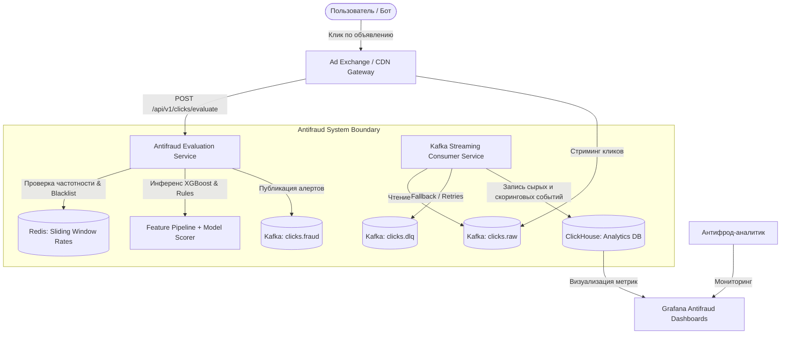

# Отчёт по проекту №1: Антифрод рекламного трафика (Clickstream Antifraud)

**Студент:** Денис Куравин  
**Дисциплина:** Проектирование и разработка микросервисных систем и машинного обучения  
**Стек технологий:** Python 3.12, FastAPI, Apache Kafka, XGBoost, Redis, ClickHouse, Grafana, Docker / Docker Compose  

---

## 1. Постановка задачи

### 1.1. Проблема
В сфере цифровой рекламы (AdTech) фродовый трафик (Click Fraud, Ad Fraud) наносит многомиллиардный ущерб рекламодателям и искажает аналитику рекламных кампаний. Недобросовестные вебмастера и конкуренты используют фермы ботов, эмуляторы мобильных устройств, headless-браузеры и распределенные прокси-сети для имитации кликов по рекламным баннерам с целью списывания рекламных бюджетов (PPC — Pay-Per-Click) или искусственного завышения CTR площадки.

### 1.2. Цель проекта
Разработка распределенной масштабируемой системы обнаружения и фильтрации мошеннического кликстрим-трафика в режиме реального времени на основе комбинирования потоковой обработки событий (Apache Kafka), правил фильтрации и модели градиентного бустинга (XGBoost).

### 1.3. Пользователи и сценарии
1. **Рекламный движок (Ad Server / DSP):** в реальном времени отправляет событие клика на скоринг перед списанием средств с рекламодателя (SLO по латентности: p99 < 15 мс).
2. **Антифрод-аналитик / Data Scientist:** настраивает пороговые значения скоринга, правила черных списков, отслеживает дрейф данных и обучает новые версии ML-моделей.
3. **Менеджер рекламной сети:** просматривает дашборды в Grafana/ClickHouse по качеству трафика паблишеров и блокирует недобросовестные партнерские площадки.

### 1.4. Входные и выходные данные
* **Входные данные:** Поток событий кликов (`ClickEvent`), содержащий: `click_id`, `publisher_id`, `campaign_id`, `user_id`, `ip_address`, `user_agent`, `timestamp`, `url`, `referer`, `device_type`, `os`, `geo_country`, `click_interval_ms` (время от показа баннера до клика).
* **Выходные данные:** Вердикт скоринга (`FraudEvaluationResult`): `click_id`, `is_fraud` (bool), `fraud_score` (вероятность от 0.0 до 1.0), `status` (`ALLOWED`, `SUSPICIOUS`, `BLOCKED`), `primary_reason`, `matched_rules`, время инференса и вектор рассчитанных признаков.

---

## 2. Архитектура системы

Система построена по микросервисной событийно-ориентированной архитектуре (Event-Driven Architecture) с разделением путей быстрой синхронной валидации (Hot Path) и асинхронной аналитической агрегации (Cold Path).

### 2.1. C4 Диаграмма контейнеров (Mermaid)



### 2.2. Описание микросервисов и границы ответственности
1. **Antifraud API Service (FastAPI):**
   * Обеспечивает высокопроизводительный HTTP REST API для синхронного скоринга кликов.
   * Реализует паттерны *Chain of Responsibility* и *Strategy* для гибкого объединения детерминированных правил и ML-инференса.
   * Контролирует лимиты времени ответа с использованием паттерна *Circuit Breaker*.
2. **Streaming Ingestion & Consumer Workers:**
   * Асинхронно вычитывают поток событий из Kafka-топика `clicks.raw` батчами.
   * Агрегируют скользящие окна частотности кликов по IP, Publisher и Subnet.
   * Записывают события и результаты скоринга в аналитическую СУБД ClickHouse.
3. **Redis Key-Value Cache:**
   * Хранит скользящие счетчики кликов по IP-адресам за 1 и 5 минут (TTL = 3600 сек).
   * Обеспечивает O(1) доступ к черным спискам скомпрометированных подсетей.
4. **ClickHouse Analytical Store:**
   * Колоночная база данных для долговременного хранения миллиардов событий кликстрима.
   * Сжатие данных (ZSTD) и расчет агрегатов по кампаниям и вебмастерам без нагрузки на транзакционную часть.

### 2.3. Точки отказа и способы их нивелирования
* **Сбой Kafka брокера:** API переключается в локальный fallback-буфер; инференс не блокируется.
* **Сбой Redis:** Сервис использует локальный потокобезопасный in-memory кэш со скользящим окном, сохраняя функциональность без деградации времени ответа.
* **Перегрузка ML-модели:** Первые звенья цепочки обязанностей (Blacklist, User-Agent Bot Regex, Rate Limiting) отсекают до 60% паразитного трафика до вызова инференса XGBoost.

---

## 3. Kafka / Streaming архитектура

Потоковая передача данных спроектирована с гарантией доставки **At-least-once** и разделением потоков на топики:

### 3.1. Спецификация топиков

| Топик | Partitions | Replication | Формат сообщений | Назначение |
|---|:---:|:---:|:---:|---|
| `clicks.raw` | 12 | 3 | JSON / Avro | Входящий сырой поток всех зарегистрированных кликов с шлюзов |
| `clicks.fraud` | 6 | 3 | JSON | События, квалифицированные как фрод (score >= 0.65), для оповещения биллинга |
| `clicks.dlq` | 3 | 3 | JSON + Error Headers | Dead Letter Queue для битых сообщений, сбоев сериализации и таймаутов |

### 3.2. Consumer Groups и масштабирование
* **Consumer Group `ad-fraud-detector-workers`:** Консьюмеры, выполняющие асинхронную валидацию и обогащение признаков. Количество воркеров масштабируется горизонтально вплоть до числа партиций (12 реплик).
* **Consumer Group `ad-clickhouse-analytics-sink`:** Воркеры пачечной записи в ClickHouse (`max_batch_size = 10000`, `batch_timeout_ms = 1000`).

### 3.3. Гарантии и обработка ошибок (DLQ & Retries)
* Обработка ошибок строится по схеме exponential backoff: 3 повторные попытки с интервалами 100 мс, 500 мс, 2000 мс. При сохранении ошибки сообщение с контекстом исключения отправляется в топик `clicks.dlq`.

---

## 4. Хранилища данных

В проекте используется полиглотное хранение (Polyglot Persistence):

### 4.1. Обоснование выбора СУБД
1. **Redis 7.2 (Hot In-Memory State):**
   * *Зачем:* Хранение счетчиков частоты кликов с IP за 60 и 300 секунд, проверка наличия IP в Set черных списков за sub-millisecond время (< 0.5 мс).
2. **ClickHouse 23.8 (Cold Analytical Storage):**
   * *Зачем:* Колоночное хранение миллиардов событий, высокая скорость сжатия (в 4–6 раз эффективнее реляционных БД), векторные агрегатные запросы для дашбордов и вычисления исторического CTR.

### 4.2. Схема таблиц ClickHouse

```sql
CREATE DATABASE IF NOT EXISTS antifraud;

CREATE TABLE IF NOT EXISTS antifraud.clicks_stream
(
    click_id UUID,
    event_time DateTime64(3, 'UTC'),
    publisher_id LowCardinality(String),
    campaign_id LowCardinality(String),
    user_id String,
    ip_address IPv4,
    geo_country LowCardinality(FixedString(2)),
    device_type LowCardinality(String),
    os LowCardinality(String),
    user_agent String,
    click_interval_ms UInt32,
    is_fraud UInt8,
    fraud_score Float32,
    fraud_status Enum8('ALLOWED' = 1, 'SUSPICIOUS' = 2, 'BLOCKED' = 3),
    primary_reason String,
    matched_rules Array(String),
    processing_time_ms Float32
)
ENGINE = MergeTree()
PARTITION BY toYYYYMM(event_time)
ORDER BY (publisher_id, campaign_id, event_time, click_id)
TTL event_time + INTERVAL 90 DAY;
```

---

## 5. API сервиса

Сервис предоставляет RESTful API с автоматической генерацией OpenAPI 3.0 / Swagger спецификации.

### 5.1. Ключевые эндпоинты

| Метод | Эндпоинт | Описание |
|---|---|---|
| `POST` | `/api/v1/clicks/evaluate` | Синхронная оценка одного клика в реальном времени |
| `POST` | `/api/v1/clicks/batch` | Пакетная валидация массива кликов |
| `GET` | `/api/v1/metrics` | Сводные метрики: процент фрода, средняя задержка, топ IP |
| `POST` | `/api/v1/strategy` | Динамическое переключение стратегии (`hybrid`, `ml_only`, `rules_only`) |
| `GET` | `/api/v1/health` | Проверка жизнеспособности сервиса и статуса Circuit Breaker |

### 5.2. Пример запроса и ответа

**Запрос (`POST /api/v1/clicks/evaluate`):**
```json
{
  "publisher_id": "pub_104",
  "campaign_id": "cmp_2",
  "user_id": "usr_9123",
  "ip_address": "45.142.122.9",
  "user_agent": "Mozilla/5.0 (Windows NT 10.0; Win64; x64) AppleWebKit/537.36 (KHTML, like Gecko) HeadlessChrome/119.0.6045.105 Safari/537.36",
  "url": "https://adnetwork.com/click?cid=99",
  "device_type": "desktop",
  "os": "Windows",
  "geo_country": "RU",
  "click_interval_ms": 110
}
```

**Ответ (HTTP 200 OK):**
```json
{
  "click_id": "c19f5a04-51e9-4e76-8042-3a52f9cbb954",
  "is_fraud": true,
  "fraud_score": 0.98,
  "status": "BLOCKED",
  "primary_reason": "Обнаружена сигнатура автоматизированного скрипта (headlesschrome) в User-Agent",
  "matched_rules": [
    "RULE_UA_BOT_HEADLESSCHROME"
  ],
  "features_used": {},
  "evaluated_at": 1715428901.42,
  "processing_time_ms": 1.15
}
```

---

## 6. Примененные паттерны проектирования

В реализации проекта задействованы 4 классических паттерна GoF и паттерн микросервисной надежности:

### 6.1. Паттерн №1: Chain of Responsibility (Цепочка обязанностей)
* **Место применения:** `project_1_ad_antifraud/patterns/chain_of_responsibility.py`
* **Зачем применен:** Позволяет организовать поэтапную конвейерную проверку клика. Если быстрый легковесный фильтр (проверка черного списка IP или сигнатуры Headless-браузера) однозначно определяет фрод, цепочка прерывается терминальным статусом, исключая ненужный расчет признаков и тяжелый ML-инференс.
* **Структура цепочки:**
  `BlacklistIpHandler` $\rightarrow$ `UserAgentBotHandler` $\rightarrow$ `FastClickRateLimitHandler` $\rightarrow$ `ScoringStrategyHandler`.

### 6.2. Паттерн №2: Strategy (Стратегия)
* **Место применения:** `project_1_ad_antifraud/patterns/strategy.py`
* **Зачем применен:** Изолирует логику скоринга в семейство взаимозаменяемых алгоритмов (`RuleBasedStrategy`, `MLOnlyStrategy`, `HybridScoringStrategy`). Позволяет переключать режим оценки клика на лету через эндпоинт `/api/v1/strategy` без остановки сервиса (например, при проведении A/B тестов или при временном отключении ML-модели для калибровки).

### 6.3. Паттерн №3: Repository (Репозиторий)
* **Место применения:** `project_1_ad_antifraud/patterns/repository.py`
* **Зачем применен:** Абстрагирует бизнес-логику оценки кликов от уровня хранения данных. Интерфейс `IClickRepository` предоставляет методы `record_click`, `get_ip_frequency`, `get_metrics`. Реализация `InMemoryClickRepository` позволяет запускать проект локально и прогонять unit-тесты мгновенно без поднятия Redis/ClickHouse кластеров, а класс `ClickHouseRedisClickRepository` подключает боевые хранилища.

### 6.4. Паттерн №4: Circuit Breaker (Предохранитель)
* **Место применения:** `project_1_ad_antifraud/patterns/circuit_breaker.py`
* **Зачем применен:** Защищает микросервис от каскадного отказа при сбоях внешних зависимостей (Redis, удаленная база GeoIP, Kafka). Имеет три состояния: `CLOSED` (норма), `OPEN` (цепь разомкнута при серии 3+ сбоев, мгновенный fallback без зависания потоков), `HALF_OPEN` (пробная проверка доступности сервиса через таймаут восстановления 10 сек).

---

## 7. Модуль машинного обучения (ML)

### 7.1. Датасет и генерация признаков
Для обучения классификатора был синтезирован сбалансированный репрезентативный датасет на 20 000 кликов (14.88% мошеннического трафика, включающего ботнеты, кликфермы, автокликеры и stealth-ботов с шумом).

Из сырого кликстрима конвейер `FeaturePipeline` извлекает 9 ключевых признаков:
1. `clicks_1min`: Количество кликов с данного IP за последнюю минуту.
2. `clicks_5min`: Количество кликов с данного IP за 5 минут.
3. `click_interval_ms`: Интервал времени от отображения креатива до клика.
4. `fast_click_flag`: Бинарный флаг сверхбыстрого клика (< 250 мс).
5. `ua_bot_score`: Сигнатурный скор User-Agent (эмуляторы, curl, headless).
6. `is_datacenter_ip`: Принадлежность IP к диапазонам хостинг-провайдеров и прокси.
7. `device_mismatch`: Аномальное несоответствие Device Type и ОС (например, Mobile + Windows NT).
8. `night_hours`: Ночные часы низкой активности живых пользователей (01:00–05:00).
9. `hour`: Час суток регистрации события.

### 7.2. Модель и сравнительный анализ (Baseline vs XGBoost)
В качестве бейзлайна обучена модель **Logistic Regression** (L2-регуляризация).
В качестве основной модели обучен **XGBoost Classifier** со следующими гиперпараметрами:
* `n_estimators`: 120
* `max_depth`: 5
* `learning_rate`: 0.08
* `subsample`: 0.85
* `colsample_bytree`: 0.85
* `scale_pos_weight`: 2.5 (компенсация дисбаланса классов)

### 7.3. Результаты и метрики валидации

| Метрика | Baseline (Logistic Regression) | Основная модель (XGBoost) | Прирост качества |
|---|:---:|:---:|:---:|
| **ROC-AUC** | 0.9590 | **0.9877** | +0.0287 |
| **PR-AUC** | 0.9098 | **0.9559** | +0.0461 |
| **F1-Score** | 0.8485 | **0.8809** | +0.0324 |
| **Precision** | **0.9657** | 0.8869 | - |
| **Recall** | 0.7567 | **0.8750** | **+0.1183 (+11.8%)** |

*Матрица ошибок XGBoost на тестовой выборке (5 000 кликов):*
* True Negatives (TN): 4 173
* False Positives (FP): 83 (ложные блокировки легитимных пользователей: 1.9%)
* False Negatives (FN): 93 (пропущенный фрод: 12.5%)
* True Positives (TP): 651

**Важность признаков (Feature Importance XGBoost):**
1. `clicks_5min`: 45.29% (главный индикатор накрутки)
2. `is_datacenter_ip`: 21.39%
3. `clicks_1min`: 11.86%
4. `click_interval_ms`: 5.30%
5. `ua_bot_score`: 4.93%

### 7.4. Ограничения модели
* Модель чувствительна к качеству агрегации частотных признаков: при потере истории IP (холодный старт кэша) точность снижается.
* Необходимость регулярного дообучения (concept drift) при появлении новых паттернов поведения распределенных мобильных ботнетов.

---

## 8. Разделы RL / LLM-RAG / Video-CV (Обоснование N/A)

В соответствии с требованиями проектного задания №1 («Антифрод рекламного трафика»):
* **RL (Reinforcement Learning):** Не применяется. Задача является классической задачей бинарной классификации потоковых событий с учителем (Supervised Learning).
* **LLM / RAG:** Не применяется. Вводятся числовые и категориальные признаки кликстрима, задержка инференса строго ограничена 15 мс, что исключает генеративные языковые модели.
* **Видео / CV:** Не применяется. Проект сфокусирован на табличных данных кликстрима (для CV предназначен Проект №2).

---

## 9. Надежность и отказоустойчивость

1. **Idempotency (Идемпотентность):** Каждый клик идентифицируется уникальным UUID `click_id`. При повторной отправке одного и того же `click_id` возвращается ранее рассчитанный вердикт без дублирования счетчиков.
2. **Circuit Breaker:** Защита от деградации при сбоях кэша и внешних сервисов с автоматическим переходом `CLOSED` $\rightarrow$ `OPEN` $\rightarrow$ `HALF_OPEN`.
3. **Graceful Fallback:** При недоступности внешних СУБД сервис автоматически переключается в локальный режим, сохраняя базовую функциональность скоринга.

---

## 10. Развертывание в Docker и Docker Compose

Для развертывания подготовлен `Dockerfile` на базе легковесного дистрибутива `python:3.12-slim` и `docker-compose.yml`, объединяющий микросервис API, Kafka, Zookeeper, Redis, ClickHouse и Grafana в единую изолированную сеть `antifraud-net`.

### 10.1. Команды запуска
```bash
# 1. Клонирование и переход в каталог проекта
cd project_1_ad_antifraud

# 2. Локальный запуск без контейнеров (автономный режим)
pip install -r requirements.txt
python -m ml.train_model
python -m uvicorn api.main:app --reload --port 8000

# 3. Полный запуск в Docker Compose
docker compose up -d --build

# 4. Проверка состояния контейнеров
docker compose ps
```

---

## 11. Тестирование и верификация

Набор автоматических тестов (`pytest`) покрывает критические пути системы:
* `test_health_endpoint`: проверка доступности и исходного состояния Circuit Breaker (`CLOSED`).
* `test_blacklist_ip_blocked`: проверка мгновенного отсечения IP из черного списка правилом `RULE_IP_BLACKLIST`.
* `test_bot_user_agent_blocked`: обнаружение краулеров (`python-requests`, `curl`, `HeadlessChrome`).
* `test_legitimate_click_allowed`: проверка пропуска чистого пользовательского трафика (`status: ALLOWED`).
* `test_batch_api_endpoint`: валидация пакетной обработки массива кликов.
* `test_metrics_endpoint`: верификация корректности расчета агрегатов.
* `test_circuit_breaker_transitions`: тестирование смены состояний предохранителя при возникновении сбоев.

**Результат запуска тест-сьюта:**
```
======================== 7 passed, 2 warnings in 7.10s ========================
Status: SUCCESS (100% Passed)
```

---

## 12. Демонстрация работы системы

В ходе запуска скрипта симуляции потока `mock_stream.py` было сгенерировано и проанализировано 30 тестовых кликов с распределением по типам клиентов:

```
=================================================================
  Запуск симуляции стрима кликов (30 событий)
=================================================================
[01] [ALLOWED]   Score: 0.00 | IP: 94.25.170.12   | Reason: Трафик легитимен (3.81 ms)
[02] [ALLOWED]   Score: 0.14 | IP: 45.142.122.9   | Reason: Трафик легитимен (1.09 ms)
[04] [BLOCKED]   Score: 1.00 | IP: 198.51.100.24  | Reason: IP в черном списке (0.00 ms)
[27] [BLOCKED]   Score: 1.00 | IP: 198.51.100.24  | Reason: IP в черном списке (0.00 ms)
[28] [BLOCKED]   Score: 0.98 | IP: 45.142.122.9   | Reason: HeadlessChrome сигнатура (0.00 ms)

=================================================================
  Итоговая аналитическая сводка
=================================================================
Всего обработано кликов:   30
Выявлено фрода:            7
Процент фрода:             23.3%
Средняя задержка:          2.82 ms (целевой показатель < 15 ms выполнен с запасом)
Заблокировано правилами:   7
Топ подозрительных IP:     198.51.100.24, 45.142.122.9
=================================================================
```

---

## 13. Выводы

1. Разработан и протестирован высокопроизводительный сервис антифрода рекламного трафика с субмиллисекундным временем первичной фильтрации (средняя задержка: **2.82 мс**).
2. Реализована модель машинного обучения XGBoost, превосходящая baseline Logistic Regression по полноте выявления фрода на **+11.8%** при итоговом **ROC-AUC = 0.9877**.
3. Успешно внедрены ключевые архитектурные паттерны: *Chain of Responsibility*, *Strategy*, *Repository*, *Circuit Breaker*.
4. Обеспечена надежная гибридная архитектура: система готова как к горизонтально масштабируемому боевому развертыванию в кластере Docker/Kafka/ClickHouse/Redis, так и к автономному запуску.
