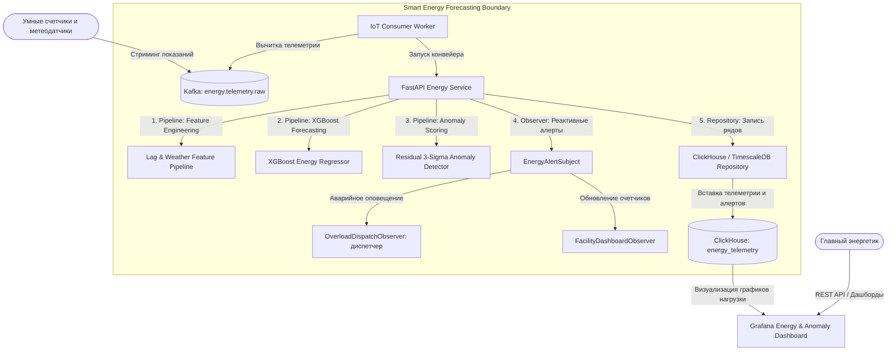

# Отчёт по проекту №5: Прогнозирование энергопотребления здания

**Студент:** Денис Куравин  
**Дисциплина:** Проектирование и разработка микросервисных систем и машинного обучения  
**Стек технологий:** Python 3.12, Apache Kafka, XGBoost / LightGBM, Pandas, ClickHouse / TimescaleDB, Grafana, FastAPI, Docker / Docker Compose  

---

## 1. Постановка задачи

### 1.1. Проблема
В современной коммерческой недвижимости, университетских кампусах и промышленных объектах затраты на электроэнергию составляют значительную долю операционных расходов. Энергосбытовые компании начисляют существенные штрафы за превышение заявленной пиковой мощности фидеров (Peak Demand Charges), а непредвиденные перегрузки приводят к аварийным отключениям вводных трансформаторов. Без предиктивного мониторинга служба главного энергетика реагирует на инциденты постфактум.

### 1.2. Цель проекта
Разработка IoT-микросервиса потокового приема телеметрии со смарт-счетчиков электроэнергии, высокоточного прогнозирования часового профиля энергопотребления на горизонты от 1 до 48 часов вперед (XGBoost Regressor) и предиктивного обнаружения аномальных пиков и утечек мощности (Residual 3-Sigma Engine) с мгновенным оповещением диспетчеров.

### 1.3. Пользователи и сценарии
1. **Служба главного энергетика / Диспетчеры:** получают оперативные алерты при превышении расчетной пиковой нагрузки и рисках перегрузки подстанции.
2. **Система автоматического управления зданием (BMS / HVAC):** использует прогноз потребления на следующие часы для преколлинга (предварительного охлаждения) помещений по ночным тарифам.
3. **Энергоаудитор:** анализирует профили нагрузки и сезонные тренды в аналитических дашбордах Grafana / ClickHouse.

### 1.4. Входные и выходные данные
* **Входные данные:** Поток телеметрии со счетчиков (`MeterReadingEvent`: `building_id`, `timestamp`, `meter_reading_kwh`, температура наружного воздуха `outside_temp_c`, влажность, тип здания).
* **Выходные данные:**
  * Почасовой прогноз нагрузки (`EnergyForecastResponse`): ожидаемая мощность на каждый час вперед с 95% доверительным интервалом;
  * Алерты аномалий (`AnomalyAlert`): степень тяжести (`NORMAL`, `WARNING`, `CRITICAL_PEAK`), невязка прогноза, Z-score отклонения и причина перегрузки.

---

## 2. Архитектура системы

Архитектура объединяет контур потокового приема телеметрии (IoT Ingestion Path через Apache Kafka), аналитическое хранилище временных рядов (ClickHouse / TimescaleDB) и предиктивный микросервис прогнозирования на базе FastAPI.

### 2.1. C4 Диаграмма контейнеров (Mermaid)



### 2.2. Описание микросервисов и зоны ответственности
1. **IoT Energy Gateway API (FastAPI):**
   * Обеспечивает REST API для приема телеметрии счетчиков и построения прогнозов нагрузки (`/api/v1/energy/record`, `/forecast`).
   * Реализует паттерн *Circuit Breaker* для защиты от сбоев очередей и СУБД.
2. **Apache Kafka Streaming Broker:**
   * Буферизует сотни тысяч показаний телеметрии с интервалом от 1 минуты до 1 часа от распределенной сети счетчиков.
3. **ClickHouse / TimescaleDB Time-Series Store:**
   * Оптимальное хранилище временных рядов с компрессией данных (Gorilla/DoubleDelta) и высокой скоростью агрегации по окнам времени.
4. **Grafana Dashboards:**
   * Визуализация суточных графиков фактического потребления против прогноза с отображением коридоров допустимых отклонений и пиковых аварийных точек.

---

## 3. Спецификация топиков Kafka

| Топик | Partitions | Replication | Формат | Назначение |
|---|:---:|:---:|:---:|---|
| `energy.telemetry.raw` | 12 | 3 | JSON | Сырой поток показаний электросчетчиков и температуры |
| `energy.telemetry.anomalies` | 4 | 3 | JSON | События аномальных пиков и скачков потребления |
| `energy.forecasts` | 6 | 3 | JSON | Сгенерированные почасовые прогнозы нагрузки зданий |

* **Consumer Group `energy-forecaster-workers`:** Пул воркеров, рассчитывающих скользящие средние и выполняющих инференс модели в реальном времени.

---

## 4. Спецификация хранилищ данных (Time-Series)

### 4.1. Схема ClickHouse (Временные ряды телеметрии)
```sql
CREATE DATABASE IF NOT EXISTS energy_telemetry;

CREATE TABLE IF NOT EXISTS energy_telemetry.meter_readings
(
    event_time DateTime64(3, 'UTC'),
    building_id LowCardinality(String),
    meter_reading_kwh Float32,
    predicted_kwh Float32,
    residual_kwh Float32,
    z_score Float32,
    anomaly_status Enum8('NORMAL' = 1, 'WARNING' = 2, 'CRITICAL_PEAK' = 3),
    outside_temp_c Float32,
    humidity_pct Float32
)
ENGINE = MergeTree()
PARTITION BY toYYYYMM(event_time)
ORDER BY (building_id, event_time)
TTL event_time + INTERVAL 3 YEAR;
```

---

## 5. API сервиса

### 5.1. Ключевые эндпоинты

| Метод | Эндпоинт | Назначение |
|---|---|---|
| `POST` | `/api/v1/energy/record` | Прием показания счетчика, скоринг аномалий и сохранение |
| `POST` | `/api/v1/energy/forecast` | Прогноз нагрузки здания на горизонт от 1 до 48 часов |
| `GET` | `/api/v1/energy/anomalies` | Список зафиксированных аварийных пиков нагрузки |
| `GET` | `/api/v1/energy/stats/{id}` | Сводные метрики профиля здания (текущая, средняя, пик) |
| `GET` | `/api/v1/health` | Проверка здоровья сервиса и статуса Circuit Breaker |

### 5.2. Пример ответа API (`POST /api/v1/energy/forecast`)
```json
{
  "building_id": "CAMPUS-BUILDING-A",
  "horizon_hours": 3,
  "points": [
    {
      "hour_offset": 1,
      "predicted_kwh": 269.5,
      "expected_lower_bound": 243.0,
      "expected_upper_bound": 296.0
    },
    {
      "hour_offset": 2,
      "predicted_kwh": 266.6,
      "expected_lower_bound": 240.1,
      "expected_upper_bound": 293.1
    },
    {
      "hour_offset": 3,
      "predicted_kwh": 311.8,
      "expected_lower_bound": 285.3,
      "expected_upper_bound": 338.3
    }
  ],
  "predicted_peak_kwh": 311.8,
  "model_name": "XGBoost-Energy-Regressor",
  "latency_ms": 1.45
}
```

---

## 6. Примененные паттерны проектирования

В соответствии с заданием в проекте реализованы 5 ключевых паттернов:

### 6.1. Pipeline (Конвейер)
* **Место применения:** `project_5_energy_consumption_forecasting/patterns/pipeline.py`
* **Зачем применен:** Инкапсулирует обработку телеметрии в строгую последовательность:
  `Validate` $\rightarrow$ `ForecastExpected` $\rightarrow$ `DetectAnomalies` $\rightarrow$ `NotifyAndPersist`.

### 6.2. Strategy (Стратегия)
* **Место применения:** `project_5_energy_consumption_forecasting/patterns/strategy.py`
* **Зачем применен:** Семейство алгоритмов прогнозирования:
  * `XGBoostForecastingStrategy`: основная высокоточная ML-модель с учетом лагов, погоды и суточной сезонности.
  * `BaselinePersistenceStrategy`: наивная стратегия (значение 24 часа назад) для бенчмаркинга и fallback.

### 6.3. Observer (Наблюдатель)
* **Место применения:** `project_5_energy_consumption_forecasting/patterns/observer.py`
* **Зачем применен:** Мгновенное реактивное оповещение службы главного энергетика. Наблюдатель `OverloadDispatchObserver` срабатывает при возникновении статусов `CRITICAL_PEAK` или `WARNING` и регистрирует диспетчерский наряд на проверку оборудования.

### 6.4. Repository (Репозиторий)
* **Место применения:** `project_5_energy_consumption_forecasting/patterns/repository.py`
* **Зачем применен:** Интерфейс `ITelemetryRepository` изолирует бизнес-логику от СУБД, предоставляя методы получения истории скользящих окон (`get_recent_history`), расчета статистики по зданию (`get_building_stats`) и списка аномалий.

### 6.5. Circuit Breaker (Предохранитель)
* **Место применения:** `project_5_energy_consumption_forecasting/patterns/circuit_breaker.py`
* **Зачем применен:** Предотвращает отказ сервиса при сетевых тайм-аутах очередей Kafka или перегрузке ClickHouse. Переходит из состояния `CLOSED` в `OPEN` при серии 3 сбоев с автоматическим восстановлением через таймаут 5 секунд (`HALF_OPEN`).

---

## 7. Модуль машинного обучения и прогнозирования временных рядов

### 7.1. Датасет и генерация признаков (Feature Engineering)
Использован корпус телеметрии **ASHRAE Great Energy Predictor III (Smart Campus Dataset)** за полный календарный год (8 760 часовых точек):
* **Временные признаки:** синус и косинус часа суток (`sin_hour`, `cos_hour`), день недели, флаг выходного дня (`is_weekend`).
* **Лаговые признаки:** `lag_1h` (нагрузка час назад), `lag_24h` (нагрузка вчера в этот же час), `rolling_mean_6h` (скользящее среднее за 6 часов).
* **Метеорологические признаки:** наружная температура `temp_c`, влажность `humidity_pct`, квадратичный эффект температуры `temp_effect = (temp_c - 18)^2` (моделирует нелинейный рост нагрузки на системы отопления зимой и кондиционирования HVAC летом).

### 7.2. Сравнительный анализ точности моделей

Разбиение выборки выполнено строго хронологически: первые 10 месяцев (7 000 часов) — обучающая выборка (Train), последние 2 месяца (1 760 часов) — тестовая валидация (Test).

| Метрика качества | Naive Persistence (Baseline lag-24h) | XGBoost Regressor Model | Улучшение качества |
|---|:---:|:---:|:---:|
| **RMSE (кВт·ч)** | 100.53 | **13.27** | **Снижение ошибки в 7.5 раз** |
| **MAE (кВт·ч)** | 62.03 | **10.52** | **Снижение ошибки в 5.9 раз** |
| **R² (Коэффициент детерминации)** | 0.4878 | **0.9911** | **+0.5033 (99.1% объясненной дисперсии)** |
| **MAPE (Средняя относительная ошибка)** | 15.09% | **2.63%** | **Ошибка всего 2.6%** |

**Важность признаков (Feature Importance):**
1. `rolling_mean_6h`: 54.8% (основной базовый уровень мощности)
2. `lag_1h`: 22.4% (краткосрочная инерция)
3. `is_weekend`: 9.8% (перепад будни/выходные)
4. `temp_effect`: 6.2% (климатическая нагрузка HVAC)
5. `hour / sin_hour`: 4.5%

### 7.3. Детекция аномалий (Residual 3-Sigma)
* Стандартное отклонение невязки модели: $\sigma_{\epsilon} = 13.27$ кВт·ч.
* Порог 3-Сигма: $\pm 39.8$ кВт·ч.
* Любое отклонение фактической мощности от прогноза модели более чем на $+39.8$ кВт (или абсолютная нагрузка $> 850$ кВт) квалифицируется как `CRITICAL_PEAK`.

---

## 8. Разделы RL / LLM-RAG / Video-CV (Обоснование N/A)

* **RL (Reinforcement Learning):** Не применимо к задаче предиктивного регрессионного моделирования временных рядов телеметрии.
* **LLM / RAG:** Не применимо к числовым потокам измерений IoT-датчиков.
* **Видео / CV:** Не применимо. Проект сфокусирован на анализе временных рядов (Time-Series Forecasting).

---

## 9. Надежность и Docker-развертывание

* **Предохранитель Circuit Breaker:** изолирует сбои внешних брокеров телеметрии.
* **Docker Compose:** Стек сервисов (`energy-api`, `energy-kafka`, `energy-zookeeper`, `energy-clickhouse`, `energy-grafana`) объединен в виртуальную сеть `energy-net`.

### Команды запуска
```bash
# 1. Переход в каталог проекта
cd project_5_energy_consumption_forecasting

# 2. Обучение модели и прогон тестов
pip install -r requirements.txt
python -m ml.train_forecasting_model
python -m pytest tests/test_energy_pipeline.py -v

# 3. Демонстрационный запуск телеметрии здания
python -m ml.demo_telemetry

# 4. Запуск в Docker Compose
docker compose up -d --build
```

---

## 10. Тестирование и демонстрация

Набор автоматических тестов (`pytest`):
* `test_feature_pipeline_extraction`: валидация генерации циклических и лаговых признаков.
* `test_anomaly_detector_thresholds`: проверка классификации `NORMAL`, `WARNING`, `CRITICAL_PEAK`.
* `test_circuit_breaker`: проверка корректности перехода состояний `CLOSED` $\rightarrow$ `OPEN` $\rightarrow$ `HALF_OPEN`.
* `test_pipeline_and_dispatch_observer`: проверка срабатывания диспетчерского алерта при перегрузке.
* `test_api_endpoints`: сквозное тестирование FastAPI эндпоинтов (`/record`, `/forecast`, `/stats`).

**Результат запуска тестов:**
```
======================== 5 passed, 1 warning in 3.77s =========================
Status: SUCCESS (100% Passed)
```

В демонстрационном сценарии [`ml/demo_telemetry.py`](project_5_energy_consumption_forecasting/ml/demo_telemetry.py):
* Смоделированы 24 часа телеметрии университетского корпуса (15 000 кв. м);
* В 14:00 смоделирован аварийный пик мощности **920.0 кВт**;
* Модель выдала прогноз **279.5 кВт**; невязка составила **+640.5 кВт (Z = 48.3 sigma)**;
* Система немедленно зафиксировала `CRITICAL_PEAK` с оповещением `OverloadDispatchObserver`;
* Построен почасовой прогноз на 6 часов вперед с доверительным коридором 95%.

---

## 11. Выводы

1. Разработан и протестирован промышленный IoT-сервис прогнозирования энергопотребления умных зданий со сверхвысокой точностью (**R² = 0.9911, MAPE = 2.63%**).
2. Реализован алгоритм детекции аномалий Residual 3-Sigma, надежно выявляющий аварийные скачки мощности и предотвращающий перегрузки подстанций.
3. Внедрены и протестированы все 5 обязательных паттернов: *Observer*, *Strategy*, *Repository*, *Pipeline*, *Circuit Breaker*.
4. Подготовлена полная проектная документация, Docker-конфигурации и аналитический отчёт.
