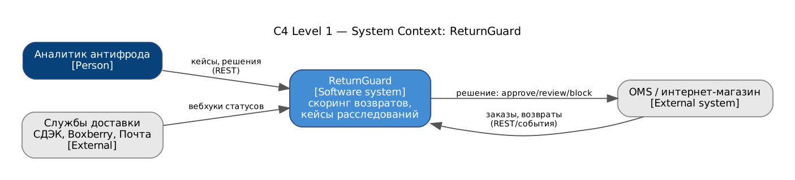
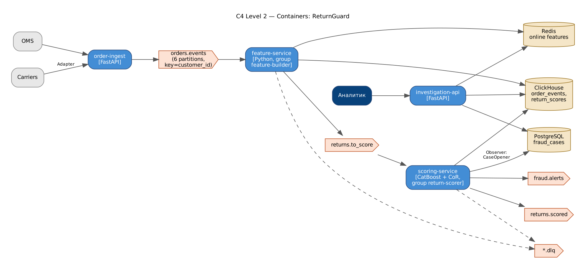
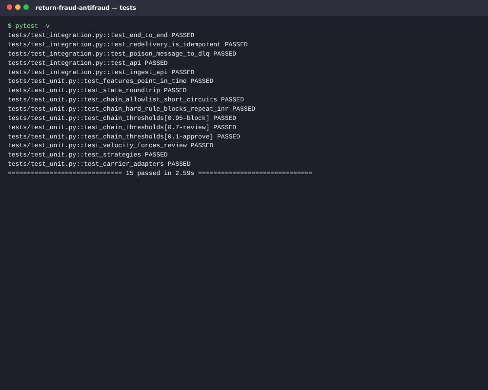
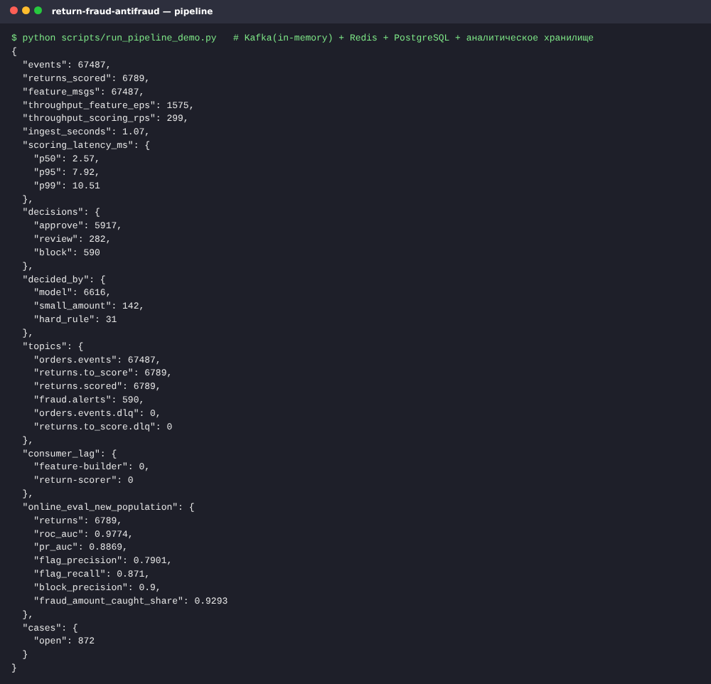
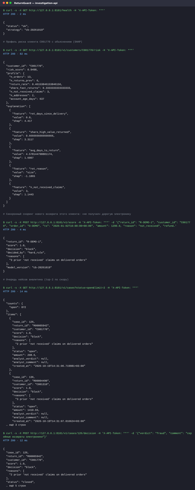
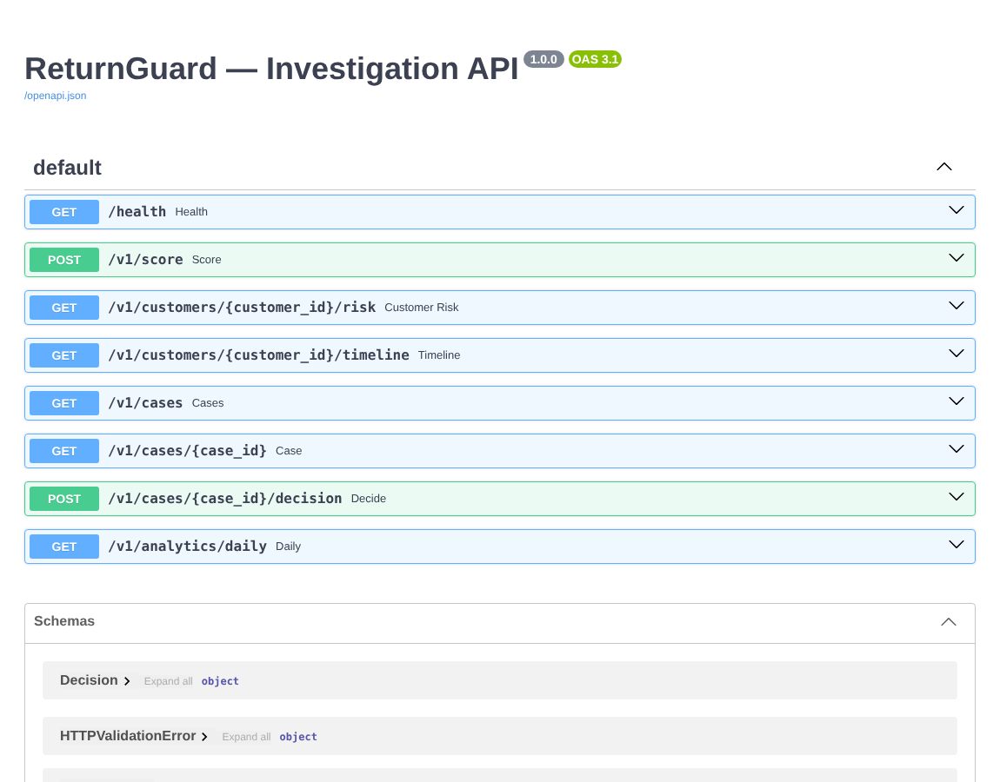
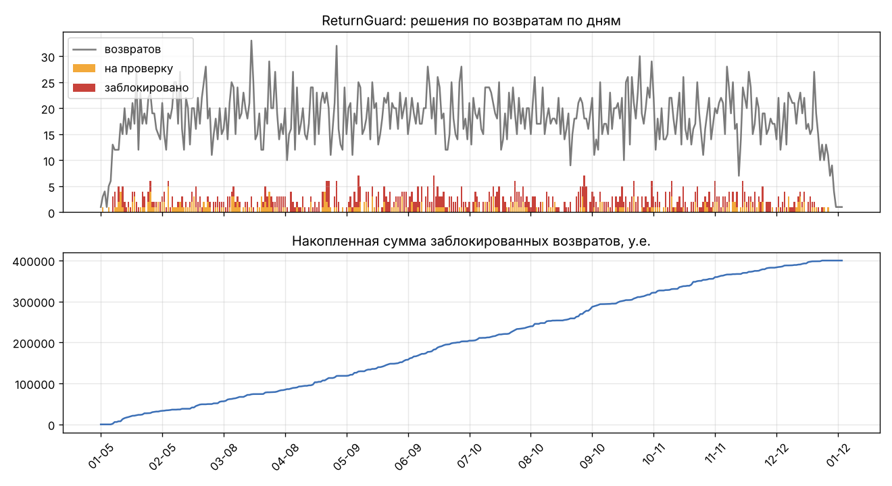
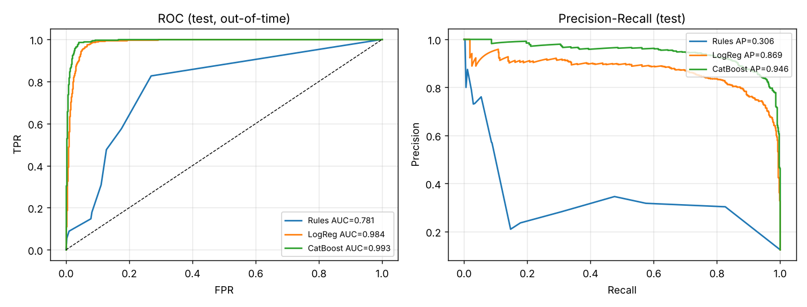
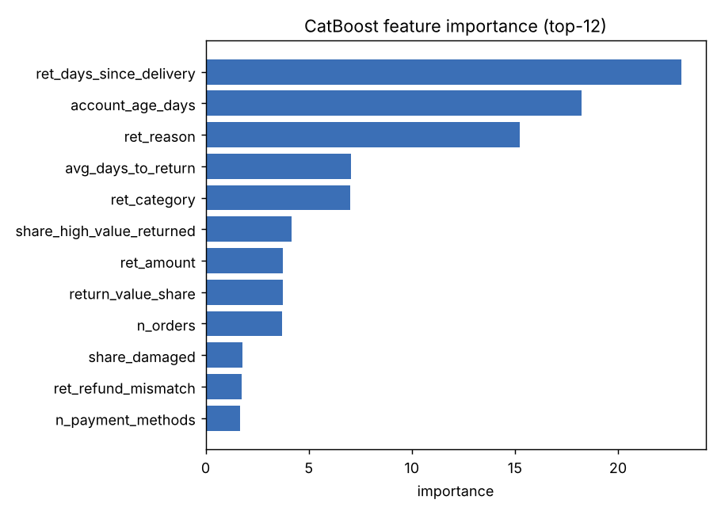
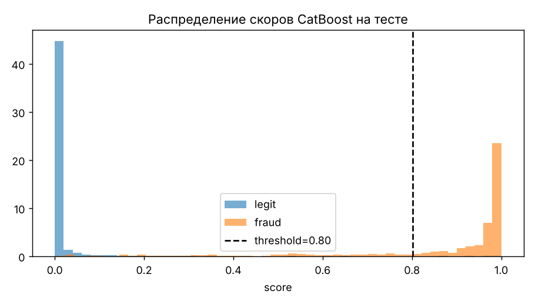

# Антифрод возвратов в e-commerce (ReturnGuard)

**Отчёт по проекту №1** · Проектный практикум · 2026

- **Выполнил:** Царьков Артём
- **Репозиторий:** github.com/godor1333/Software_architecture_2025_API, projects/Tsarkov_Artem/1_antifrod-vozvratov-v-e-commerce

Также: PDF и Word-версии отчёта в папке [`report/`](report/).

## Содержание

- [1. Цель и проблема проекта](#1-цель-и-проблема-проекта)
- [2. Требования и ограничения](#2-требования-и-ограничения)
- [3. Входные и выходные данные](#3-входные-и-выходные-данные)
- [4. Архитектура](#4-архитектура)
- [5. Микросервисы и границы ответственности](#5-микросервисы-и-границы-ответственности)
- [6. Kafka: топики, producers/consumers, формат сообщений](#6-kafka-топики-producersconsumers-формат-сообщений)
- [7. Схема хранилищ и индексы](#7-схема-хранилищ-и-индексы)
- [8. API](#8-api)
- [9. Применённые паттерны](#9-применённые-паттерны)
- [10. Docker и запуск](#10-docker-и-запуск)
- [11. Тестирование и результаты](#11-тестирование-и-результаты)
- [12. Демонстрация работы](#12-демонстрация-работы)
- [13. ML-часть](#13-ml-часть)
- [14. RL-часть](#14-rl-часть)
- [15. Выводы и распределение работы](#15-выводы-и-распределение-работы)

## 1. Цель и проблема проекта

Злоупотребление возвратами (return abuse) — одна из самых дорогих форм мошенничества в e-commerce: «wardrobing» (купил, использовал, вернул), заявления «товар повреждён / пустая коробка», ложные жалобы «посылка не получена» при подтверждённом вручении, массовые возвраты перекупщиков. Такие возвраты выглядят по отдельности законно, а злоупотребление видно только в истории клиента: частоте и скорости возвратов, причинах, стоимости товаров, расхождениях со статусами доставки.

**Цель проекта** — построить потоковую систему ReturnGuard, которая в момент запроса возврата оценивает риск злоупотребления по истории заказов, товаров и доставки, автоматически одобряет «чистые» возвраты, блокирует явные и отправляет пограничные на ручную проверку, а аналитику даёт API для расследования (профиль риска, объяснение скоринга, таймлайн клиента, очередь кейсов).

Репозиторий: <https://github.com/godor1333/Software_architecture_2025_API/tree/main/projects/Tsarkov_Artem/1_antifrod-vozvratov-v-e-commerce>

## 2. Требования и ограничения

### Функциональные требования

1. Принимать поток событий: создание заказа, вручение (вебхуки служб доставки), запрос возврата.
2. Поддерживать онлайн-профиль клиента (признаки) с обновлением по каждому событию.
3. Для каждого запроса возврата вычислять риск-скор и решение approve / review / block с причинами.
4. Открывать кейс расследования для review/block, публиковать алерт для block.
5. API аналитика: профиль риска с объяснением, таймлайн событий, очередь кейсов, фиксация вердикта.
6. Синхронный эндпоинт скоринга для OMS (решение до подтверждения возврата клиенту).
7. Дневная аналитика решений (дашборд).

### Нефункциональные требования и ограничения

- Задержка скоринга p95 < 50 мс на сообщение; пропускная способность масштабируется числом consumer'ов в группе.
- Отсутствие train/serve skew: признаки офлайн и онлайн считаются одним кодом.
- At-least-once доставка без дублей кейсов (идемпотентность), обработка «ядовитых» сообщений через DLQ.
- Объяснимость решений (правило или SHAP-вклад признаков) — требование для работы с клиентами и регуляторами.
- Ограничение: реальные данные о мошенничестве закрыты (ПДн, коммерческая тайна), поэтому для обучения и демонстрации используется поведенческий симулятор (раздел 13); архитектура и код не зависят от источника данных.
- Ограничение среды: демонстрационный прогон выполнен на CPU-сервере без Docker-демона; Kafka в демо заменена брокером в памяти с той же семантикой (раздел 6), Redis и PostgreSQL — реальные, ClickHouse — SQLite с той же схемой. Полный стек описан в docker-compose.

## 3. Входные и выходные данные

*Таблица 1 — Входные события (топик orders.events)*

| Событие | Ключевые поля | Источник |
|---|---|---|
| order.created | order_id, customer_id, ts, items[{sku, category, price}], amount, payment_method, address_id, signup_ts | OMS |
| order.delivered | order_id, customer_id, ts, carrier, status=DELIVERED, proof | Вебхуки СДЭК / Boxberry / Почта России → Adapter |
| return.requested | return_id, order_id, customer_id, ts, items, amount, reason, refund_method | OMS / личный кабинет |

*Таблица 2 — Выходные данные*

| Выход | Содержание |
|---|---|
| returns.scored | return_id, score ∈ [0,1], decision (approve/review/block), decided_by (allowlist/hard_rule/model), reasons[], model_version |
| fraud.alerts | решения block — для антифрод-команды и OMS |
| fraud_cases (PostgreSQL) | кейсы расследования, статус, вердикт аналитика |
| return_scores, order_events (ClickHouse) | история для аналитики и дашборда |
| REST API | профиль риска + SHAP-объяснение, таймлайн, кейсы, дневная сводка |

Пример сообщения `return.requested`:

```
{
  "type": "return.requested",
  "ts": "2025-10-12T14:03:11+00:00",
  "return_id": "R00012345",
  "order_id": "O00098765",
  "customer_id": "C001770",
  "items": [
    {
      "sku": "ELE01234",
      "category": "electronics",
      "price": 1290.0
    }
  ],
  "amount": 1290.0,
  "reason": "not_received",
  "refund_method": "wallet"
}
```

## 4. Архитектура

Архитектура описана в нотации C4. На уровне контекста ReturnGuard взаимодействует с OMS, службами доставки и аналитиками антифрода.



*Рисунок 1 — C4 Level 1 — System Context*

На уровне контейнеров система — это событийный конвейер «Order event stream → customer features → scoring → investigation API». Сервисы общаются асинхронно через Kafka; синхронно — только API (REST) и обращения к хранилищам.



*Рисунок 2 — C4 Level 2 — Containers*

### Компоненты scoring-service (C4 Level 3)

- **Consumer loop** (Adapter над Kafka) → **ScoringService.handle**;
- **Chain of Responsibility**: AllowlistHandler → HardRuleHandler → VelocityHandler → ModelHandler → ThresholdHandler;
- **ScoringStrategy** (CatBoost / Rules / Blend) — подставляется в ModelHandler;
- **DecisionPublisher** (Observer) → CaseOpener (PostgreSQL), KafkaAlertPublisher (fraud.alerts), MetricsCollector;
- **AnalyticsRepository** — запись return_scores в ClickHouse.

### Синхронные и асинхронные взаимодействия, точки отказа

*Таблица 3 — Точки отказа и реакция системы*

| Отказ | Поведение |
|---|---|
| Падение feature-service | Сообщения копятся в orders.events (lag). После рестарта чтение с последнего закоммиченного offset; дубликаты отсекаются по event_id (Redis SET NX). |
| Падение scoring-service | Аналогично; OMS при недоступности синхронного /v1/score применяет fallback-политику (approve + пост-проверка). |
| Недоступен Redis | Обработчик падает → 3 ретрая → DLQ; offset не теряется. |
| Недоступен ClickHouse | Аналитика деградирует, скоринг продолжает работать (решение уже опубликовано в returns.scored). |
| Битое событие | orders.events.dlq / returns.to_score.dlq с текстом ошибки, партиция не блокируется. |
| Плохая модель | SCORING_STRATEGY=rules или blend — откат без перевыкатки кода (Strategy). |

## 5. Микросервисы и границы ответственности

*Таблица 4 — Сервисы ReturnGuard*

| Сервис | Ответственность | Данные / интерфейсы |
|---|---|---|
| order-ingest | Приём событий OMS и вебхуков доставки, валидация (Pydantic), нормализация форматов служб доставки (Adapter), публикация в Kafka | REST → orders.events |
| feature-service | Онлайн-состояние клиента, расчёт признаков на момент возврата (point-in-time), дедупликация, запись сырых событий | orders.events → Redis, ClickHouse, returns.to_score |
| scoring-service | Цепочка правил + ML-модель, решение, кейсы и алерты | returns.to_score → returns.scored, fraud.alerts, PostgreSQL, ClickHouse |
| investigation-api | Рабочее место аналитика и синхронный скоринг для OMS | REST; читает Redis, PostgreSQL, ClickHouse |
| trainer (офлайн) | Replay событий → датасет → обучение CatBoost и baseline'ов, метрики, артефакт модели | models/catboost_returns.cbm |

Границы проведены по данным: только feature-service пишет состояние клиента; только scoring-service принимает решения; API ничего не пишет в поток событий, кроме вердиктов по кейсам.

*Листинг 1 — Структура репозитория*

```
"report/\320\236\321\202\321\207\320\265\321\202_\320\237\321\200\320\276\320\265\320\272\321\2021_\320\220\320\275\321\202\320\270\321\204\321\200\320\276\320\264_\320\262\320\276\320\267\320\262\321\200\320\260\321\202\320\276\320\262_\320\246\320\260\321\200\321\214\320\272\320\276\320\262.docx"
"report/\320\236\321\202\321\207\320\265\321\202_\320\237\321\200\320\276\320\265\320\272\321\2021_\320\220\320\275\321\202\320\270\321\204\321\200\320\276\320\264_\320\262\320\276\320\267\320\262\321\200\320\260\321\202\320\276\320\262_\320\246\320\260\321\200\321\214\320\272\320\276\320\262.pdf"
.dockerignore
.gitattributes
.gitignore
Dockerfile
README.md
docker-compose.yml
docs/c4_container.dot
docs/c4_context.dot
docs/img/  (10 файлов)
loadtest/load.js
models/catboost_returns.cbm
models/catboost_returns.json
models/metrics.json
models/pipeline_run.json
monitoring/grafana/  (3 файлов)
monitoring/prometheus.yml
requirements.txt
returnguard/__init__.py
returnguard/alerts.py
returnguard/datagen.py
returnguard/features.py
returnguard/obs.py
returnguard/scoring/  (3 файлов)
returnguard/storage/  (2 файлов)
returnguard/streaming/  (3 файлов)
returnguard/train.py
scripts/demo.ps1
scripts/demo.sh
scripts/run_pipeline_demo.py
services/__init__.py
services/feature_service/  (2 файлов)
services/investigation_api/  (2 файлов)
services/order_ingest/  (2 файлов)
services/scoring_service/  (2 файлов)
sql/clickhouse.sql
sql/postgres.sql
tests/e2e/  (3 файлов)
tests/test_integration.py
tests/test_unit.py
```

## 6. Kafka: топики, producers/consumers, формат сообщений

*Таблица 5 — Топики*

| Топик | Парт. | Ключ | Producer | Consumer group |
|---|---|---|---|---|
| orders.events | 6 | customer_id | order-ingest | feature-builder (feature-service ×2) |
| returns.to_score | 6 | customer_id | feature-service | return-scorer (scoring-service ×2) |
| returns.scored | 6 | customer_id | scoring-service | OMS, аналитика |
| fraud.alerts | 3 | customer_id | scoring-service (Observer) | антифрод-команда, OMS |
| orders.events.dlq | 1 | исходный | feature-service | ручной разбор |
| returns.to_score.dlq | 1 | исходный | scoring-service | ручной разбор |

Ключ customer_id выбран потому, что признаки — это состояние клиента: все его события должны обрабатываться последовательно одним экземпляром feature-service, иначе возможна гонка «возврат обработан раньше заказа». Сообщение в returns.to_score уже содержит готовый вектор признаков — scoring-service stateless и масштабируется свободно.

*Листинг 2 — Сообщение returns.to_score (сокращено)*

```
{
  "return_id": "R00005942",
  "customer_id": "C001770",
  "order_id": "O00061234",
  "ts": "2025-11-02T09:12:44+00:00",
  "amount": 208.6,
  "features": {
    "account_age_days": 637,
    "n_orders": 12,
    "n_returns_prev": 5,
    "return_rate": 0.417,
    "share_fast_returns": 0.4,
    "n_not_received_claims": 2,
    "ret_reason": "not_received",
    "ret_category": "beauty",
    "...": "..."
  }
}
```

Надёжность обработки:

- **Порядок обработки**: ключ сообщения задаёт партицию, поэтому все события одной сущности обрабатываются строго по порядку одним consumer'ом группы; разные сущности обрабатываются параллельно.
- **At-least-once**: offset коммитится только после успешной обработки батча (`enable_auto_commit=False`); при падении consumer'а сообщения будут перечитаны.
- **Идемпотентность**: повторная доставка не создаёт дублей — запись в хранилище выполняется upsert'ом по естественному ключу.
- **Retries и DLQ**: обработчик повторяется до 3 раз; «ядовитое» сообщение после этого отправляется в топик `<topic>.dlq` с текстом ошибки и исходным payload и не блокирует партицию.
- **Producer**: `acks=all`, `retries=5`, `linger_ms=5` — подтверждение записи всеми репликами и небольшая пакетизация.
- Дедупликация в feature-service — `SET seen:{event_id} NX EX 7d` в Redis (атомарно).

*Листинг 3 — Цикл consumer'а: commit после обработки, ретраи и DLQ (returnguard/streaming/kafka_io.py)*

```
def run_consumer_loop(consumer: EventConsumer, handler: Callable[[Message], None], producer: EventProducer | None = None,
                      dlq_topic: str | None = None, max_retries: int = 3, stop: Callable[[], bool] = lambda: False,
                      once: bool = False) -> int:
    """At-least-once обработка: commit после успешной обработки батча.

    Сообщение, упавшее max_retries раз, отправляется в DLQ (если задан) и
    не блокирует партицию. Возвращает число обработанных сообщений.
    """
    processed = 0
    while not stop():
        batch = consumer.poll()
        if not batch:
            if once:  # режим «вычитать всё, что есть, и выйти» (тесты, batch-джобы)
                break
            continue
        group = getattr(consumer, "group_id", "") or ""
        if hasattr(handler, "handle_batch"):  # батчевая обработка (например, инференс модели на пачке сообщений)
            t0 = time.perf_counter()
            try:
                handler.handle_batch(batch)
                processed += len(batch)
                if MSG_PROCESSED is not None:
                    dt = (time.perf_counter() - t0) / len(batch)
                    for m in batch:
                        MSG_PROCESSED.labels(m.topic, group).inc()
                        MSG_LATENCY.labels(m.topic, group).observe(dt)
                consumer.commit()
                continue
            except Exception as e:  # noqa: BLE001 — откат на поштучную обработку, чтобы изолировать «ядовитое» сообщение
                log.warning("batch handler failed, falling back to per-message: %s", e)
        for msg in batch:
            for attempt in range(1, max_retries + 1):
                t0 = time.perf_counter()
                try:
                    handler(msg)
                    processed += 1
                    if MSG_PROCESSED is not None:
                        MSG_PROCESSED.labels(msg.topic, group).inc()
                        MSG_LATENCY.labels(msg.topic, group).observe(time.perf_counter() - t0)
                    break
                except Exception as e:  # noqa: BLE001
                    log.warning("handler failed (attempt %s/%s): %s", attempt, max_retries, e)
                    if MSG_FAILED is not None:
                        MSG_FAILED.labels(msg.topic, group).inc()
                    if attempt == max_retries and producer and dlq_topic:
                        producer.send(dlq_topic, key=msg.key,
                                      value=json.dumps({"error": str(e), "topic": msg.topic, "offset": msg.offset,
                                                        "original": msg.value}, ensure_ascii=False))
                        if MSG_DLQ is not None:
                            MSG_DLQ.labels(msg.topic, group).inc()
                    else:
                        time.sleep(min(0.05 * 2 ** attempt, 1.0))  # экспоненциальная пауза между ретраями
        consumer.commit()
    return processed
```

## 7. Схема хранилищ и индексы

*Таблица 6 — Выбор хранилищ*

| Хранилище | Что хранит | Почему |
|---|---|---|
| Redis | cust:{id} — JSON-состояние клиента; seen:{event_id} — дедупликация | O(1) чтение/запись на каждое событие, TTL для ключей дедупликации |
| ClickHouse | order_events, return_scores, MV дневных агрегатов | Колоночное хранилище: быстрые агрегаты по сотням миллионов событий, сжатие ZSTD, TTL-retention |
| PostgreSQL | fraud_cases | Транзакционные изменения статуса кейсов, уникальность по return_id |

*Листинг 4 — ClickHouse DDL (sql/clickhouse.sql)*

```
-- Аналитическое хранилище ReturnGuard (ClickHouse)
CREATE TABLE IF NOT EXISTS order_events
(
    event_id    String,
    ts          DateTime64(3, 'UTC'),
    type        LowCardinality(String),
    customer_id String,
    order_id    String,
    amount      Float64,
    payload     String CODEC(ZSTD(3))
)
ENGINE = ReplacingMergeTree            -- дедупликация повторных доставок по event_id
PARTITION BY toYYYYMM(ts)
ORDER BY (customer_id, ts, event_id)   -- быстрый таймлайн клиента
TTL toDateTime(ts) + INTERVAL 3 YEAR;  -- retention

CREATE TABLE IF NOT EXISTS return_scores
(
    return_id     String,
    ts            DateTime64(3, 'UTC'),
    customer_id   String,
    score         Float32,
    decision      LowCardinality(String),
    decided_by    LowCardinality(String),
    model_version LowCardinality(String),
    amount        Float64,
    INDEX ix_decision decision TYPE set(3) GRANULARITY 4
)
ENGINE = ReplacingMergeTree
PARTITION BY toYYYYMM(ts)
ORDER BY (ts, return_id)
TTL toDateTime(ts) + INTERVAL 3 YEAR;

-- Витрина для дашборда: дневные агрегаты считаются при вставке
CREATE MATERIALIZED VIEW IF NOT EXISTS mv_daily_decisions
ENGINE = SummingMergeTree ORDER BY (day, decision)
AS SELECT toDate(ts) AS day, decision, count() AS n, sum(amount) AS amount
FROM return_scores GROUP BY day, decision;
```

*Листинг 5 — PostgreSQL DDL (sql/postgres.sql)*

```
-- Кейсы расследований (PostgreSQL). Таблица также создаётся автоматически через SQLAlchemy.
CREATE TABLE IF NOT EXISTS fraud_cases (
    case_id          SERIAL PRIMARY KEY,
    return_id        VARCHAR(32) NOT NULL UNIQUE,      -- идемпотентное открытие кейса
    customer_id      VARCHAR(32) NOT NULL,
    score            DOUBLE PRECISION NOT NULL,
    decision         VARCHAR(16) NOT NULL,             -- review | block
    reasons          JSONB NOT NULL,
    status           VARCHAR(16) NOT NULL DEFAULT 'open',
    analyst_verdict  VARCHAR(16),
    analyst_comment  TEXT,
    amount           DOUBLE PRECISION NOT NULL,
    created_at       TIMESTAMPTZ NOT NULL DEFAULT now(),
    updated_at       TIMESTAMPTZ
);
CREATE INDEX IF NOT EXISTS ix_cases_status_score ON fraud_cases (status, score DESC);  -- очередь аналитика
CREATE INDEX IF NOT EXISTS ix_cases_customer ON fraud_cases (customer_id);
```

Индексы подобраны под запросы: ORDER BY (customer_id, ts) в ClickHouse — таймлайн клиента читает один диапазон; ReplacingMergeTree по event_id убирает дубли повторной доставки; в PostgreSQL составной индекс (status, score DESC) обслуживает очередь аналитика «открытые кейсы по убыванию риска». Retention: 3 года (TTL) для событий и скорингов; ключи дедупликации в Redis — 7 дней.

## 8. API

*Таблица 7 — Эндпоинты*

| Метод | Путь | Назначение |
|---|---|---|
| POST | /v1/events (order-ingest) | событие OMS → orders.events (202) |
| POST | /v1/carriers/{carrier} | вебхук службы доставки (cdek, boxberry, russian_post) |
| POST | /v1/score | синхронный скоринг возврата |
| GET | /v1/customers/{id}/risk | профиль риска + SHAP-объяснение |
| GET | /v1/customers/{id}/timeline | история событий из ClickHouse |
| GET | /v1/cases?status=open | очередь кейсов |
| GET | /v1/cases/{id} | кейс |
| POST | /v1/cases/{id}/decision | вердикт аналитика (fraud/legit) |
| GET | /v1/analytics/daily | дневная сводка решений |
| GET | /health | проверка живости и версия модели |

Авторизация — заголовок `X-API-Token` (в проде — за API-шлюзом с OAuth2). Ошибки: 401 — неверный токен, 404 — клиент/кейс не найден, 422 — ошибка валидации (например, неизвестная причина возврата).

*Листинг 6 — Запрос и ответ /v1/score (реальный вызов)*

```
POST /v1/score
X-API-Token: dev-token
{
  "return_id": "R-DEMO-1",
  "customer_id": "C001770",
  "order_id": "O-DEMO",
  "ts": "2026-01-02T10:00:00+00:00",
  "amount": 1290.0,
  "reason": "not_received",
  "refund_method": "wallet",
  "items": [
    {
      "sku": "ELE01234",
      "category": "electronics",
      "price": 1290.0
    }
  ]
}

HTTP 200
{
  "return_id": "R-DEMO-1",
  "score": 1.0,
  "decision": "block",
  "decided_by": "hard_rule",
  "reasons": [
    "3 prior 'not received' claims on delivered orders"
  ],
  "model_version": "cb-20261019"
}
```

## 9. Применённые паттерны

### 9.1 Strategy — стратегии скоринга

**Где**: returnguard/scoring/strategies.py — RuleBasedStrategy, CatBoostStrategy, BlendStrategy за общим интерфейсом ScoringStrategy. **Зачем**: выбор модели через переменную окружения, A/B-сравнение, мгновенный откат на правила при деградации модели, одинаковый интерфейс для офлайн-оценки и онлайн-скоринга.

```
class ScoringStrategy(ABC):
    name = "abstract"
    version = "0"

    @abstractmethod
    def score(self, features: dict) -> float:
        """Вероятность того, что возврат — злоупотребление, [0..1]."""

    def score_batch(self, rows: list[dict]) -> np.ndarray:
        return np.array([self.score(r) for r in rows])

def make_strategy(name: str, model_path: str | None = None) -> ScoringStrategy:
    if name == "rules":
        return RuleBasedStrategy()
    if name == "catboost":
        return CatBoostStrategy(model_path or "models/catboost_returns.cbm")
    if name == "blend":
        return BlendStrategy([(CatBoostStrategy(model_path or "models/catboost_returns.cbm"), 0.8), (RuleBasedStrategy(), 0.2)])
    raise ValueError(f"unknown strategy {name}")
```

### 9.2 Chain of Responsibility — цепочка принятия решения

**Где**: returnguard/scoring/chain.py. Запрос проходит Allowlist → HardRule → Velocity → Model → Threshold; любой обработчик может вынести финальное решение. **Зачем**: дешёвые детерминированные проверки отрабатывают до модели, бизнес-правила добавляются без переобучения, в ответе видно, кто принял решение (`decided_by`). В демо-прогоне 142 возвратов одобрены по малой сумме и 31 заблокированы жёстким правилом без вызова модели.

```
class HardRuleHandler(Handler):
    """Жёсткие правила: повторные заявления «не получил» при подтверждённой доставке."""

    def __init__(self, max_inr_claims: int = 2) -> None:
        super().__init__()
        self.max_inr = max_inr_claims

    def handle(self, ctx: ReturnContext) -> ReturnContext:
        f = ctx.features
        if f["ret_reason"] == "not_received" and f["n_not_received_claims"] >= self.max_inr:
            ctx.decision, ctx.decided_by, ctx.score = "block", "hard_rule", 1.0
            ctx.reasons.append(f"{f['n_not_received_claims']} prior 'not received' claims on delivered orders")
        return super().handle(ctx)

def build_chain(strategy: ScoringStrategy, allowlist: set[str] | None = None,
                block: float = 0.85, review: float = 0.5) -> Handler:
    head = AllowlistHandler(allowlist)
    head.set_next(HardRuleHandler()).set_next(VelocityHandler()).set_next(ModelHandler(strategy)).set_next(
        ThresholdHandler(block, review))
    return head
```

### 9.3 Observer — реакция на решения

**Где**: returnguard/alerts.py. ScoringService публикует решение, подписчики независимо открывают кейс, отправляют алерт в Kafka, считают метрики. **Зачем**: новые реакции (уведомление в Slack, блокировка аккаунта) добавляются подпиской, не меняя код скоринга.

```
class DecisionPublisher:
    def __init__(self) -> None:
        self.listeners: list[DecisionListener] = []

    def subscribe(self, l: DecisionListener) -> None:
        self.listeners.append(l)

    def publish(self, ctx: ReturnContext) -> None:
        for l in self.listeners:
            l.on_decision(ctx)

class CaseOpener(DecisionListener):
    def __init__(self, cases) -> None:
        self.cases = cases

    def on_decision(self, ctx: ReturnContext) -> None:
        if ctx.decision in ("review", "block"):
            self.cases.open_case(ctx.return_id, ctx.customer_id, ctx.score or 0.0, ctx.decision, ctx.reasons, ctx.amount)
```

### 9.4 Repository — хранилища

**Где**: returnguard/storage/repositories.py. CustomerFeatureRepository (Redis / InMemory), AnalyticsRepository (ClickHouse / SQLite), CaseRepository (PostgreSQL через SQLAlchemy). **Зачем**: бизнес-логика не знает о СУБД; тесты используют in-memory реализации, прод — реальные.

```
class CustomerFeatureRepository(ABC):
    @abstractmethod
    def get(self, customer_id: str) -> CustomerState: ...

    @abstractmethod
    def save(self, st: CustomerState) -> None: ...

    def seen_event(self, event_id: str) -> bool:
        """Дедупликация (идемпотентность consumer'а). True — событие уже обрабатывали."""
        return False


class InMemoryCustomerRepo(CustomerFeatureRepository):
```

### 9.5 Adapter — службы доставки и Kafka

**Где**: returnguard/streaming/carriers.py (вебхуки СДЭК, Boxberry, Почты России приводятся к событию order.delivered) и kafka_io.py (EventProducer/EventConsumer над kafka-python и брокером в памяти).

```
class BoxberryAdapter(CarrierAdapter):
    carrier = "boxberry"

    def to_event(self, p: dict) -> dict | None:
        if p.get("Status") != "Выдано":
            return None
        ts = datetime.strptime(p["Date"], "%d.%m.%Y %H:%M").replace(tzinfo=timezone.utc).isoformat()
        return {"type": "order.delivered", "ts": ts, "order_id": p["OrderId"], "customer_id": p["ClientId"],
                "carrier": self.carrier, "status": "DELIVERED", "proof": "signature"}
```

## 10. Docker и запуск

Все сервисы собираются из одного образа (Dockerfile), команда запуска задаётся в docker-compose. Инфраструктура: Kafka (KRaft, без ZooKeeper) + init-контейнер создания топиков, Kafka UI, Redis (AOF), PostgreSQL (DDL монтируется в initdb), ClickHouse (DDL в initdb).

*Листинг 7 — Dockerfile*

```
FROM python:3.11-slim
ENV PYTHONDONTWRITEBYTECODE=1 PYTHONUNBUFFERED=1
WORKDIR /app
COPY requirements.txt .
RUN pip install --no-cache-dir -r requirements.txt
COPY returnguard ./returnguard
COPY services ./services
COPY scripts ./scripts
COPY models ./models
COPY tests ./tests
EXPOSE 8000
CMD ["uvicorn", "services.investigation_api.app:app", "--host", "0.0.0.0", "--port", "8000"]
```

*Листинг 8 — Фрагмент docker-compose.yml*

```
x-app: &app
  build: .
  image: returnguard:latest
  environment:
    KAFKA_BOOTSTRAP: kafka:9092
    REDIS_URL: redis://redis:6379/0
    DATABASE_URL: postgresql+psycopg://rg:rg@postgres:5432/returnguard
    CLICKHOUSE_URL: clickhouse://rg:rg@clickhouse:8123/default
    SCORING_STRATEGY: catboost
    MODEL_PATH: /app/models/catboost_returns.cbm
    BLOCK_THRESHOLD: "0.9"
    REVIEW_THRESHOLD: "0.6"
    API_TOKEN: dev-token
    METRICS_PORT: "9100"
    API_URL: http://investigation-api:8000
    INGEST_URL: http://order-ingest:8001
    DATAGEN_CUSTOMERS: "1500"
  depends_on:
    kafka-init: { condition: service_completed_successfully }
    redis: { condition: service_healthy }
    postgres: { condition: service_healthy }
    clickhouse: { condition: service_healthy }
  ...
  feature-service:
    <<: *app
    command: ["python", "-m", "services.feature_service.service"]
    deploy: { replicas: 2 }      # 2 consumer'а в группе feature-builder

  scoring-service:
    <<: *app
    command: ["python", "-m", "services.scoring_service.service"]
```

*Листинг 9 — Инструкция запуска*

```
git clone https://github.com/nesssleh/return-fraud-antifraud && cd return-fraud-antifraud
# 1) полный стек
docker compose up -d --build
docker compose --profile demo run --rm replay      # загрузить синтетический поток событий
open http://localhost:8000/docs                    # investigation-api (X-API-Token: dev-token)
open http://localhost:8080                         # Kafka UI

# 2) локально без Docker
pip install -r requirements.txt
python -m returnguard.train                        # обучение + метрики + графики
python scripts/run_pipeline_demo.py                # сквозной прогон пайплайна
pytest -q
```

*Таблица 8 — Переменные окружения*

| Переменная | Назначение |
|---|---|
| KAFKA_BOOTSTRAP | адрес Kafka; если не задан — брокер в памяти |
| REDIS_URL | онлайн-признаки |
| DATABASE_URL | PostgreSQL (кейсы) |
| CLICKHOUSE_URL / ANALYTICS_SQLITE | аналитика |
| SCORING_STRATEGY | catboost \| rules \| blend |
| BLOCK_THRESHOLD / REVIEW_THRESHOLD | пороги решений (0.9 / 0.6) |
| API_TOKEN | токен API |

Помимо прикладных сервисов docker-compose поднимает **Prometheus** (с приёмом remote write от k6), **Grafana** с готовым дашбордом, **kafka-exporter** (lag consumer groups) и init-контейнер, создающий топики. Профили запускаются отдельно: `--profile e2e` — e2e-тесты внутри docker-сети, `--profile load` — нагрузочный тест k6. API запускается несколькими процессами uvicorn с общими метриками (multiprocess-режим Prometheus). Весь сценарий демонстрации собран в `scripts/demo.ps1` (Windows) и `scripts/demo.sh` (Linux/macOS): запуск, ожидание healthcheck, `docker compose ps`, состав docker-сети, топики Kafka, e2e-тесты, нагрузка, `docker stats`, lag consumer groups, логи. Всё сохраняется в папку `evidence/`.

## 11. Тестирование и результаты

Тесты (pytest) разделены на unit и integration. Integration-тесты поднимают весь конвейер на брокере в памяти с SQLite и проверяют контракты между сервисами. Все 15 тестов проходят.

*Таблица 9 — Ключевые тестовые сценарии*

| Тест | Что проверяет |
|---|---|
| test_features_point_in_time | признаки считаются на момент возврата без утечки текущего возврата |
| test_chain_* (5 тестов) | allowlist, жёсткое правило, пороги, velocity → review |
| test_strategies | CatBoost/Rules/Blend, SHAP-объяснение, ошибка на неизвестной стратегии |
| test_carrier_adapters | нормализация вебхуков трёх служб, нефинальные статусы, неизвестная служба |
| test_end_to_end | все возвраты оценены, lag=0, кейсы = review+block, алерты = block |
| test_redelivery_is_idempotent | повторное чтение топика другой группой не создаёт дублей |
| test_poison_message_to_dlq | битое событие уходит в DLQ |
| test_api / test_ingest_api | 401/404/422, скоринг, очередь и закрытие кейса, вебхуки |



*Рисунок 3 — Результат запуска тестов*

Нагрузочные характеристики сквозного прогона (CPU  2 ядра  Redis + PostgreSQL): 67 487 событий  6 789 скорингов; feature-service — 1575 событий/с на один consumer  scoring-service — 299 возвратов/с; задержка скоринга p50 = 2.57 мс  p95 = 7.92 мс  p99 = 10.51 мс; lag обеих групп после прогона = 0; DLQ пусты.

### Мониторинг: Prometheus + Grafana

Каждый сервис отдаёт метрики Prometheus: API — через middleware (счётчик и гистограмма длительности по шаблону пути, `/metrics`; при нескольких процессах uvicorn — multiprocess-режим), Kafka-воркеры — HTTP-сервер метрик на порту 9100 (обработанные сообщения, время обработки, ретраи, DLQ по consumer group). Lag consumer groups и offset'ы топиков снимает kafka-exporter. Prometheus находит все реплики воркеров через DNS service discovery docker-сети. Grafana поднимается с готовым источником данных и дашбордом «overview» (provisioning из `monitoring/`).

*Таблица 10 — Дашборд Grafana «overview»*

| Блок | Панели |
|---|---|
| k6 | RPS, виртуальные пользователи, латентность p50/p95/p99 на стороне клиента, доля ошибок |
| API | RPS по эндпоинтам, латентность p50/p95/p99 (гистограмма на сервере), ошибки 4xx/5xx |
| Kafka | входящий поток по топикам, обработка по consumer group, consumer lag (kafka-exporter), время обработки p95, ретраи и DLQ, число живых реплик воркеров |
| Антифрод | решения в секунду по типу, кто принял решение (allowlist / жёсткое правило / модель), сумма заблокированных возвратов |
| ClickHouse | решения по дням, причины возвратов (разбор JSON-payload прямо в ClickHouse), топ-15 клиентов по риску по всей истории, объём событий — SQL-панели плагина grafana-clickhouse-datasource |

### E2E-тесты против живого стека

Контейнер `e2e` собирается из того же образа, подключается к той же docker-сети и обращается к сервисам по их именам (`docker compose --profile e2e run --rm e2e`). Тесты проверяют, что топики и consumer groups созданы, и проводят событие через весь асинхронный конвейер: подписываются на выходной топик до отправки, ждут сообщение и проверяют результат в базах данных через API.

*Таблица 11 — E2E-тесты (tests/e2e/test_live.py)*

| Тест | Что проверяет |
|---|---|
| test_services_healthy | оба API отвечают /health |
| test_kafka_topics_and_consumer_groups | топики и группы feature-builder, return-scorer |
| test_pipeline_end_to_end | 4 заказа с «не получил» → returns.scored: block, hard_rule |
| test_case_opened_in_postgres | кейс открыт в PostgreSQL |
| test_events_in_clickhouse_timeline | 12 событий клиента в ClickHouse |
| test_sync_score_and_errors | синхронный скоринг, 401, 422, дневная сводка |

### Нагрузочное тестирование (k6)

Скрипт `loadtest/load.js` запускается контейнером grafana/k6 (`docker compose --profile load run --rm k6`). Метрики k6 отправляются в Prometheus через remote write и отображаются на том же дашборде, что и метрики сервисов и Kafka: видно, как рост нагрузки отражается на латентности API, потоке сообщений и lag consumer groups. Пороги k6 (thresholds) задают SLO, итог сохраняется в `evidence/k6_summary.json`.

*Таблица 12 — Сценарии нагрузки*

| Сценарий | Что делает | Профиль |
|---|---|---|
| score | синхронный скоринг возврата (investigation-api) | рост 10 → 150 RPS, 3 мин |
| events | заказ → доставка → возврат через order-ingest → Kafka → feature-service ×2 → scoring-service ×2 | 60 итераций/с (≈150 событий/с) |
| analyst | очередь кейсов и профили риска | 2 VU постоянно |

**Контрольный прогон.** До сдачи все сервисы проекта были запущены отдельными процессами с теми же настройками, что в docker-compose (несколько uvicorn-процессов, по 2 реплики воркеров), против брокера с протоколом Kafka (franz-go kfake), PostgreSQL/PostGIS/pgvector и Redis. Сервисы, k6 и Prometheus работали на одной машине с 2 ядрами CPU, поэтому абсолютные значения латентности — оценка снизу. Итоговые графики Grafana и логи `evidence/` фиксируются запуском `scripts/demo.ps1` в Docker.

*Таблица 13 — Результаты контрольного прогона*

| Показатель | Значение |
|---|---|
| Всего запросов / ошибки | 49 310 / 0 % |
| Пропускная способность | 246 RPS |
| /v1/score p95 (SLO < 300 мс) | 116 мс |
| Приём событий p95 (SLO < 200 мс) | 169 мс |
| Replay 50 351 событий через Kafka | обработаны 2 consumer'ами feature-builder за ≈60 с (≈800 событий/с) |
| Событие от ingest до returns.scored (e2e) | < 2 с |

Что выявила нагрузка и что исправлено:

- Скоринг через pandas DataFrame — 2 мс CPU на запрос; при 150 RPS p95 вырос до 2.2 с. Онлайн-путь переписан на передачу списка значений в CatBoost (0.2 мс, результат идентичен батчевому) — p95 116 мс.
- У order-ingest не было эндпоинта /health — healthcheck в docker-compose не прошёл бы, e2e-контейнер не стартовал бы. Добавлен.
- Вставки в ClickHouse по одному событию создают «too many parts» — включены async_insert, сервер сам буферизует поток.
- Одновременный старт нескольких сервисов создавал таблицы конкурентно (ошибка уникальности в pg_type) — схема создаётся init-скриптом PostgreSQL, create_all повторяется при гонке.

## 12. Демонстрация работы



*Рисунок 4 — Сквозной прогон пайплайна: топики, consumer lag, решения, качество на новой популяции*



*Рисунок 5 — Работа investigation-api: профиль риска с SHAP, синхронный скоринг, очередь кейсов, вердикт*



*Рисунок 6 — Swagger UI investigation-api*



*Рисунок 7 — Аналитический экран: решения по дням и накопленная сумма заблокированных возвратов*

## 13. ML-часть

### Датасет

Поведенческий симулятор (returnguard/datagen.py) генерирует 6 000 клиентов за 12 месяцев: 202 350 событий  20 777 возвратов. Архетипы: обычные покупатели  «честные» частые возвратчики (трудный негативный класс — высокий return rate  но медленные возвраты дешёвых вещей)  wardrobing  damage claims  ложные «не получил»  перекупщики. Абьюзеры часть возвратов делают честно  у обычных клиентов бывают реально потерянные посылки — классы перекрываются. Доля мошеннических возвратов — 13.3%.

*Таблица 14 — Распределение клиентов по архетипам*

| Архетип | Клиентов |
|---|---|
| normal | 4898 |
| heavy_legit | 594 |
| reseller | 159 |
| damage_claim | 133 |
| wardrobing | 125 |
| inr_claim | 91 |

### Preprocessing и признаки

Датасет строится replay'ем событий через тот же FeatureBuilder, что работает онлайн; признаки берутся строго на момент запроса возврата (point-in-time). 22 признака: история (return_rate, return_value_share, returns_30d, avg_days_to_return, share_fast_returns, доли причин, n_not_received_claims при подтверждённой доставке, число адресов и способов оплаты, возраст аккаунта, доля дорогих возвратов, несовпадение способа возврата денег) и текущий возврат (сумма, дни с вручения, категория, причина). Категориальные признаки подаются в CatBoost нативно.

Разбиение **out-of-time**: последние 25% возвратов по времени — тест (5 195)  из оставшихся последние 15% — валидация для early stopping и подбора порога (2 338)  остальное — обучение (13 244).

### Модель и baseline'ы

- **Rules (baseline)** — аддитивный балл ручных правил (как в типичном «ручном» антифроде).
- **Logistic Regression (baseline)** — стандартизация + one-hot, class_weight=balanced.
- **CatBoost** — 800 итераций (early stopping, лучшая 798), depth 6, lr 0.05, auto_class_weights=Balanced, метрика PR-AUC; порог 0.80 подобран по максимуму F1 на валидации.

*Таблица 15 — Качество на out-of-time тесте*

| Модель | ROC-AUC | PR-AUC | Precision | Recall | F1 | Recall@FPR1% |
|---|---|---|---|---|---|---|
| Rules | 0.781 | 0.306 | 0.733 | 0.034 | 0.065 | 0.089 |
| LogReg | 0.984 | 0.869 | 0.744 | 0.932 | 0.827 | 0.563 |
| CatBoost | 0.993 | 0.946 | 0.922 | 0.809 | 0.862 | 0.826 |



*Рисунок 8 — ROC- и PR-кривые на тесте*



*Рисунок 9 — Важность признаков CatBoost*



*Рисунок 10 — Распределение скоров на тесте*

Проверка в онлайне: модель применена в потоковом пайплайне к **новой популяции** клиентов (другой seed симулятора, данные модели не видела): ROC-AUC = 0.9774, PR-AUC = 0.8869; при порогах review ≥ 0.6 и block ≥ 0.9 доля пойманных злоупотреблений (flag recall) = 87.1% при точности флага 79.0%; точность блокировок — 90.0%; перехвачено 92.9% суммы мошеннических возвратов.

### Ограничения

- Синтетические данные: абсолютные значения метрик выше, чем ожидаются на реальных данных; перед продом нужна разметка реальных кейсов (вердикты аналитиков из fraud_cases — естественный источник меток).
- Метки ставятся на уровне возврата; часть «честных» возвратов абьюзеров неизбежно получает высокий скор — поэтому пограничная зона уходит на ручную проверку, а не блокируется.
- Не учтены связи между аккаунтами (общие адреса/карты) — следующий шаг: графовые признаки.
- Дрейф поведения: нужен мониторинг распределения скоров и регулярное переобучение (trainer по расписанию).

## 14. RL-часть

Не применимо: в проекте нет задачи обучения с подкреплением.

## 15. Выводы и распределение работы

- Реализована потоковая антифрод-система из 4 сервисов (ingest, features, scoring, investigation API) на Kafka, Redis, ClickHouse, PostgreSQL, FastAPI и CatBoost с docker-compose развёртыванием.
- CatBoost превосходит baseline'ы: PR-AUC 0.946 против 0.869 (LogReg) и 0.306 (правила); при FPR 1% ловит 82.6% злоупотреблений против 8.9% у правил.
- На новой популяции в потоке перехвачено 92.9% суммы мошеннических возвратов; задержка скоринга p95 7.92 мс.
- Применены паттерны Strategy, Chain of Responsibility, Observer, Repository, Adapter; надёжность обеспечена at-least-once + идемпотентностью + DLQ.
- Развитие: графовые признаки связанных аккаунтов, онлайн-дообучение на вердиктах аналитиков, мониторинг дрейфа, feature store (Feast) вместо собственного FeatureBuilder.

*Таблица 16 — Распределение работы (проект выполнен индивидуально)*

| Работа | Исполнитель |
|---|---|
| Постановка задачи, требования, архитектура (C4) | Царьков Артём |
| Реализация микросервисов, Kafka-контракты, хранилища | Царьков Артём |
| Данные, модель, обучение и оценка | Царьков Артём |
| API, Docker/docker-compose, тесты | Царьков Артём |
| Отчёт, README, демонстрация | Царьков Артём |
