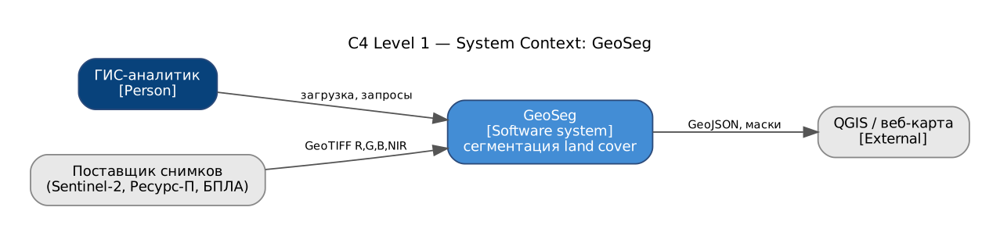
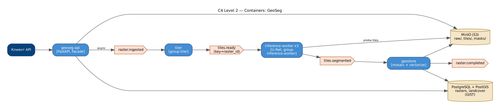
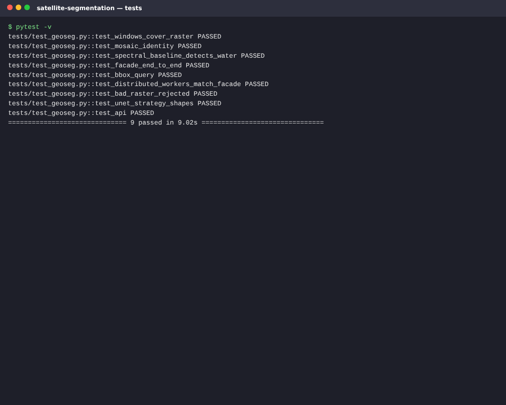
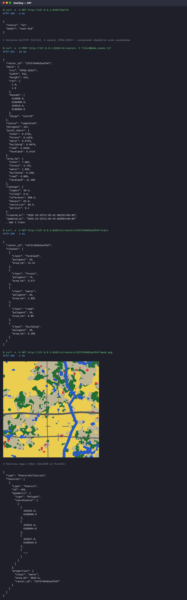
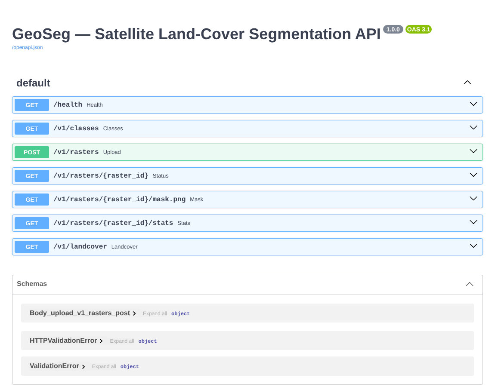
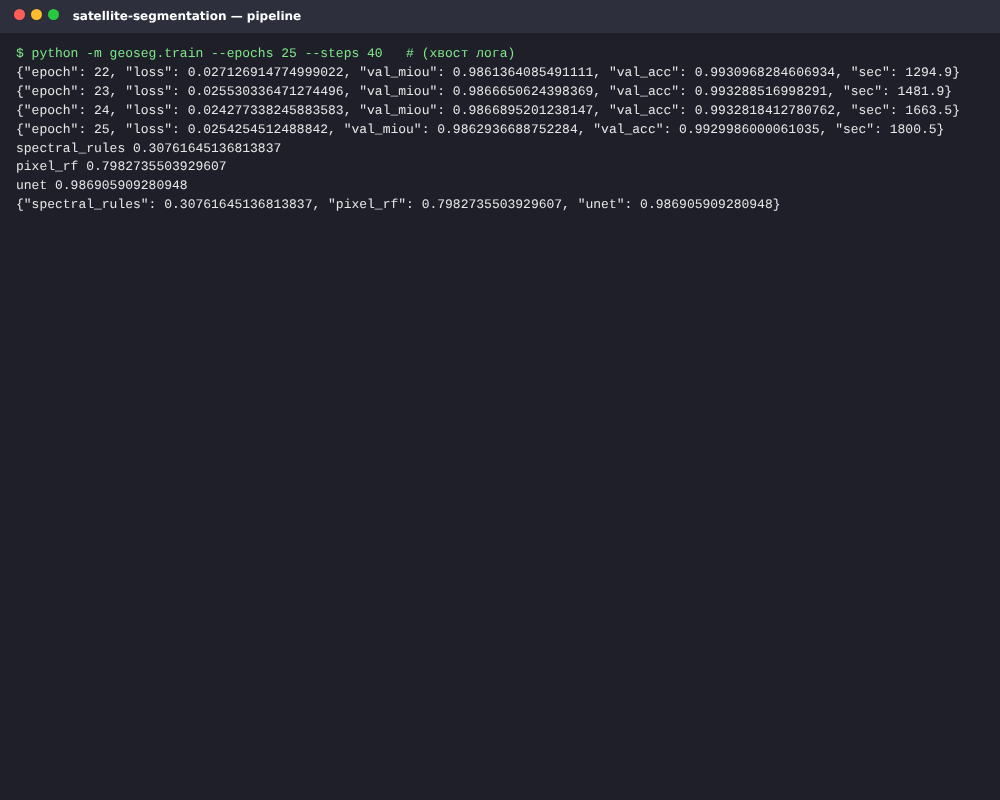
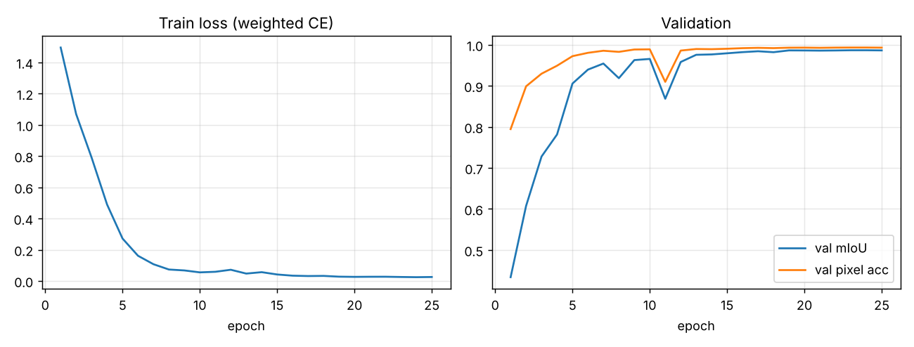
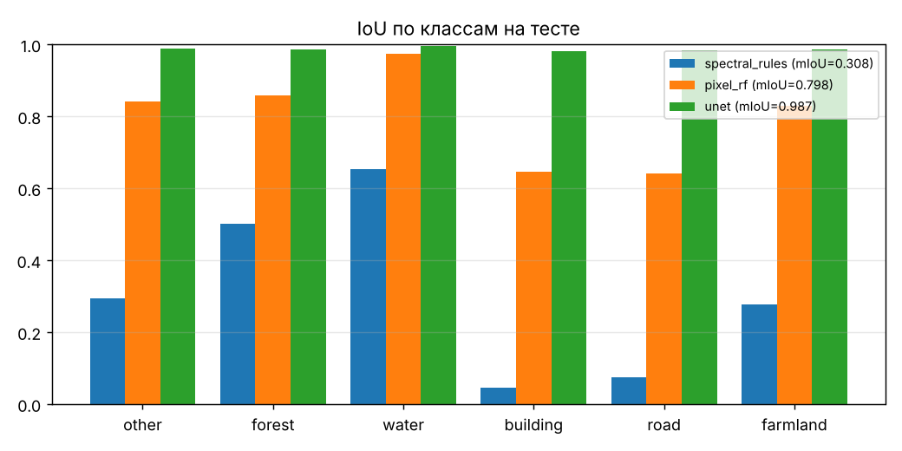
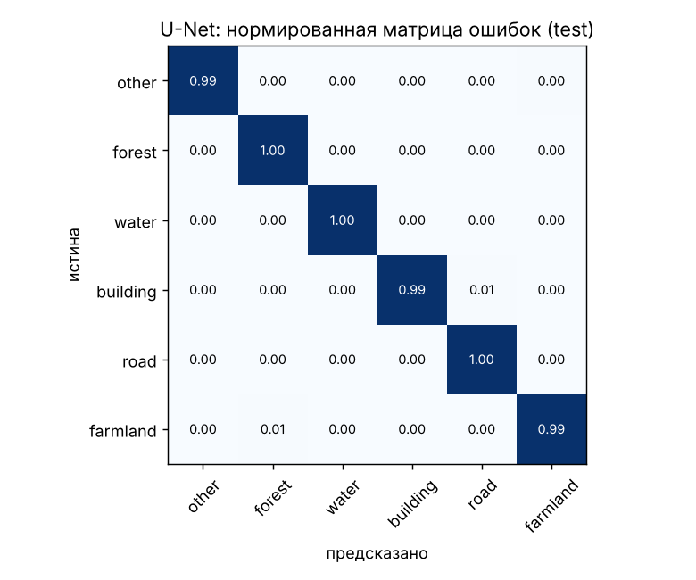
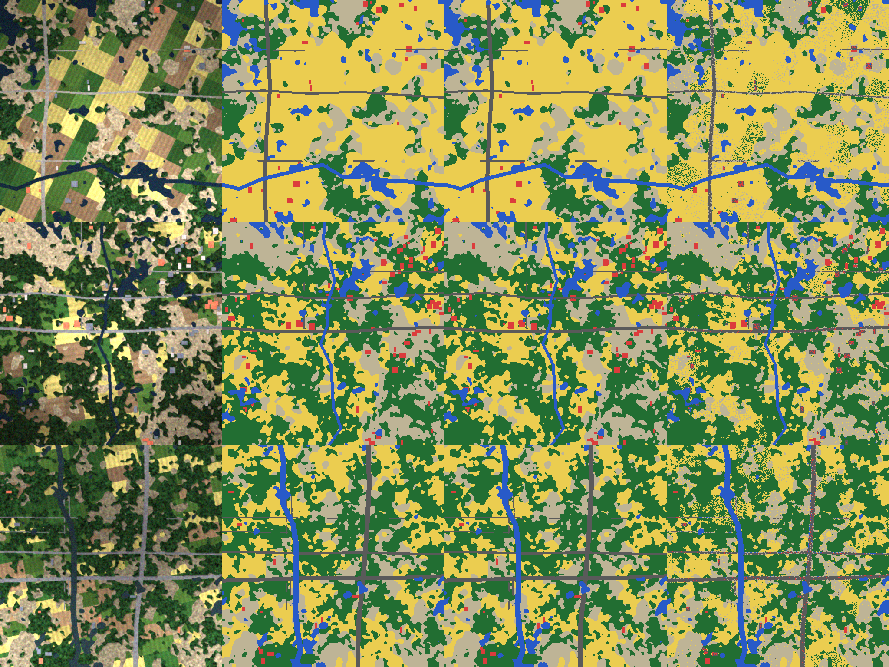

# Сегментация спутниковых снимков (GeoSeg)

**Отчёт по проекту №2** · Проектный практикум · 2026

- **Выполнил:** Царьков Артём
- **Репозиторий:** github.com/godor1333/Software_architecture_2025_API, projects/Tsarkov_Artem/2_segmentatsiya-sputnikovykh-snimkov

Также: PDF и Word-версии отчёта в папке [`report/`](report/).

## Содержание

- [1. Цель и проблема проекта](#1-цель-и-проблема-проекта)
- [2. Требования и ограничения](#2-требования-и-ограничения)
- [3. Входные и выходные данные](#3-входные-и-выходные-данные)
- [4. Архитектура](#4-архитектура)
- [5. Микросервисы и границы ответственности](#5-микросервисы-и-границы-ответственности)
- [6. Kafka: топики, producers/consumers, формат сообщений](#6-kafka-топики-producersconsumers-формат-сообщений)
- [7. Схема хранилища и индексы](#7-схема-хранилища-и-индексы)
- [8. API](#8-api)
- [9. Применённые паттерны](#9-применённые-паттерны)
- [10. Docker и запуск](#10-docker-и-запуск)
- [11. Тестирование и результаты](#11-тестирование-и-результаты)
- [12. Демонстрация работы](#12-демонстрация-работы)
- [13. ML-часть](#13-ml-часть)
- [14. RL-часть](#14-rl-часть)
- [15. Выводы и распределение работы](#15-выводы-и-распределение-работы)

## 1. Цель и проблема проекта

Геоаналитика (кадастр, мониторинг вырубок, учёт посевов, планирование застройки, оценка паводков) требует регулярного картирования типов земного покрова. Ручная оцифровка снимков занимает дни на один район и плохо масштабируется; классические ГИС-подходы на спектральных индексах (NDVI, NDWI) отделяют воду и растительность, но не различают лес и посевы, дороги и здания.

**Цель** — построить сервис GeoSeg, который принимает многоспектральный спутниковый снимок (GeoTIFF: R, G, B, NIR), разделяет его на классы **лес, вода, здания, дороги, сельхозугодья** (и «прочее»), сохраняет маску и векторные полигоны с координатами в PostGIS и отдаёт результат через API для последующей геоаналитики (площади классов, выборки по bbox).

Репозиторий: <https://github.com/godor1333/Software_architecture_2025_API/tree/main/projects/Tsarkov_Artem/2_segmentatsiya-sputnikovykh-snimkov>

## 2. Требования и ограничения

### Функциональные требования

1. Загрузка GeoTIFF произвольного размера (≥ 4 каналов) с сохранением исходника в объектном хранилище.
2. Нарезка на тайлы с перекрытием, сегментация, сборка маски всего растра без швов.
3. Векторизация маски в полигоны с сохранением CRS, фильтром мелких объектов и упрощением геометрии.
4. API: загрузка (синхронно и асинхронно), статус, маска PNG/GeoTIFF, площади классов, GeoJSON по bbox и классу.
5. Горизонтальное масштабирование инференса для больших растров.

### Нефункциональные требования и ограничения

- Идемпотентность: повторная загрузка того же файла не пересчитывается (raster_id = SHA-256 содержимого).
- Инференс на CPU: ≤ 5 с на мегапиксель; GPU — опционально.
- Корректная геопривязка результатов: полигоны в той же проекции, что и снимок (UTM).
- Ограничение данных: открытые датасеты (LandCover.ai, DeepGlobe, LoveDA) весят десятки ГБ и требуют регистрации, а в среде разработки не было доступа к Hugging Face Hub и внешним хранилищам. Поэтому для обучения и CI используется процедурный генератор снимков с реалистичными спектральными сигнатурами (раздел 13); загрузчик реальных данных подключается без изменения конвейера.
- Ограничение среды: демо выполнено без Docker-демона: MinIO заменён локальной ФС (тот же интерфейс), PostGIS — SQLite с bbox-индексом, Kafka — брокер в памяти с той же семантикой.

## 3. Входные и выходные данные

*Таблица 1 — Вход*

| Параметр | Значение |
|---|---|
| Формат | GeoTIFF, 4 канала: red, green, blue, nir; uint16 (отражение ×10 000) или float |
| Проекция | любая метрическая CRS (в демо EPSG:32637, UTM 37N), разрешение ~1 м/пиксель |
| Размер | произвольный; режется на тайлы 256×256 с перекрытием 32 px |

*Таблица 2 — Выход*

| Артефакт | Содержание |
|---|---|
| masks/{id}.tif | маска классов uint8 с геопривязкой и цветовой палитрой |
| masks/{id}.png | цветная маска для просмотра |
| landcover (PostGIS) | полигоны: класс, площадь м², геометрия |
| rasters (PostGIS) | метаданные, статус, доли и площади классов (га), тайминги стадий |
| GeoJSON (API) | FeatureCollection по bbox / классу / растру |

*Таблица 3 — Классы и цвета*

| id | Класс | Описание |
|---|---|---|
| 0 | other (прочее) | открытый грунт, луга, всё остальное |
| 1 | forest (лес) | древесная растительность |
| 2 | water (вода) | реки, озёра |
| 3 | building (здания) | крыши строений |
| 4 | road (дороги) | дороги и улицы |
| 5 | farmland (сельхозугодья) | поля с разными культурами и пашня |

## 4. Архитектура



*Рисунок 1 — C4 Level 1 — System Context*

Конвейер: Raster ingestion → tiling → segmentation inference → mosaic → vectorize → geospatial storage → API. Он реализован один раз (стадии Pipeline) и работает в двух режимах: синхронно внутри API через фасад (малые растры, интерактив) и распределённо — стадии исполняют отдельные воркеры, связанные топиками Kafka (большие растры, масштабирование инференса).



*Рисунок 2 — C4 Level 2 — Containers*

### Компоненты (C4 Level 3)

- **LandCoverFacade** — process(bytes) / status / mask_png / stats / geojson;
- **Pipeline** из стадий IngestStage → TilingStage → InferenceStage → MosaicStage → VectorizeStage → PersistStage;
- **SegmentationStrategy** — UNetStrategy / SegFormerStrategy / SpectralIndexStrategy / PixelForestStrategy;
- **ObjectStorage** (MinIO / Local) и **LandCoverRepository** (PostGIS / SQLite).

*Таблица 4 — Точки отказа*

| Отказ | Поведение |
|---|---|
| Падение inference-worker | Необработанные tiles.ready перечитываются другим воркером группы (offset не закоммичен). |
| Повторная доставка tiles.segmented | geostore хранит тайлы в dict по proba_key — дубликат не увеличивает счётчик. |
| Битый файл | API отвечает 422; в распределённом режиме — DLQ, статус растра failed с текстом ошибки. |
| Недоступен MinIO / PostGIS | Ретраи обработчика → DLQ; растр остаётся в статусе tiling, его можно перезапустить. |
| Падение geostore | Состояние сборки держится в памяти (ограничение) — после рестарта нужно переотправить tiles.segmented растра; развитие — хранить счётчик в Redis. |

## 5. Микросервисы и границы ответственности

*Таблица 5 — Сервисы GeoSeg*

| Сервис | Ответственность | Вход / выход |
|---|---|---|
| geoseg-api | Приём файлов, валидация, ingest, синхронная обработка (Facade), чтение результатов | REST; MinIO, PostGIS, raster.ingested |
| tiler | Расчёт окон тайлов, статус tiling | raster.ingested → tiles.ready |
| inference-worker (×3) | Сегментация тайла выбранной моделью, сохранение вероятностей (uint8, npz) | tiles.ready → MinIO, tiles.segmented |
| geostore | Сборка мозаики с Hann-смешиванием, векторизация, запись полигонов | tiles.segmented → PostGIS, raster.completed |
| trainer (офлайн) | Генерация/загрузка датасета, обучение U-Net и baseline'ов, метрики | models/unet_landcover.pt |

*Листинг 1 — Структура репозитория*

```
"report/\320\236\321\202\321\207\320\265\321\202_\320\237\321\200\320\276\320\265\320\272\321\2022_\320\241\320\265\320\263\320\274\320\265\320\275\321\202\320\260\321\206\320\270\321\217_\321\201\320\277\321\203\321\202\320\275\320\270\320\272\320\276\320\262\321\213\321\205_\321\201\320\275\320\270\320\274\320\272\320\276\320\262_\320\246\320\260\321\200\321\214\320\272\320\276\320\262.docx"
"report/\320\236\321\202\321\207\320\265\321\202_\320\237\321\200\320\276\320\265\320\272\321\2022_\320\241\320\265\320\263\320\274\320\265\320\275\321\202\320\260\321\206\320\270\321\217_\321\201\320\277\321\203\321\202\320\275\320\270\320\272\320\276\320\262\321\213\321\205_\321\201\320\275\320\270\320\274\320\272\320\276\320\262_\320\246\320\260\321\200\321\214\320\272\320\276\320\262.pdf"
.dockerignore
.gitattributes
.gitignore
Dockerfile
README.md
docker-compose.yml
docs/c4_container.dot
docs/c4_context.dot
docs/img/  (10 файлов)
geoseg/__init__.py
geoseg/models/  (3 файлов)
geoseg/obs.py
geoseg/pipeline/  (4 файлов)
geoseg/storage/  (3 файлов)
geoseg/synth.py
geoseg/train.py
loadtest/load.js
loadtest/sample.tif
models/metrics.json
models/pixel_rf.joblib
models/unet_landcover.pt
monitoring/grafana/  (3 файлов)
monitoring/prometheus.yml
requirements.txt
scripts/demo.ps1
scripts/demo.sh
services/__init__.py
services/ingest_api/  (2 файлов)
services/run_worker.py
services/workers.py
sql/postgis.sql
tests/e2e/  (3 файлов)
tests/test_geoseg.py
```

## 6. Kafka: топики, producers/consumers, формат сообщений

*Таблица 6 — Топики*

| Топик | Парт. | Ключ | Producer | Consumer group |
|---|---|---|---|---|
| raster.ingested | 3 | raster_id | geoseg-api | tiler |
| tiles.ready | 6 | raster_id | tiler | inference-worker (×3) |
| tiles.segmented | 6 | raster_id | inference-worker | geostore |
| raster.completed | 3 | raster_id | geostore | внешние подписчики |
| *.dlq | 1 | исходный | consumer'ы | ручной разбор |

В сообщениях передаются только ссылки на объекты в MinIO (raw/{id}.tif, tiles/{id}/r{row}_c{col}.npz), а не пиксели: размер сообщения — сотни байт, Kafka не нагружается растрами. Вероятности тайла квантуются в uint8 и сжимаются (в 4 раза меньше float32).

*Листинг 2 — Сообщения tiles.ready и tiles.segmented*

```
{
  "raster_id": "15f3749462eaf64f",
  "raw_key": "raw/15f3749462eaf64f.tif",
  "total": 9,
  "window": [
    224,
    224,
    256,
    256
  ]
}

{
  "raster_id": "15f3749462eaf64f",
  "raw_key": "raw/15f3749462eaf64f.tif",
  "total": 9,
  "window": [
    224,
    224,
    256,
    256
  ],
  "proba_key": "tiles/15f3749462eaf64f/r224_c224.npz"
}
```

Ключ raster_id: все тайлы растра попадают в одну партицию tiles.segmented, и один экземпляр geostore собирает растр целиком. При этом tiles.ready с тем же ключом обрабатываются последовательно одним воркером; для ускорения одного большого растра ключом tiles.ready можно сделать raster_id:row (параллелизм внутри растра) — это параметр конфигурации.

- **Порядок обработки**: ключ сообщения задаёт партицию, поэтому все события одной сущности обрабатываются строго по порядку одним consumer'ом группы; разные сущности обрабатываются параллельно.
- **At-least-once**: offset коммитится только после успешной обработки батча (`enable_auto_commit=False`); при падении consumer'а сообщения будут перечитаны.
- **Идемпотентность**: повторная доставка не создаёт дублей — запись в хранилище выполняется upsert'ом по естественному ключу.
- **Retries и DLQ**: обработчик повторяется до 3 раз; «ядовитое» сообщение после этого отправляется в топик `<topic>.dlq` с текстом ошибки и исходным payload и не блокирует партицию.
- **Producer**: `acks=all`, `retries=5`, `linger_ms=5` — подтверждение записи всеми репликами и небольшая пакетизация.

## 7. Схема хранилища и индексы

PostgreSQL + PostGIS выбран для полигонов, потому что даёт пространственные индексы (GIST), операции ST_Intersects/ST_Area и прямую совместимость с QGIS/GeoServer. Растры и тайлы хранятся в MinIO (S3) — объектное хранилище дешевле и подходит для больших бинарных файлов.

*Листинг 3 — sql/postgis.sql*

```
CREATE EXTENSION IF NOT EXISTS postgis;

CREATE TABLE IF NOT EXISTS rasters (
    raster_id  VARCHAR(16) PRIMARY KEY,          -- sha256(content)[:16] => идемпотентная загрузка
    meta       JSONB NOT NULL,                   -- crs, размер, разрешение, bounds
    status     VARCHAR(16) NOT NULL,             -- ingested | tiling | completed | failed
    extra      JSONB NOT NULL DEFAULT '{}'::jsonb,
    created_at TIMESTAMPTZ NOT NULL DEFAULT now(),
    updated_at TIMESTAMPTZ NOT NULL DEFAULT now()
);

CREATE TABLE IF NOT EXISTS landcover (
    id        BIGSERIAL PRIMARY KEY,
    raster_id VARCHAR(16) NOT NULL REFERENCES rasters(raster_id) ON DELETE CASCADE,
    class     VARCHAR(16) NOT NULL,
    area_m2   DOUBLE PRECISION NOT NULL,
    geom      geometry(Geometry) NOT NULL
);
CREATE INDEX IF NOT EXISTS ix_landcover_geom ON landcover USING GIST (geom);      -- bbox / intersects
CREATE INDEX IF NOT EXISTS ix_landcover_raster_class ON landcover (raster_id, class);
CREATE INDEX IF NOT EXISTS ix_landcover_class_area ON landcover (class, area_m2 DESC);  -- «топ полигонов класса» без сортировки всей таблицы
```

GIST-индекс по geom обслуживает запросы «полигоны в bbox» (оператор &&), составной (raster_id, class) — статистику по растру. Retention: исходники и маски в MinIO живут по lifecycle-политике бакета (например, тайлы — 7 дней, маски — бессрочно); при перезапуске обработки полигоны растра перезаписываются (DELETE + INSERT в одной транзакции).

## 8. API

*Таблица 7 — Эндпоинты*

| Метод | Путь | Назначение |
|---|---|---|
| POST | /v1/rasters?mode=sync\|async | загрузка GeoTIFF (multipart) |
| GET | /v1/rasters/{id} | статус, площади, тайминги |
| GET | /v1/rasters/{id}/mask.png | цветная маска |
| GET | /v1/rasters/{id}/stats | площади классов по полигонам, га |
| GET | /v1/landcover?bbox=&cls=&raster_id= | GeoJSON полигонов |
| GET | /v1/classes | классы и цвета |
| GET | /health | живость, версия модели |

Ошибки: 413 — файл больше MAX_UPLOAD_MB, 422 — файл не читается или меньше 4 каналов / неверный bbox / неизвестный класс, 404 — растр не найден или маска ещё не готова.

*Листинг 4 — Ответ POST /v1/rasters (реальный вызов, сокращено)*

```
{
  "raster_id": "15f3749462eaf64f",
  "meta": {
    "crs": "EPSG:32637",
    "width": 512,
    "height": 512,
    "res": [
      1.0,
      1.0
    ]
  },
  "status": "completed",
  "polygons": 167,
  "area_ha": {
    "other": 7.082,
    "forest": 3.731,
    "water": 1.896,
    "building": 0.208,
    "road": 0.889,
    "farmland": 12.409
  },
  "timings": {
    "ingest": 39.5,
    "tiling": 0.0,
    "inference": 898.5,
    "mosaic": 62.0,
    "vectorize": 83.5,
    "persist": 9.1
  }
}
```

## 9. Применённые паттерны

### 9.1 Pipeline — конвейер обработки растра

**Где**: geoseg/pipeline/stages.py. Каждая стадия — объект с run(ctx); Pipeline исполняет их по порядку и замеряет время. **Зачем**: те же стадии переиспользуются в распределённых воркерах (MosaicStage, VectorizeStage, PersistStage в geostore), стадии тестируются по отдельности, тайминги видны в статусе растра.

```
class Pipeline:
    def __init__(self, stages: list[Stage]) -> None:
        self.stages = stages

    def run(self, ctx: RasterContext) -> RasterContext:
        for st in self.stages:
            t = time.perf_counter()
            ctx = st.run(ctx)
            ctx.timings[st.name] = round((time.perf_counter() - t) * 1000, 1)
            if STAGE_SEC is not None:
                STAGE_SEC.labels(st.name).observe(ctx.timings[st.name] / 1000)
            log.info("raster %s: stage %s done in %.1f ms", ctx.raster_id, st.name, ctx.timings[st.name])
```

### 9.2 Facade — LandCoverFacade

**Зачем**: API вызывает одну операцию process(bytes) и не знает о хранилищах, тайлинге и модели; фасад же отвечает за идемпотентность (растр с тем же хэшем не пересчитывается) и статус failed при ошибке.

```
def process(self, data: bytes, force: bool = False) -> dict:
    rid = raster_id_for(data)
    existing = self.repo.get_raster(rid)
    if existing and existing["status"] == "completed" and not force:  # force — пересчёт (новая модель, нагрузочный тест)
        return existing
    try:
        ctx = self.pipeline.run(RasterContext(rid, raw=data))
        self.repo.set_status(rid, "completed", timings=ctx.timings)  # с учётом времени стадии persist
    except Exception as e:
        if self.repo.get_raster(rid):
            self.repo.set_status(rid, "failed", error=str(e))
        raise
    return self.repo.get_raster(rid)

def status(self, raster_id: str) -> dict | None:
```

### 9.3 Strategy + Adapter — модели сегментации

**Где**: geoseg/models/strategies.py. Единый интерфейс predict_proba(tile) для U-Net, baseline'ов и SegFormer. SegFormerStrategy — адаптер: модель Hugging Face принимает 3 канала и возвращает логиты в 1/4 разрешения, адаптер приводит вход и выход к общему контракту [K,H,W].

```
class SegFormerStrategy(SegmentationStrategy):
    """Адаптер Hugging Face SegFormer: 3 канала на входе, выход в 1/4 разрешения → апсемплинг."""

    name = "segformer"

    def __init__(self, checkpoint: str = "nvidia/mit-b0") -> None:
        import torch
        from transformers import SegformerForSemanticSegmentation  # type: ignore

        self.torch = torch
        self.model = SegformerForSemanticSegmentation.from_pretrained(checkpoint, num_labels=N_CLASSES,
                                                                      ignore_mismatched_sizes=True).eval()
        self.version = checkpoint

    def predict_proba(self, tile: np.ndarray) -> np.ndarray:
        rgb = normalize(tile)[:3][None]  # SegFormer ожидает RGB
        with self.torch.no_grad():
            logits = self.model(pixel_values=self.torch.from_numpy(rgb)).logits
```

### 9.4 Adapter — объектное хранилище

```
class MinIOStorage(ObjectStorage):
    def __init__(self, endpoint: str, access_key: str, secret_key: str, bucket: str = "rasters", secure: bool = False) -> None:
        from minio import Minio

        import time

        self.client = Minio(endpoint, access_key=access_key, secret_key=secret_key, secure=secure)
        self.bucket = bucket
        for attempt in range(60):      # хранилище может стартовать позже сервиса
            try:
                if not self.client.bucket_exists(bucket):
                    self.client.make_bucket(bucket)
                break
            except Exception:
```

### 9.5 Repository — геохранилище

PostGISLandCoverRepository и SQLiteLandCoverRepository реализуют один интерфейс; запрос по bbox в PostGIS использует GIST-индекс, в SQLite — B-tree по bbox-колонкам.

```
q, args = "SELECT id, raster_id, class, area_m2, ST_AsGeoJSON(geom) FROM landcover WHERE true", []
if bbox:
    q += " AND geom && ST_MakeEnvelope(%s, %s, %s, %s, ST_SRID(geom))"
    args += list(bbox)
if cls:
    q += " AND class = %s"
    args.append(cls)
if raster_id:
    q += " AND raster_id = %s"
    args.append(raster_id)
q += " ORDER BY area_m2 DESC LIMIT %s"
args.append(limit)
```

## 10. Docker и запуск

Один образ (Dockerfile, PyTorch CPU) для API и трёх типов воркеров; инфраструктура — Kafka (KRaft) с init-контейнером топиков, S3-совместимое хранилище SeaweedFS (код работает с ним через клиент minio-py по S3 API; официальные образы MinIO убраны из Docker Hub, поэтому в docker-compose используется SeaweedFS), PostGIS с DDL в initdb. inference-worker масштабируется `deploy.replicas`.

*Листинг 5 — Dockerfile*

```
FROM python:3.11-slim
ENV PYTHONDONTWRITEBYTECODE=1 PYTHONUNBUFFERED=1
WORKDIR /app
# rasterio (GDAL) требует libexpat — в slim-образе её нет
RUN apt-get update && apt-get install -y --no-install-recommends libexpat1 libgomp1 && rm -rf /var/lib/apt/lists/*
RUN pip install --no-cache-dir torch --index-url https://download.pytorch.org/whl/cpu
COPY requirements.txt .
RUN pip install --no-cache-dir -r requirements.txt
COPY geoseg ./geoseg
COPY services ./services
COPY models ./models
COPY tests ./tests
EXPOSE 8000
CMD ["uvicorn", "services.ingest_api.app:app", "--host", "0.0.0.0", "--port", "8000"]
```

*Листинг 6 — Фрагмент docker-compose.yml*

```
  api:
    <<: *app
    command: ["sh", "-c", "rm -rf /tmp/prom && mkdir -p /tmp/prom && PROMETHEUS_MULTIPROC_DIR=/tmp/prom exec uvicorn services.ingest_api.app:app --host 0.0.0.0 --port 8000 --workers 2"]
    ports: ["8000:8000"]
    healthcheck:
      test: ["CMD", "python", "-c", "import urllib.request; urllib.request.urlopen('http://localhost:8000/health', timeout=5)"]
      interval: 10s
      timeout: 10s
      retries: 30
      start_period: 30s

  tiler:
    <<: *app
    command: ["python", "-m", "services.run_worker", "tiler"]

  inference-worker:
    <<: *app
    command: ["python", "-m", "services.run_worker", "inference"]
```

*Листинг 7 — Инструкция запуска*

```
git clone https://github.com/nesssleh/satellite-segmentation && cd satellite-segmentation
docker compose up -d --build
curl -F file=@scene.tif "http://localhost:8000/v1/rasters?mode=async"
curl http://localhost:8000/v1/rasters/<raster_id>
# Swagger: http://localhost:8000/docs ; MinIO: http://localhost:9001 (minio / minio123)

# локально
pip install -r requirements.txt
python -m geoseg.synth && python -m geoseg.train --epochs 25 --steps 40
pytest -q
```

Помимо прикладных сервисов docker-compose поднимает **Prometheus** (с приёмом remote write от k6), **Grafana** с готовым дашбордом, **kafka-exporter** (lag consumer groups) и init-контейнер, создающий топики. Профили запускаются отдельно: `--profile e2e` — e2e-тесты внутри docker-сети, `--profile load` — нагрузочный тест k6. API запускается несколькими процессами uvicorn с общими метриками (multiprocess-режим Prometheus). Весь сценарий демонстрации собран в `scripts/demo.ps1` (Windows) и `scripts/demo.sh` (Linux/macOS): запуск, ожидание healthcheck, `docker compose ps`, состав docker-сети, топики Kafka, e2e-тесты, нагрузка, `docker stats`, lag consumer groups, логи. Всё сохраняется в папку `evidence/`.

## 11. Тестирование и результаты

*Таблица 8 — Тестовые сценарии (9 тестов, все проходят)*

| Тест | Что проверяет |
|---|---|
| test_windows_cover_raster | окна тайлов покрывают растр нестандартного размера 300×420 |
| test_mosaic_identity | сборка мозаики с весами Hann не искажает предсказания |
| test_spectral_baseline_detects_water | baseline находит воду по NDWI |
| test_facade_end_to_end | весь конвейер: статус, тайминги всех стадий, PNG, площади, GeoJSON, идемпотентность |
| test_bbox_query | пространственный фильтр по bbox |
| test_distributed_workers_match_facade | tiler → inference → geostore через Kafka, все тайлы растра в одной партиции |
| test_bad_raster_rejected | битый файл отклоняется |
| test_unet_strategy_shapes | U-Net возвращает распределение вероятностей [6,H,W] |
| test_api | загрузка, статус, маска, статистика, GeoJSON, ошибки 404/422 |



*Рисунок 3 — Результат запуска тестов*

Производительность (CPU, 2 потока): U-Net — 2.699 с на мегапиксель с перекрытием тайлов; Random Forest — 9.055 с/Мпкс; обработка сцены 512×512 целиком через API ≈ 1.1 с, из них инференс 0.9 с.

### Мониторинг: Prometheus + Grafana

Каждый сервис отдаёт метрики Prometheus: API — через middleware (счётчик и гистограмма длительности по шаблону пути, `/metrics`; при нескольких процессах uvicorn — multiprocess-режим), Kafka-воркеры — HTTP-сервер метрик на порту 9100 (обработанные сообщения, время обработки, ретраи, DLQ по consumer group). Lag consumer groups и offset'ы топиков снимает kafka-exporter. Prometheus находит все реплики воркеров через DNS service discovery docker-сети. Grafana поднимается с готовым источником данных и дашбордом «overview» (provisioning из `monitoring/`).

*Таблица 9 — Дашборд Grafana «overview»*

| Блок | Панели |
|---|---|
| k6 | RPS, виртуальные пользователи, латентность p50/p95/p99 на стороне клиента, доля ошибок |
| API | RPS по эндпоинтам, латентность p50/p95/p99 (гистограмма на сервере), ошибки 4xx/5xx |
| Kafka | входящий поток по топикам, обработка по consumer group, consumer lag (kafka-exporter), время обработки p95, ретраи и DLQ, число живых реплик воркеров |
| Сегментация | растров в минуту, длительность стадий конвейера p95, накопленная площадь классов (га) |

### E2E-тесты против живого стека

Контейнер `e2e` собирается из того же образа, подключается к той же docker-сети и обращается к сервисам по их именам (`docker compose --profile e2e run --rm e2e`). Тесты проверяют, что топики и consumer groups созданы, и проводят событие через весь асинхронный конвейер: подписываются на выходной топик до отправки, ждут сообщение и проверяют результат в базах данных через API.

*Таблица 10 — E2E-тесты (tests/e2e/test_live.py)*

| Тест | Что проверяет |
|---|---|
| test_api_healthy | API и модель загружены |
| test_kafka_topics_and_consumer_groups | топики и группы tiler, inference-worker, geostore |
| test_async_pipeline_through_kafka | растр через Kafka → raster.completed, статус, маска из MinIO, площади из PostGIS |
| test_sync_and_geojson | синхронная загрузка, GeoJSON по bbox, ошибка 422 на битом файле |

### Нагрузочное тестирование (k6)

Скрипт `loadtest/load.js` запускается контейнером grafana/k6 (`docker compose --profile load run --rm k6`). Метрики k6 отправляются в Prometheus через remote write и отображаются на том же дашборде, что и метрики сервисов и Kafka: видно, как рост нагрузки отражается на латентности API, потоке сообщений и lag consumer groups. Пороги k6 (thresholds) задают SLO, итог сохраняется в `evidence/k6_summary.json`.

*Таблица 11 — Сценарии нагрузки*

| Сценарий | Что делает | Профиль |
|---|---|---|
| sync | загрузка снимка 512×512 с синхронной сегментацией (force=true — полный пересчёт) | 1 → 4 VU |
| async | загрузка в асинхронном режиме: tiler → inference-worker ×2 → geostore через Kafka | 12 растров/мин |
| query | GeoJSON полигонов класса из PostGIS | 10 RPS |

**Контрольный прогон.** До сдачи все сервисы проекта были запущены отдельными процессами с теми же настройками, что в docker-compose (несколько uvicorn-процессов, по 2 реплики воркеров), против брокера с протоколом Kafka (franz-go kfake), PostgreSQL/PostGIS/pgvector и Redis. Сервисы, k6 и Prometheus работали на одной машине с 2 ядрами CPU, поэтому абсолютные значения латентности — оценка снизу. Итоговые графики Grafana и логи `evidence/` фиксируются запуском `scripts/demo.ps1` в Docker.

*Таблица 12 — Результаты контрольного прогона*

| Показатель | Значение |
|---|---|
| Ошибки | 0 из 1 450 запросов |
| Асинхронный растр end-to-end (e2e) | 3.4 с от загрузки до raster.completed |
| Распределение тайлов между inference-воркерами | 115 / 150 тайлов (после смены ключа) |
| GeoJSON-запрос: план выполнения | 7.7 мс в PostgreSQL (индекс по классу и площади) |
| GeoJSON p95 под нагрузкой | 2.4 с — CPU занят синхронной сегментацией на тех же 2 ядрах |

Что выявила нагрузка и что исправлено:

- Ключ tiles.ready = raster_id: все тайлы растра попадали в одну партицию, второй inference-воркер простаивал. Ключ изменён на raster_id:row:col — тайлы одного растра обрабатываются всеми воркерами параллельно; в tiles.segmented ключ остаётся raster_id (сборка в одном geostore).
- Репозиторий PostGIS использовал одно соединение на все потоки API — заменено на пул соединений (psycopg_pool); локальная SQLite-реализация защищена блокировкой.
- Добавлен индекс (class, area_m2 DESC) под запрос «крупнейшие полигоны класса».
- Kafka-producer создавался на каждый асинхронный запрос — теперь один на процесс.

## 12. Демонстрация работы



*Рисунок 4 — Работа API: загрузка снимка, статистика классов, маска, GeoJSON полигонов воды*



*Рисунок 5 — Swagger UI GeoSeg*



*Рисунок 6 — Лог обучения U-Net (валидация по эпохам и итог на тесте)*

## 13. ML-часть

### Датасет

Процедурный генератор geoseg/synth.py создаёт сцены 512×512 (1 м/пиксель, EPSG:32637, 4 канала): поля нарезаются повёрнутой решёткой, каждому полю назначается культура со своей сигнатурой (зелёные посевы, пашня, созревшие); лес — шумовые массивы с сильной текстурой; застройка — регион с домами разных крыш; дороги и реки — меандрирующие полилинии; озёра — пороговый шум. Добавлены тени деревьев и зданий, неравномерная освещённость, дымка (сильнее в синем канале), размытие PSF и шум сенсора. Трудные пары перекрываются специально: пашня ≈ открытый грунт, зелёные посевы ≈ лес, серые крыши ≈ дороги. Объём: 48 сцен train, 8 val, 12 test.

*Таблица 13 — Доли классов (train)*

| Класс | Доля пикселей |
|---|---|
| other (прочее) | 30.6% |
| forest (лес) | 20.7% |
| water (вода) | 5.0% |
| building (здания) | 1.2% |
| road (дороги) | 2.7% |
| farmland (сельхозугодья) | 39.8% |

### Preprocessing

Отражение uint16/10 000 → поканальная стандартизация; обучение на случайных кропах 128×128 с поворотами на 90°, отражениями и фотометрической аугментацией (±10% яркости, шум). Дисбаланс классов (здания 1.2%, дороги 2.7%) компенсирован весами в cross-entropy ∝ 1/√частоты.

### Модель

U-Net: 4 уровня  базовая ширина 16 (16→256 каналов)  BatchNorm  транспонированные свёртки  1 942 806 параметров. AdamW  OneCycle (max lr 3·10⁻³)  25 эпох × 40 шагов  batch 16; лучшая эпоха по val mIoU. Обучение — 31 мин на CPU. Инференс — тайлы 256 с перекрытием 32 и смешиванием вероятностей окном Hann.



*Рисунок 7 — Кривые обучения U-Net*

### Baseline'ы и результаты

*Таблица 14 — IoU по классам на тесте*

| Модель | прочее | лес | вода | здания | дороги | сельхозугодья | mIoU |
|---|---|---|---|---|---|---|---|
| NDVI/NDWI правила | 0.294 | 0.501 | 0.653 | 0.045 | 0.074 | 0.279 | **0.308** |
| RandomForest (пиксель) | 0.841 | 0.858 | 0.973 | 0.647 | 0.641 | 0.830 | **0.798** |
| U-Net | 0.988 | 0.987 | 0.995 | 0.981 | 0.984 | 0.986 | **0.987** |



*Рисунок 8 — IoU по классам: baseline'ы и U-Net*



*Рисунок 9 — Нормированная матрица ошибок U-Net*



*Рисунок 10 — Примеры: снимок (RGB) · эталон · U-Net · RandomForest*

Спектральные правила хорошо находят воду, но путают поля, грунт и лес (mIoU 0.308). Попиксельный RandomForest по спектру и индексам достигает 0.798, но даёт «соль-и-перец» на текстурных классах и плохо различает дороги и здания (IoU 0.641 / 0.647) — им не хватает пространственного контекста. U-Net использует форму и текстуру и получает mIoU 0.987.

### Ограничения

- Синтетические сцены проще реальных: абсолютные значения метрик завышены; на LandCover.ai/DeepGlobe ожидаемый mIoU для подобной архитектуры — 0.7–0.85. Следующий шаг — дообучение на реальных данных (адаптер загрузки датасета, предобученный энкодер / SegFormer-b0).
- Нет учёта облаков и сезонности; облачная маска — отдельная задача предобработки.
- Разрешение фиксировано (~1 м); для Sentinel-2 (10 м) нужна отдельная модель или ресемплинг.

## 14. RL-часть

Не применимо: в проекте нет задачи обучения с подкреплением.

## 15. Выводы и распределение работы

- Реализован сервис сегментации спутниковых снимков с конвейером ingestion → tiling → inference → mosaic → vectorize → PostGIS → API на PyTorch, Rasterio, MinIO, FastAPI, PostGIS и Kafka, с docker-compose развёртыванием и масштабируемым инференсом.
- U-Net (1.9M параметров) достигает mIoU 0.987 против 0.798 у RandomForest и 0.308 у правил на индексах; наибольший выигрыш — на дорогах и зданиях.
- Результаты пригодны для геоаналитики: площади классов в гектарах, GeoJSON-полигоны в исходной проекции, запросы по bbox.
- Паттерны: Pipeline, Facade, Strategy, Adapter, Repository.
- Развитие: обучение на реальных датасетах, SegFormer/предобученные энкодеры, GPU-инференс, облачная маска, изменения во времени (change detection).

*Таблица 15 — Распределение работы (проект выполнен индивидуально)*

| Работа | Исполнитель |
|---|---|
| Постановка задачи, требования, архитектура (C4) | Царьков Артём |
| Реализация микросервисов, Kafka-контракты, хранилища | Царьков Артём |
| Данные, модель, обучение и оценка | Царьков Артём |
| API, Docker/docker-compose, тесты | Царьков Артём |
| Отчёт, README, демонстрация | Царьков Артём |
