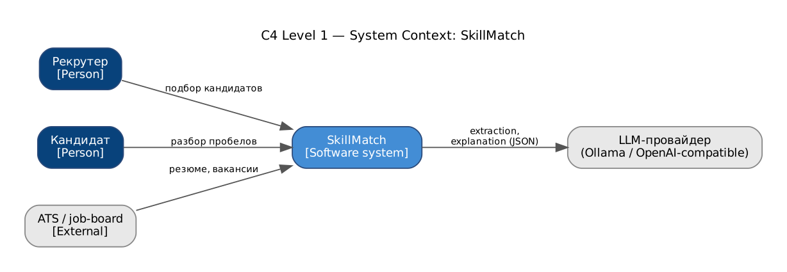
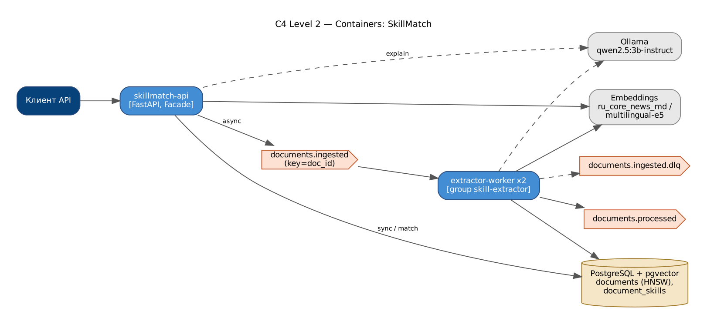
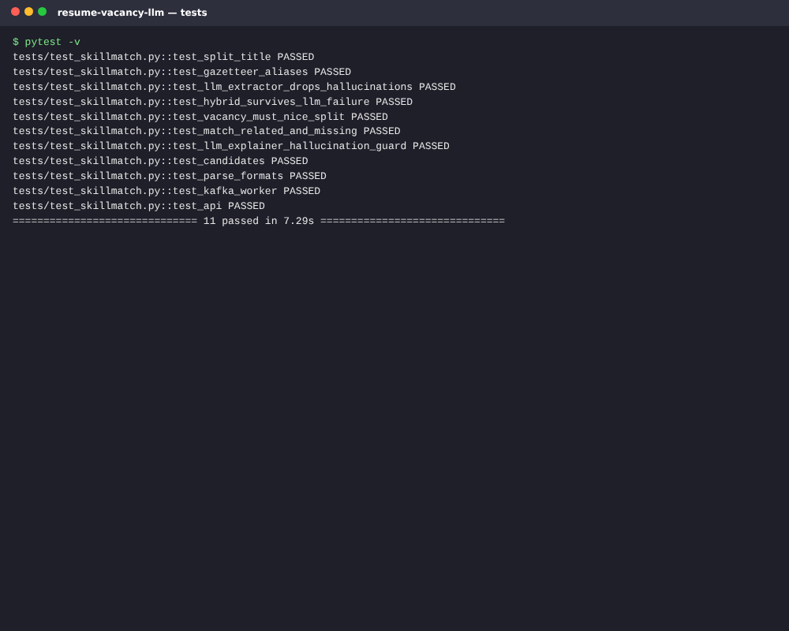
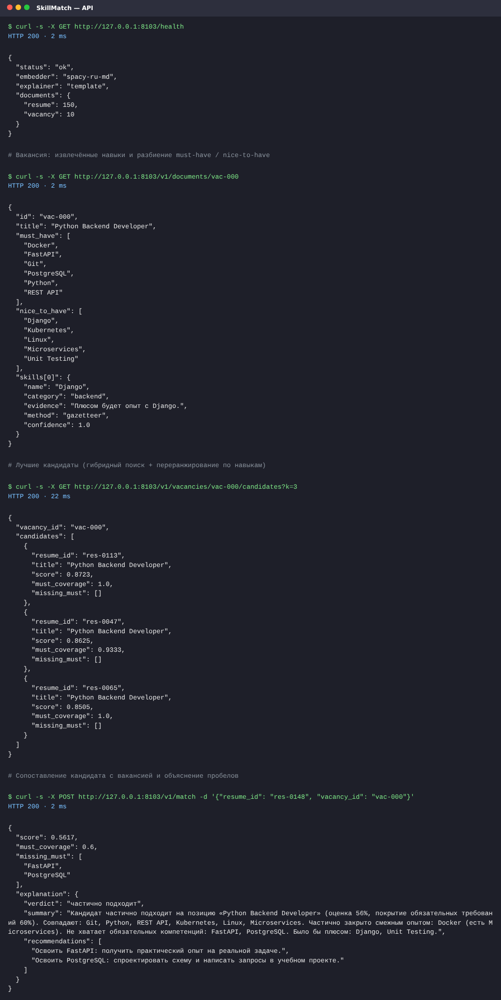
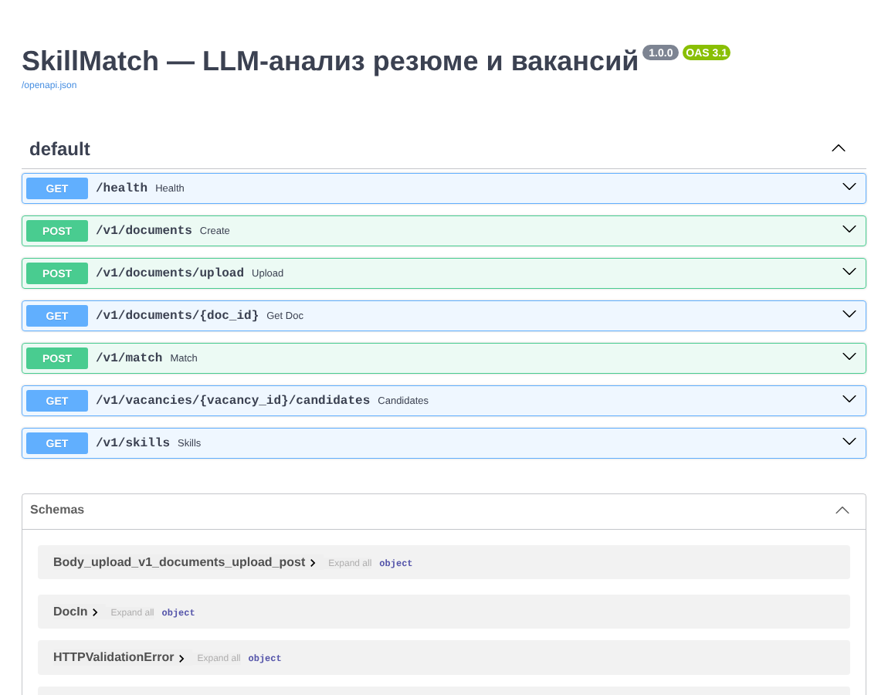
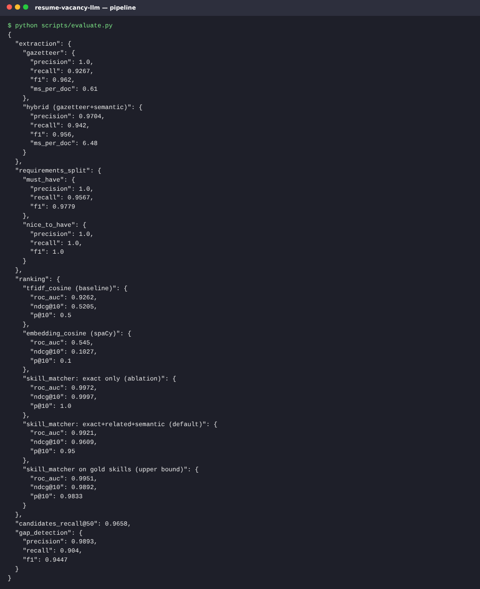
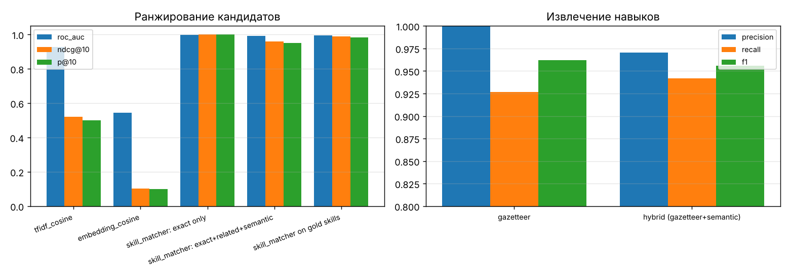

# LLM-анализ резюме и вакансий (SkillMatch)

**Отчёт по проекту №3** · Проектный практикум · 2026

- **Выполнил:** Царьков Артём
- **Репозиторий:** github.com/godor1333/Software_architecture_2025_API, projects/Tsarkov_Artem/3_llm-analiz-rezyume-i-vakansiy

Также: PDF и Word-версии отчёта в папке [`report/`](report/).

## Содержание

- [1. Цель и проблема проекта](#1-цель-и-проблема-проекта)
- [2. Требования и ограничения](#2-требования-и-ограничения)
- [3. Входные и выходные данные](#3-входные-и-выходные-данные)
- [4. Архитектура](#4-архитектура)
- [5. Микросервисы и границы ответственности](#5-микросервисы-и-границы-ответственности)
- [6. Kafka: топики и сообщения](#6-kafka-топики-и-сообщения)
- [7. Схема БД и индексы](#7-схема-бд-и-индексы)
- [8. API](#8-api)
- [9. Применённые паттерны](#9-применённые-паттерны)
- [10. Docker и запуск](#10-docker-и-запуск)
- [11. Тестирование и результаты](#11-тестирование-и-результаты)
- [12. Демонстрация работы](#12-демонстрация-работы)
- [13. ML/LLM-часть](#13-mlllm-часть)
- [14. RL-часть](#14-rl-часть)
- [15. Выводы и распределение работы](#15-выводы-и-распределение-работы)

## 1. Цель и проблема проекта

Рекрутер тратит минуты на каждое резюме, а кандидат обычно не понимает, почему получил отказ. Поиск по ключевым словам в ATS пропускает синонимы («постгрес», «Postgres», «PostgreSQL 15»), неявный опыт («настраивал DAG-и в оркестраторе» = Airflow) и не учитывает смежные навыки (Django частично закрывает требование FastAPI). Полнотекстовая близость документов плохо отражает соответствие требованиям.

**Цель** — сервис SkillMatch, который извлекает навыки из резюме и вакансий (LLM + словарь + эмбеддинги), разделяет требования вакансии на обязательные и желательные, сопоставляет их с навыками кандидата (точное / смежное / семантическое совпадение), ранжирует кандидатов и **объясняет, каких компетенций не хватает**, с рекомендациями — без галлюцинаций модели.

Репозиторий: <https://github.com/godor1333/Software_architecture_2025_API/tree/main/projects/Tsarkov_Artem/3_llm-analiz-rezyume-i-vakansiy>

## 2. Требования и ограничения

1. Загрузка резюме/вакансий текстом или файлом (txt, pdf, docx), синхронно или через очередь.
2. Извлечение навыков с цитатой-доказательством (evidence) и методом извлечения.
3. Для вакансии — разделение must-have / nice-to-have.
4. Сопоставление резюме ↔ вакансия: скор, покрытие, совпавшие/частичные/отсутствующие навыки.
5. Объяснение результата и рекомендации на русском языке.
6. Поиск лучших кандидатов на вакансию (векторный поиск + переранжирование).

- Контроль галлюцинаций LLM: навыки только из таксономии, evidence проверяется в тексте, объяснение не может упоминать навыки вне фактов.
- Деградация без LLM: при недоступности провайдера сервис продолжает работать на словаре + эмбеддингах и шаблонном объяснении.
- Персональные данные: резюме хранятся только в PostgreSQL сервиса; в LLM уходит текст без контактов (в проде — маскирование ФИО/телефонов перед отправкой).
- Задержка: обработка документа < 100 мс без LLM; сопоставление пары < 1 мс.
- Ограничение среды: доступ к Hugging Face Hub и внешним LLM API в среде разработки был закрыт. Поэтому в оценке использованы предобученные векторы spaCy ru_core_news_md (скачаны с GitHub), а LLM подключается через OpenAI-совместимый адаптер (в docker-compose — Ollama с qwen2.5:3b-instruct) и проверяется в тестах на заглушке. Метрики раздела 13 получены без LLM — это нижняя граница качества.

## 3. Входные и выходные данные

*Таблица 1 — Входные данные*

| Вход | Описание |
|---|---|
| Резюме | свободный текст или файл; первая строка «Желаемая должность: …» распознаётся как заголовок |
| Вакансия | текст; маркеры «будет плюсом», «желательно» отделяют nice-to-have |
| Таксономия | 76 навыков: имя, категория, синонимы RU/EN, связанные навыки, описание |

*Таблица 2 — Выходные данные*

| Выход | Описание |
|---|---|
| skills[] | name, category, evidence (цитата), method (gazetteer / semantic / llm), confidence |
| match | score, must_coverage, nice_coverage, doc_similarity, missing_must, matches[{requirement, matched_by, kind, score}] |
| explanation | verdict, summary, recommendations[], facts, explainer (template / llm) |
| candidates | top-k резюме с итоговым скором и пробелами |

## 4. Архитектура



*Рисунок 1 — C4 Level 1 — System Context*

Архитектура «Document ingestion + extraction + semantic matching + explanation service». Загрузка может быть синхронной (API сам прогоняет конвейер) или асинхронной: API публикует documents.ingested, extractor-worker'ы (consumer group) обрабатывают документы и пишут результат в PostgreSQL/pgvector.



*Рисунок 2 — C4 Level 2 — Containers*

### Компоненты (C4 Level 3)

- **SkillMatchFacade**: ingest / match / candidates;
- **DocumentPipeline**: split_title → extract → requirements → embed;
- **HybridExtractor** = GazetteerExtractor + LLMExtractor (опционально) + SemanticExtractor;
- **SkillMatcher** (exact / related / semantic), **Explainer** (Template / LLM с fallback);
- **DocumentRepository** (pgvector / in-memory), **Embedder** (spaCy / sentence-transformers / TF-IDF), **LLMClient** (OpenAI-compatible / HF / Null).

*Таблица 3 — Точки отказа*

| Отказ | Поведение |
|---|---|
| LLM недоступна / timeout | OpenAICompatibleLLM делает 2 повтора с экспоненциальной паузой; затем HybridExtractor и LLMExplainer переходят на детерминированный fallback, запрос не падает. |
| LLM вернула мусор / выдумала навык | JSON не распарсился → fallback; навык вне таксономии отбрасывается; объяснение с чужими навыками отклоняется. |
| Падение extractor-worker | Сообщения дочитываются другим экземпляром группы, upsert по id документа идемпотентен. |
| Битый документ | 3 ретрая → documents.ingested.dlq. |

## 5. Микросервисы и границы ответственности

*Таблица 4 — Сервисы*

| Сервис | Ответственность | Интерфейсы |
|---|---|---|
| skillmatch-api | Приём документов (JSON/файл), матчинг, поиск кандидатов, объяснения | REST; PostgreSQL; documents.ingested |
| extractor-worker (×2) | Парсинг, извлечение навыков, эмбеддинг, запись в БД | documents.ingested → PostgreSQL, documents.processed |
| ollama | LLM для извлечения и объяснений (OpenAI-совместимый API) | HTTP /v1/chat/completions |
| PostgreSQL + pgvector | документы, эмбеддинги (HNSW), инвертированный индекс навыков | SQL |

*Листинг 1 — Структура репозитория*

```
"report/\320\236\321\202\321\207\320\265\321\202_\320\237\321\200\320\276\320\265\320\272\321\2023_LLM_\320\260\320\275\320\260\320\273\320\270\320\267_\321\200\320\265\320\267\321\216\320\274\320\265_\320\246\320\260\321\200\321\214\320\272\320\276\320\262.docx"
"report/\320\236\321\202\321\207\320\265\321\202_\320\237\321\200\320\276\320\265\320\272\321\2023_LLM_\320\260\320\275\320\260\320\273\320\270\320\267_\321\200\320\265\320\267\321\216\320\274\320\265_\320\246\320\260\321\200\321\214\320\272\320\276\320\262.pdf"
.dockerignore
.gitattributes
.gitignore
Dockerfile
README.md
docker-compose.yml
docs/c4_container.dot
docs/c4_context.dot
docs/img/  (7 файлов)
loadtest/data.json
loadtest/load.js
models/metrics.json
monitoring/grafana/  (3 файлов)
monitoring/prometheus.yml
requirements.txt
scripts/demo.ps1
scripts/demo.sh
scripts/evaluate.py
services/__init__.py
services/api/  (2 файлов)
services/extractor_worker/  (2 файлов)
skillmatch/__init__.py
skillmatch/datagen.py
skillmatch/embedding/  (2 файлов)
skillmatch/explain/  (2 файлов)
skillmatch/extraction/  (2 файлов)
skillmatch/facade.py
skillmatch/factory.py
skillmatch/kafka_io.py
skillmatch/llm.py
skillmatch/matching.py
skillmatch/obs.py
skillmatch/parsing/  (2 файлов)
skillmatch/storage/  (2 файлов)
skillmatch/taxonomy.py
sql/schema.sql
tests/e2e/  (3 файлов)
tests/test_skillmatch.py
```

## 6. Kafka: топики и сообщения

*Таблица 5 — Топики*

| Топик | Парт. | Ключ | Producer | Consumer group |
|---|---|---|---|---|
| documents.ingested | 6 | doc_id | skillmatch-api | skill-extractor |
| documents.processed | 6 | doc_id | extractor-worker | ATS / уведомления |
| documents.ingested.dlq | 1 | doc_id | extractor-worker | ручной разбор |

*Листинг 2 — Сообщения*

```
documents.ingested:
{
  "id": "res-0148",
  "type": "resume",
  "text": "Резюме. Желаемая должность: Python Backend Developer. Стек: Django, MySQL. ..."
}

documents.processed:
{
  "id": "res-0148",
  "type": "resume",
  "skills": [
    "Django",
    "Docker",
    "Git",
    "Kubernetes",
    "Python"
  ],
  "must_have": []
}
```

- **Порядок обработки**: ключ сообщения задаёт партицию, поэтому все события одной сущности обрабатываются строго по порядку одним consumer'ом группы; разные сущности обрабатываются параллельно.
- **At-least-once**: offset коммитится только после успешной обработки батча (`enable_auto_commit=False`); при падении consumer'а сообщения будут перечитаны.
- **Идемпотентность**: повторная доставка не создаёт дублей — запись в хранилище выполняется upsert'ом по естественному ключу.
- **Retries и DLQ**: обработчик повторяется до 3 раз; «ядовитое» сообщение после этого отправляется в топик `<topic>.dlq` с текстом ошибки и исходным payload и не блокирует партицию.
- **Producer**: `acks=all`, `retries=5`, `linger_ms=5` — подтверждение записи всеми репликами и небольшая пакетизация.
- Извлечение с LLM медленное (секунды) — асинхронный режим не блокирует клиента API, а число воркеров масштабируется по lag.

## 7. Схема БД и индексы

*Листинг 3 — sql/schema.sql*

```
CREATE EXTENSION IF NOT EXISTS vector;

CREATE TABLE IF NOT EXISTS documents (
    id           VARCHAR(64) PRIMARY KEY,
    type         VARCHAR(16) NOT NULL CHECK (type IN ('resume', 'vacancy')),
    title        TEXT,
    text         TEXT NOT NULL,
    skills       JSONB NOT NULL DEFAULT '[]',     -- [{name, category, evidence, method, confidence}]
    must_have    TEXT[] NOT NULL DEFAULT '{}',
    nice_to_have TEXT[] NOT NULL DEFAULT '{}',
    embedding    vector(300),                      -- ru_core_news_md; 384 для multilingual-e5-small
    status       VARCHAR(16) NOT NULL DEFAULT 'processed',
    created_at   TIMESTAMPTZ NOT NULL DEFAULT now(),
    updated_at   TIMESTAMPTZ NOT NULL DEFAULT now()
);
-- ANN-поиск по косинусной близости
CREATE INDEX IF NOT EXISTS ix_documents_embedding ON documents USING hnsw (embedding vector_cosine_ops)
    WITH (m = 16, ef_construction = 64);
CREATE INDEX IF NOT EXISTS ix_documents_type ON documents (type);

-- Инвертированный индекс навыков: кандидатогенерация «у кого есть навыки вакансии»
CREATE TABLE IF NOT EXISTS document_skills (
    doc_id     VARCHAR(64) NOT NULL REFERENCES documents(id) ON DELETE CASCADE,
    skill      VARCHAR(64) NOT NULL,
    method     VARCHAR(16) NOT NULL,              -- gazetteer | semantic | llm
    confidence REAL NOT NULL,
    PRIMARY KEY (doc_id, skill)
);
CREATE INDEX IF NOT EXISTS ix_document_skills_skill ON document_skills (skill);
```

HNSW-индекс по cosine-расстоянию отвечает за ANN-поиск похожих документов; таблица document_skills с индексом по skill — инвертированный индекс «у кого есть навык X» для кандидатогенерации. Поиск кандидатов гибридный: объединение кандидатов по навыкам и по вектору, затем точное переранжирование SkillMatcher. Retention: резюме удаляются по запросу кандидата или через N месяцев (ON DELETE CASCADE удаляет навыки).

## 8. API

*Таблица 6 — Эндпоинты*

| Метод | Путь | Назначение |
|---|---|---|
| POST | /v1/documents?mode=sync\|async | резюме или вакансия (JSON) |
| POST | /v1/documents/upload | файл txt/pdf/docx (multipart) |
| GET | /v1/documents/{id} | документ и навыки |
| POST | /v1/match | сопоставление + объяснение |
| GET | /v1/vacancies/{id}/candidates?k= | лучшие кандидаты |
| GET | /v1/skills | таксономия |
| GET | /health | статус, эмбеддер, объяснитель |

Ошибки: 422 — неверный тип документа, слишком короткий текст, неподдерживаемый формат файла; 404 — документ не найден.

*Листинг 4 — POST /v1/match — реальный ответ (сокращено)*

```
{
  "resume_id": "res-0230",
  "vacancy_id": "vac-000",
  "score": 0.7578,
  "must_coverage": 0.7667,
  "missing_must": [
    "Python"
  ],
  "matches": [
    {
      "requirement": "Docker",
      "matched_by": "Docker",
      "kind": "exact",
      "score": 1.0
    },
    {
      "requirement": "FastAPI",
      "matched_by": "Django",
      "kind": "related",
      "score": 0.6
    },
    {
      "requirement": "Git",
      "matched_by": "Git",
      "kind": "exact",
      "score": 1.0
    },
    {
      "...": "..."
    }
  ],
  "explanation": {
    "verdict": "частично подходит",
    "summary": "Кандидат частично подходит на позицию «Python Backend Developer» (оценка 76%, покрытие обязательных требований 77%). Совпадают: Docker, Git, PostgreSQL, REST API, Apache Kafka, Django, Microservices, Redis. Частично закрыто смежным опытом: FastAPI (есть Django). Не хватает обязательных компетенций: Python.",
    "recommendations": [
      "Освоить Python: решить несколько практических задач и сделать pet-проект."
    ]
  }
}
```

## 9. Применённые паттерны

### 9.1 Facade — SkillMatchFacade

**Зачем**: API и Kafka-воркер работают с тремя операциями (ingest, match, candidates) и не знают о стратегиях, БД и LLM; конфигурация собирается в одном месте (factory.build_facade).

```
def match(self, resume_id: str, vacancy_id: str, explain: bool = True) -> dict:
    r, v = self.repo.get(resume_id), self.repo.get(vacancy_id)
    if not r or not v:
        raise KeyError("resume or vacancy not found")
    sim = float(r.embedding @ v.embedding) if r.embedding is not None and v.embedding is not None else 0.0
    res = self.matcher.match(r.skill_names, v.must_have, v.nice_to_have, sim)
    out = {"resume_id": r.id, "vacancy_id": v.id, **res.as_dict()}
    if MATCH_SCORE is not None:
        MATCH_SCORE.observe(res.score)
    if explain:
        out["explanation"] = self.explainer.explain(v.title or v.id, res)
    return out
```

### 9.2 Pipeline — DocumentPipeline

```
class DocumentPipeline:
    def __init__(self, extractor: SkillExtractor, embedder: Embedder) -> None:
        self.extractor, self.embedder = extractor, embedder
        self.stages: list[tuple[str, Stage]] = [("split_title", self._split), ("extract", self._extract),
                                                ("requirements", self._requirements), ("embed", self._embed)]

    def run(self, ctx: dict) -> dict:
        ctx["timings_ms"] = {}
        for name, st in self.stages:
            t = time.perf_counter()
            ctx = st(ctx)
            ctx["timings_ms"][name] = round((time.perf_counter() - t) * 1000, 2)
        return ctx

    def _split(self, ctx):
```

### 9.3 Strategy — экстракторы, эмбеддеры, объяснители

Экстракторы (Gazetteer / Semantic / LLM / Hybrid), эмбеддеры (spaCy / sentence-transformers / TF-IDF) и объяснители (Template / LLM) взаимозаменяемы; HybridExtractor компонует стратегии и обрабатывает отказ LLM.

```
class HybridExtractor(SkillExtractor):
    name = "hybrid"

    def __init__(self, gazetteer: GazetteerExtractor, semantic: SemanticExtractor | None = None,
                 llm: LLMExtractor | None = None) -> None:
        self.g, self.s, self.l = gazetteer, semantic, llm

    def extract(self, text: str) -> list[ExtractedSkill]:
        res = {e.name: e for e in self.g.extract(text)}
        if self.l is not None:
            try:
                for e in self.l.extract(text):
                    res.setdefault(e.name, e)
            except (LLMUnavailable, ValueError) as err:  # LLM недоступна / мусорный ответ — работаем без неё
                log.warning("LLM extractor fallback: %s", err)
        if self.s is not None:
            for e in self.s.extract(text, skip=set(res)):
                res.setdefault(e.name, e)
        return sorted(res.values(), key=lambda e: e.name)
```

### 9.4 Adapter — LLM-провайдеры и парсеры

OpenAICompatibleLLM, HFPipelineLLM и NullLLM приводят разные API к complete_json(); парсеры PDF/DOCX/TXT — к тексту. Ниже — контроль галлюцинаций в LLMExtractor.

```
        data = self.llm.complete_json(EXTRACT_SYSTEM.format(skills=", ".join(SKILLS)), text[:6000])
        out, low = {}, text.lower()
        for item in data.get("skills", []):
            name, ev = item.get("name"), (item.get("evidence") or "").strip()
            if name not in SKILLS:          # навык вне таксономии — галлюцинация, отбрасываем
                log.info("llm hallucinated skill %r dropped", name)
                continue
            if not ev or ev.lower()[:40] not in low:  # цитаты нет в тексте — снижаем доверие
                conf = 0.5
            else:
                conf = 0.9
            out.setdefault(name, ExtractedSkill(name, SKILLS[name].category, ev, self.name, conf))
        return [s for s in out.values() if s.confidence >= 0.5]


class HybridExtractor(SkillExtractor):
```

### 9.5 Repository — pgvector

```
    rows = c.execute("SELECT id, 1 - (embedding <=> %s) AS sim FROM documents WHERE type=%s "
                     "ORDER BY embedding <=> %s LIMIT %s", (vec, doc_type, vec, k)).fetchall()
return [(i, float(s)) for i, s in rows]
```

## 10. Docker и запуск

*Листинг 5 — Dockerfile*

```
FROM python:3.11-slim
ENV PYTHONDONTWRITEBYTECODE=1 PYTHONUNBUFFERED=1
WORKDIR /app
COPY requirements.txt .
RUN pip install --no-cache-dir -r requirements.txt
COPY skillmatch ./skillmatch
COPY services ./services
COPY scripts ./scripts
COPY tests ./tests
EXPOSE 8000
CMD ["uvicorn", "services.api.app:app", "--host", "0.0.0.0", "--port", "8000"]
```

*Листинг 6 — Фрагмент docker-compose.yml*

```
x-app: &app
  build: .
  image: skillmatch:latest
  environment:
    KAFKA_BOOTSTRAP: kafka:9092
    DATABASE_URL: postgresql://sm:sm@postgres:5432/skillmatch
    LLM_BASE_URL: ${LLM_BASE_URL:-}         # http://ollama:11434/v1 при запуске с --profile llm
    LLM_MODEL: qwen2.5:3b-instruct
    EMBEDDER: spacy
    METRICS_PORT: "9100"
    API_URL: http://api:8000
  depends_on:
    kafka-init: { condition: service_completed_successfully }
  ...
  ollama:                        # LLM (опционально): docker compose --profile llm up -d
    image: ollama/ollama:0.3.12
    profiles: ["llm"]
    volumes: ["ollama:/root/.ollama"]
    ports: ["11434:11434"]

  ollama-pull:
    image: ollama/ollama:0.3.12
    profiles: ["llm"]
    depends_on: [ollama]
    environment: { OLLAMA_HOST: ollama:11434 }
    entrypoint: ["/bin/sh", "-c", "sleep 5 && ollama pull qwen2.5:3b-instruct"]

  api:
    <<: *app
    command: ["sh", "-c", "rm -rf /tmp/prom && mkdir -p /tmp/prom && PROMETHEUS_MULTIPROC_DIR=/tmp/prom exec uvicorn services.api.app:app --host 0.0.0.0 --port 8000 --workers 2"]
    ports: ["8000:8000"]
    healthcheck:
      test: ["CMD", "python", "-c", "import urllib.request; urllib.request.urlopen('http://localhost:8000/health', timeout=5)"]
      interval: 10s
```

*Листинг 7 — Запуск*

```
git clone https://github.com/nesssleh/resume-vacancy-llm && cd resume-vacancy-llm
docker compose up -d --build        # первый запуск скачивает модель qwen2.5:3b-instruct (ollama-pull)
curl -X POST localhost:8000/v1/documents -H 'Content-Type: application/json' \
     -d '{"type":"vacancy","text":"Вакансия: Python Backend Developer. Требуется опыт с Python ..."}'
# Swagger: http://localhost:8000/docs

pip install -r requirements.txt
python scripts/evaluate.py && pytest -q
# переменные: LLM_BASE_URL, LLM_MODEL, LLM_API_KEY (OpenAI/GPT), EMBEDDER=spacy|st, DATABASE_URL, KAFKA_BOOTSTRAP
```

Помимо прикладных сервисов docker-compose поднимает **Prometheus** (с приёмом remote write от k6), **Grafana** с готовым дашбордом, **kafka-exporter** (lag consumer groups) и init-контейнер, создающий топики. Профили запускаются отдельно: `--profile e2e` — e2e-тесты внутри docker-сети, `--profile load` — нагрузочный тест k6. API запускается несколькими процессами uvicorn с общими метриками (multiprocess-режим Prometheus). Весь сценарий демонстрации собран в `scripts/demo.ps1` (Windows) и `scripts/demo.sh` (Linux/macOS): запуск, ожидание healthcheck, `docker compose ps`, состав docker-сети, топики Kafka, e2e-тесты, нагрузка, `docker stats`, lag consumer groups, логи. Всё сохраняется в папку `evidence/`.

## 11. Тестирование и результаты

*Таблица 7 — Тестовые сценарии (11 тестов, все проходят)*

| Тест | Что проверяет |
|---|---|
| test_split_title | отделение заголовка (роль ≠ навык) |
| test_gazetteer_aliases | синонимы и морфология («постгрес») |
| test_llm_extractor_drops_hallucinations | навык вне таксономии от LLM отбрасывается |
| test_hybrid_survives_llm_failure | отказ LLM не ломает извлечение |
| test_vacancy_must_nice_split | разделение требований по маркерам |
| test_match_related_and_missing | exact / related (Django→FastAPI, MySQL→PostgreSQL) / missing |
| test_llm_explainer_hallucination_guard | объяснение LLM с выдуманным навыком отклоняется, корректное — принимается |
| test_candidates | релевантный кандидат на первом месте |
| test_parse_formats | форматы файлов |
| test_kafka_worker | воркер: processed + DLQ для невалидного документа |
| test_api | все эндпоинты, 404/422, upload файла |



*Рисунок 3 — Результат запуска тестов*

### Мониторинг: Prometheus + Grafana

Каждый сервис отдаёт метрики Prometheus: API — через middleware (счётчик и гистограмма длительности по шаблону пути, `/metrics`; при нескольких процессах uvicorn — multiprocess-режим), Kafka-воркеры — HTTP-сервер метрик на порту 9100 (обработанные сообщения, время обработки, ретраи, DLQ по consumer group). Lag consumer groups и offset'ы топиков снимает kafka-exporter. Prometheus находит все реплики воркеров через DNS service discovery docker-сети. Grafana поднимается с готовым источником данных и дашбордом «overview» (provisioning из `monitoring/`).

*Таблица 8 — Дашборд Grafana «overview»*

| Блок | Панели |
|---|---|
| k6 | RPS, виртуальные пользователи, латентность p50/p95/p99 на стороне клиента, доля ошибок |
| API | RPS по эндпоинтам, латентность p50/p95/p99 (гистограмма на сервере), ошибки 4xx/5xx |
| Kafka | входящий поток по топикам, обработка по consumer group, consumer lag (kafka-exporter), время обработки p95, ретраи и DLQ, число живых реплик воркеров |
| Извлечение и матчинг | документов в секунду по типу, навыки по методу извлечения, медиана скора сопоставления |

### E2E-тесты против живого стека

Контейнер `e2e` собирается из того же образа, подключается к той же docker-сети и обращается к сервисам по их именам (`docker compose --profile e2e run --rm e2e`). Тесты проверяют, что топики и consumer groups созданы, и проводят событие через весь асинхронный конвейер: подписываются на выходной топик до отправки, ждут сообщение и проверяют результат в базах данных через API.

*Таблица 9 — E2E-тесты (tests/e2e/test_live.py)*

| Тест | Что проверяет |
|---|---|
| test_api_healthy | API, эмбеддер, объяснитель |
| test_kafka_topics_and_consumer_groups | топики и группа skill-extractor |
| test_async_ingest_through_kafka_and_match | резюме → Kafka → воркер → pgvector, documents.processed, match: exact и related, кандидат в выдаче |
| test_errors | 422 и 404 |

### Нагрузочное тестирование (k6)

Скрипт `loadtest/load.js` запускается контейнером grafana/k6 (`docker compose --profile load run --rm k6`). Метрики k6 отправляются в Prometheus через remote write и отображаются на том же дашборде, что и метрики сервисов и Kafka: видно, как рост нагрузки отражается на латентности API, потоке сообщений и lag consumer groups. Пороги k6 (thresholds) задают SLO, итог сохраняется в `evidence/k6_summary.json`.

*Таблица 10 — Сценарии нагрузки*

| Сценарий | Что делает | Профиль |
|---|---|---|
| setup | загрузка 20 вакансий и 100 резюме | один раз |
| ingest | резюме в асинхронном режиме: API → Kafka → extractor-worker ×2 → pgvector | 20 RPS |
| match | сопоставление резюме и вакансии с объяснением | рост 10 → 80 RPS |
| search | кандидаты на вакансию (pgvector + переранжирование) | 3 RPS |

**Контрольный прогон.** До сдачи все сервисы проекта были запущены отдельными процессами с теми же настройками, что в docker-compose (несколько uvicorn-процессов, по 2 реплики воркеров), против брокера с протоколом Kafka (franz-go kfake), PostgreSQL/PostGIS/pgvector и Redis. Сервисы, k6 и Prometheus работали на одной машине с 2 ядрами CPU, поэтому абсолютные значения латентности — оценка снизу. Итоговые графики Grafana и логи `evidence/` фиксируются запуском `scripts/demo.ps1` в Docker.

*Таблица 11 — Результаты контрольного прогона*

| Показатель | Значение |
|---|---|
| Всего запросов / ошибки | 13 358 / 0 % |
| /v1/match p95 (SLO < 300 мс) | 94 мс |
| Асинхронно обработано воркерами | ≈5 900 документов, нагрузка поделена между 2 воркерами поровну |
| Резюме через Kafka в pgvector (e2e) | 0.3 с |
| Память процесса API | стабильно ≈1 ГБ (модель spaCy) |

Что выявила нагрузка и что исправлено:

- Поиск кандидатов делал отдельный запрос в БД на каждого из ~200 кандидатов (N+1). Под нагрузкой пул соединений исчерпывался, запросы копились, и процесс API рос до 3.6 ГБ и убивался по OOM (0.3 % ошибок, таймауты 60 с). Добавлена выборка одним запросом (get_many) — 0 ошибок, память стабильна.
- Векторы pgvector возвращаются объектом Vector — добавлено преобразование в numpy (без него GET документа падал).
- Одно соединение с БД на все потоки заменено пулом соединений с регистрацией типа vector.
- Kafka-producer создавался на каждый запрос — теперь один на процесс.

## 12. Демонстрация работы



*Рисунок 4 — Работа API: навыки вакансии, кандидаты, объяснение пробелов*



*Рисунок 5 — Swagger UI SkillMatch*



*Рисунок 6 — Результат scripts/evaluate.py*

## 13. ML/LLM-часть

### Датасет

Для оценки пар с известными навыками и требованиями используется генератор (skillmatch/datagen.py): 10 ролей (backend, DS, NLP, DE, аналитик, Java, frontend, DevOps, Go, тимлид) с обязательными и желательными навыками. Навык упоминается каноническим именем, синонимом (RU/EN, сленг) или **неявно** — описанием опыта, которое словарь не ловит. Оценка: 600 резюме и 60 вакансий, в среднем 7.19 навыка на резюме. Метка пары «подходит»: кандидат покрывает ≥ 80% обязательных навыков (доля положительных пар 4.8%).

### Preprocessing, модели, prompt

- Нормализация пробелов, отделение заголовка, разбиение на предложения (evidence = предложение).
- **Gazetteer**: регулярное выражение по синонимам с границами слов + морфология русских синонимов (основа + окончание), без тяжёлого лемматизатора.
- **Semantic**: для предложений без явных упоминаний — косинусная близость среднего вектора spaCy (300d) к описаниям навыков, порог 0.6 и отрыв от второго кандидата ≥ 0.02.
- **LLM extraction**: system-prompt со списком канонических навыков, structured output JSON {skills:[{name, evidence}]}, temperature 0; валидация по таксономии и проверка цитаты в тексте.
- **Embeddings документов**: spaCy ru_core_news_md (офлайн) или multilingual-e5-small (в docker-compose) → pgvector HNSW.
- **Matching**: exact = 1, related (таксономия) = 0.6, semantic (cos ≥ 0.75) = 0.5·cos; скор = 0.8·must + 0.2·nice, блендинг 0.9/0.1 с близостью документов.
- **Explanation**: LLM получает только факты матчинга; ответ проверяется на упоминание навыков вне фактов (hallucination control), иначе — шаблон.

*Листинг 8 — Prompt объяснения*

```
SYSTEM = """Ты — карьерный консультант. Тебе дан JSON с фактами сопоставления резюме и вакансии.
Опирайся ТОЛЬКО на эти факты, не придумывай навыки и опыт.
Верни JSON: {"verdict": "подходит|частично подходит|не подходит", "summary": "2-3 предложения",
"recommendations": ["конкретный шаг по закрытию пробела", ...]}"""
```

### Метрики

*Таблица 12 — Извлечение навыков (micro по всем документам)*

| Метод | Precision | Recall | F1 | мс/док |
|---|---|---|---|---|
| gazetteer | 1.000 | 0.927 | 0.962 | 0.61 |
| hybrid (gazetteer+semantic) | 0.970 | 0.942 | 0.956 | 6.48 |

*Таблица 13 — Разделение требований вакансий*

| Часть | Precision | Recall | F1 |
|---|---|---|---|
| must_have | 1.000 | 0.957 | 0.978 |
| nice_to_have | 1.000 | 1.000 | 1.000 |

*Таблица 14 — Ранжирование кандидатов (60 вакансий × 600 резюме)*

| Метод | ROC-AUC | NDCG@10 | P@10 |
|---|---|---|---|
| tfidf_cosine (baseline) | 0.926 | 0.520 | 0.500 |
| embedding_cosine (spaCy) | 0.545 | 0.103 | 0.100 |
| skill_matcher: exact only (ablation) | 0.997 | 1.000 | 1.000 |
| skill_matcher: exact+related+semantic (default) | 0.992 | 0.961 | 0.950 |
| skill_matcher on gold skills (upper bound) | 0.995 | 0.989 | 0.983 |



*Рисунок 7 — Сводка качества: ранжирование и извлечение*

**Выводы по метрикам.** Сопоставление по извлечённым навыкам радикально лучше сравнения документов целиком: TF-IDF даёт NDCG@10 0.520, а средний вектор spaCy почти не отличает роли (0.545 ROC-AUC) — все резюме похожи лексически. Навыковый матчер близок к верхней границе (матчер на эталонных навыках). Вариант «только точные совпадения» немного выше на строгой метке, потому что сама метка считает только точные совпадения; частичные совпадения (related/semantic) стоят ~0.5 п.п. ROC-AUC, но дают кандидату и рекрутеру объяснение переносимого опыта. Полнота кандидатогенерации top-50 — 0.966; поиск пробелов — F1 0.945. Семантический экстрактор добавляет +1.5 п.п. полноты ценой −3 п.п. точности: средние векторы слов слабо ловят неявные формулировки — это задача для LLM-экстрактора.

### Ограничения

- Метрики посчитаны без LLM (нижняя граница); вклад LLM-экстрактора на реальных резюме нужно измерить после подключения провайдера.
- Синтетические тексты короче и регулярнее реальных резюме; таксономия — 76 навыков, для прода нужен ESCO/HH-справочник.
- Уровень владения навыком (годы, senior/junior) пока не учитывается в скоре.

## 14. RL-часть

Не применимо.

## 15. Выводы и распределение работы

- Реализован сервис анализа резюме и вакансий: ingestion (txt/pdf/docx), гибридное извлечение навыков (словарь + эмбеддинги + LLM), семантическое сопоставление, объяснение пробелов, гибридный поиск кандидатов на pgvector, асинхронная обработка через Kafka, docker-compose с Ollama.
- Извлечение навыков F1 = 0.962; ранжирование NDCG@10 = 0.961 против 0.520 у TF-IDF baseline.
- Галлюцинации LLM контролируются на трёх уровнях: закрытая таксономия, проверка evidence, валидация объяснения по фактам с fallback на шаблон.
- Паттерны: Facade, Strategy, Adapter, Repository, Pipeline.
- Развитие: дообучение NER на реальных резюме, учёт уровня и стажа, ESCO-таксономия, кросс-энкодер для переранжирования.

*Таблица 15 — Распределение работы (проект выполнен индивидуально)*

| Работа | Исполнитель |
|---|---|
| Постановка задачи, требования, архитектура (C4) | Царьков Артём |
| Реализация микросервисов, Kafka-контракты, хранилища | Царьков Артём |
| Данные, модель, обучение и оценка | Царьков Артём |
| API, Docker/docker-compose, тесты | Царьков Артём |
| Отчёт, README, демонстрация | Царьков Артём |

## Данные для проверки SkillMatch

### Что дают открытые корпуса

В SkillSpan эксперты разметили фрагменты с профессиональными навыками в англоязычных вакансиях. По этому корпусу можно проверить, верно ли экстрактор находит навык и его границы в тексте.

<https://aclanthology.org/2022.naacl-main.366/>

DataTurks опубликовал 220 резюме с разметкой именованных сущностей, включая навыки. Эти документы подходят для отдельной проверки разбора резюме.

<https://github.com/DataTurks-Engg/Entity-Recognition-In-Resumes-SpaCy>

### Зачем для эксперимента понадобилась генерация

В SkillMatch проверяется пара русскоязычных документов. Для неё нужны эталонные навыки кандидата, обязательные и желательные требования вакансии. Объединение двух открытых корпусов потребовало бы согласовать язык и таксономию, сформировать пары и разметить требования. Генератор задаёт все три списка до составления текста и варьирует формулировки, включая синонимы и описания опыта.

В dataset/resumes.jsonl сохранены 600 резюме, в dataset/vacancies.jsonl — 60 вакансий. Это корпус для scripts/evaluate.py с seed=1. Эталон пары положителен при точном покрытии не менее 80% обязательных навыков. Шаблоны и это правило ограничивают выводы о качестве на реальных откликах.

### Пример записи

res-0006 · Резюме. Желаемая должность: Python Backend Developer. Стек: Git. Опыт работы с java se. проектировал HTTP-эндпоинты с OpenAPI-спецификацией. Знаком с Apache Kafka. Уверенно владею FastAPI. распиливал монолит на независимые сервисы с отдельными базами. упаковывал сервисы в образы и описывал окружение через compose-файлы. Писал сервисы с применением Redis. Ответственный, быстро обучаюсь. Интересуюсь новыми технологиями.

Эталон этой записи включает Docker. Основание — фраза про упаковку сервисов в образы и compose-файлы.

## От загрузки до анализа пары

### 1. Загрузка вакансии и резюме

vac-000 · Вакансия: Python Backend Developer. Опыт работы с питон от 2 лет. Требуется опыт с FastAPI. Ожидаем уверенное владение постгрес. Обязательно знание контейнеризация. Обязательно знание rest. Обязательно знание gitlab. Плюсом будет опыт с Redis. Плюсом будет опыт с Apache Kafka. Плюсом будет опыт с Django. Будет плюсом: Microservices. ДМС и обучение за счёт компании.

Скрипт читает обе записи JSONL, передаёт текст в TXT-парсер и затем в SkillMatchFacade.ingest. Эталонные списки остаются только для проверки.

### 2. Инференс и сохранение

Локальная Qwen2.5-0.5B-Instruct получает текст без заголовка и возвращает JSON с навыками и цитатами. Гибридный экстрактор объединяет ответ со словарём и семантическим поиском. В этом прогоне использованы символьные TF-IDF-векторы. Документы, требования и векторы сохраняются в InMemoryRepository.

Извлечены 7 из 8 эталонных навыков резюме. REST API и Microservices найдены по смыслу. Docker пропущен. Для вакансии извлечены 6 обязательных и 4 желательных навыка.

### 3. Сопоставление и проверка ответа

Скор пары — 0,6932. Взвешенное покрытие обязательных требований — 0,70, желательных — 0,90. PostgreSQL остался без соответствия. По исходной разметке кандидат точно покрывает 4 из 6 обязательных требований, поэтому эталонная метка пары отрицательная.

Qwen вернула вердикт «подходит» и строку «2-3 предложения» в поле summary. Это ошибка пояснения. Численные оценки рассчитывает SkillMatcher; дословные ответы модели и результаты каждого этапа сохранены в docs/demo/inference.json.

### Как повторить

Из корня проекта выполнить python scripts/show_inference.py с запущенным OpenAI-совместимым сервером. По умолчанию используется Qwen2.5-0.5B-Instruct на 127.0.0.1:18083/v1. Адрес и модель можно задать через LLM_BASE_URL и LLM_MODEL.
