# Классификация обращений в службу поддержки (TicketFlow)

**Отчёт по проекту №4** · Проектный практикум · 2026

- **Выполнил:** Царьков Артём
- **Репозиторий:** github.com/godor1333/Software_architecture_2025_API, projects/Tsarkov_Artem/4_klassifikatsiya-obrashcheniy-v-sluzhbu

Также: PDF и Word-версии отчёта в папке [`report/`](report/).

## Содержание

- [1. Цель и проблема проекта](#1-цель-и-проблема-проекта)
- [2. Требования и ограничения](#2-требования-и-ограничения)
- [3. Входные и выходные данные](#3-входные-и-выходные-данные)
- [4. Архитектура](#4-архитектура)
- [5. Микросервисы и границы ответственности](#5-микросервисы-и-границы-ответственности)
- [6. Kafka: топики и сообщения](#6-kafka-топики-и-сообщения)
- [7. Хранилища и индексы](#7-хранилища-и-индексы)
- [8. API](#8-api)
- [9. Применённые паттерны](#9-применённые-паттерны)
- [10. Docker и запуск](#10-docker-и-запуск)
- [11. Тестирование и результаты](#11-тестирование-и-результаты)
- [12. Демонстрация работы](#12-демонстрация-работы)
- [13. ML/NLP-часть](#13-mlnlp-часть)
- [14. RL-часть](#14-rl-часть)
- [15. Выводы и распределение работы](#15-выводы-и-распределение-работы)

## 1. Цель и проблема проекта

Первая линия поддержки тратит значительную долю времени на сортировку обращений: определить тему, срочность и команду. Ошибки маршрутизации увеличивают время решения (тикет «гуляет» между командами), а критичные обращения — инциденты безопасности, массовые сбои, проблемы enterprise-клиентов — рискуют нарушить SLA.

**Цель** — сервис TicketFlow, который автоматически определяет **категорию** обращения (7 классов), **приоритет** (low/medium/high/critical) и **рекомендуемый маршрут** между командами, применяет бизнес-правила (безопасность, массовые инциденты, VIP-SLA, неуверенность модели → ручная триажная очередь), ведёт журнал действий с возможностью отмены и даёт поиск похожих обращений и аналитику.

Репозиторий: <https://github.com/godor1333/Software_architecture_2025_API/tree/main/projects/Tsarkov_Artem/4_klassifikatsiya-obrashcheniy-v-sluzhbu>

## 2. Требования и ограничения

1. Приём обращений из каналов (email, чат, веб, приложение) синхронно и через очередь.
2. Классификация категории и приоритета с уверенностью модели.
3. Маршрутизация по правилам: security-сигналы → security_team независимо от модели; всплеск технических тикетов → массовый инцидент с приоритетом critical; enterprise → не ниже high; низкая уверенность → l1_triage.
4. Журнал всех автоматических действий, отмена авто-маршрутизации оператором.
5. Дедлайн SLA по приоритету; поиск похожих тикетов; статистика по командам.

- Задержка классификации < 50 мс на тикет на CPU; горизонтальное масштабирование классификатора.
- Устойчивость к новым формулировкам клиентов (модель не должна «проваливаться» на непривычном тексте).
- Ограничение: размеченные обращения реальной компании закрыты, а доступа к HF Hub (предобученный rubert-tiny2) в среде не было — модель обучена с нуля на синтетическом корпусе с собственным токенизатором; загрузка предобученного чекпойнта поддерживается параметром init_from.
- Ограничение среды: демо без Docker-демона — Elasticsearch заменён in-memory поиском с тем же интерфейсом, Kafka — брокером в памяти; PostgreSQL и Redis реальные.

## 3. Входные и выходные данные

*Таблица 1 — Вход: обращение*

| Поле | Описание |
|---|---|
| text | текст обращения (5…10 000 символов) |
| customer_tier | free \| pro \| enterprise |
| channel | email \| chat \| web \| app |
| ticket_id | опционально (иначе генерируется) |

*Таблица 2 — Выход*

| Поле | Описание |
|---|---|
| category, category_conf | billing, technical, account_access, delivery, refund, feature_request, security |
| priority, priority_conf | low, medium, high, critical |
| team | billing_team, l2_tech, identity_team, logistics_team, product_team, security_team, l1_triage |
| tags, incident_id | security, enterprise, mass_incident, needs_triage; ссылка на массовый инцидент |
| trace, commands | какие правила сработали и какие команды применены (аудит) |
| sla_deadline | дедлайн реакции по приоритету |
`
## 4. Архитектура

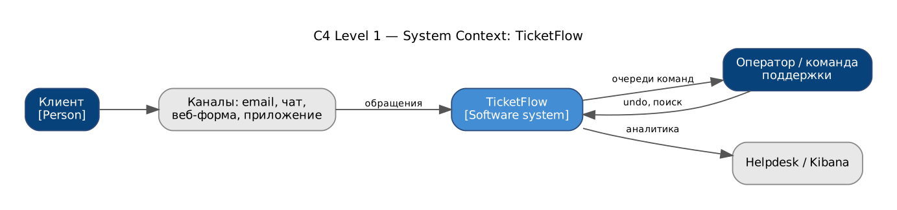

*Рисунок 1 — C4 Level 1 — System Context*

Архитектура «Ticket event stream + NLP classifier + routing service + search/analytics». Классификация и маршрутизация — разные сервисы: модель обновляется и масштабируется независимо от бизнес-правил.

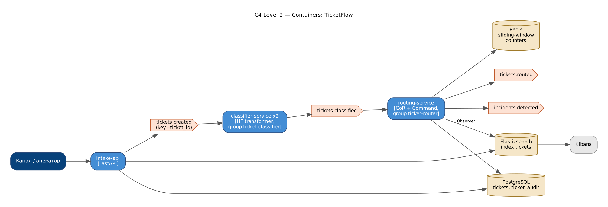

*Рисунок 2 — C4 Level 2 — Containers*

### Компоненты routing-service (C4 Level 3)

- **RouteHandler chain**: SecurityHandler → OutageHandler (Redis sliding window) → VipHandler → LowConfidenceHandler → CategoryHandler;
- **CommandInvoker**: исполнение команд AssignTeam / SetPriority / AddTag / LinkIncident, журнал, undo;
- **TicketEventBus** (Observer): SearchIndexer (Elasticsearch), SlaMonitor, KafkaPublisher, MetricsListener;
- **TicketRepository** (PostgreSQL), **SearchRepository** (Elasticsearch / in-memory).

*Таблица 3 — Точки отказа*

| Отказ | Поведение |
|---|---|
| Падение classifier-service | tickets.created копится, после рестарта дочитывается; другие экземпляры группы забирают партиции. |
| Низкая уверенность / непонятный текст | LowConfidenceHandler → l1_triage + тег needs_triage (человек в контуре). |
| Недоступен Redis | Детекция инцидентов падает в ретраи/DLQ; в проде — circuit breaker с пропуском OutageHandler. |
| Недоступен Elasticsearch | Индексация — подписчик Observer; ошибка индексации не должна ломать маршрутизацию (переиндексация из PostgreSQL). |
| Ошибочная авто-маршрутизация | Оператор вызывает undo — команды откатываются в обратном порядке, тикет уходит в триаж. |

## 5. Микросервисы и границы ответственности

*Таблица 4 — Сервисы*

| Сервис | Ответственность | Интерфейсы |
|---|---|---|
| intake-api | Приём обращений, синхронная обработка, просмотр тикета и аудита, undo, поиск, статистика | REST; tickets.created |
| classifier-service (×2) | Категория и приоритет (Strategy: ensemble HF + правила) | tickets.created → tickets.classified |
| routing-service | Бизнес-правила, команды, аудит, инциденты, индексация | tickets.classified → tickets.routed, incidents.detected; PostgreSQL, Redis, ES |
| trainer (офлайн) | Генерация корпуса, обучение TF-IDF и HF-модели, сравнение | models/ |

*Листинг 1 — Структура репозитория*

```
"report/\320\236\321\202\321\207\320\265\321\202_\320\237\321\200\320\276\320\265\320\272\321\2024_\320\232\320\273\320\260\321\201\321\201\320\270\321\204\320\270\320\272\320\260\321\206\320\270\321\217_\320\276\320\261\321\200\320\260\321\211\320\265\320\275\320\270\320\271_\320\246\320\260\321\200\321\214\320\272\320\276\320\262.docx"
"report/\320\236\321\202\321\207\320\265\321\202_\320\237\321\200\320\276\320\265\320\272\321\2024_\320\232\320\273\320\260\321\201\321\201\320\270\321\204\320\270\320\272\320\260\321\206\320\270\321\217_\320\276\320\261\321\200\320\260\321\211\320\265\320\275\320\270\320\271_\320\246\320\260\321\200\321\214\320\272\320\276\320\262.pdf"
.dockerignore
.gitattributes
.gitignore
Dockerfile
README.md
docker-compose.yml
docs/c4_container.dot
docs/c4_context.dot
docs/img/  (9 файлов)
loadtest/data.json
loadtest/load.js
models/hf_ticket_model/  (6 файлов)
models/metrics.json
models/tfidf_logreg.joblib
monitoring/grafana/  (3 файлов)
monitoring/prometheus.yml
requirements.txt
scripts/demo.ps1
scripts/demo.sh
services/__init__.py
services/intake_api/  (2 файлов)
services/workers.py
sql/schema.sql
tests/e2e/  (3 файлов)
tests/test_ticketflow.py
ticketflow/__init__.py
ticketflow/classify/  (3 файлов)
ticketflow/datagen.py
ticketflow/events.py
ticketflow/kafka_io.py
ticketflow/obs.py
ticketflow/routing/  (3 файлов)
ticketflow/service.py
ticketflow/storage/  (2 файлов)
ticketflow/train.py
```

## 6. Kafka: топики и сообщения

*Таблица 5 — Топики*

| Топик | Парт. | Ключ | Producer | Consumer group |
|---|---|---|---|---|
| tickets.created | 6 | ticket_id | intake-api | ticket-classifier |
| tickets.classified | 6 | ticket_id | classifier-service | ticket-router |
| tickets.routed | 6 | ticket_id | routing-service | helpdesk, уведомления |
| incidents.detected | 1 | incident_id | routing-service | дежурный SRE |
| tickets.created.dlq, tickets.classified.dlq | 1 | исходный | consumer'ы | ручной разбор |

*Листинг 2 — Сообщение tickets.routed (сокращено)*

```
{
  "ticket": {
    "ticket_id": "T-34570fa882",
    "category": "billing",
    "category_conf": 0.83,
    "priority": "high",
    "team": "billing_team",
    "tags": [
      "enterprise"
    ],
    "status": "assigned",
    "model": "ensemble"
  },
  "trace": [
    "vip",
    "category"
  ],
  "commands": [
    {
      "command": "add_tag",
      "tag": "enterprise"
    },
    {
      "command": "assign_team",
      "team": "billing_team",
      "reason": "category=billing"
    }
  ]
}
```

- **Порядок обработки**: ключ сообщения задаёт партицию, поэтому все события одной сущности обрабатываются строго по порядку одним consumer'ом группы; разные сущности обрабатываются параллельно.
- **At-least-once**: offset коммитится только после успешной обработки батча (`enable_auto_commit=False`); при падении consumer'а сообщения будут перечитаны.
- **Идемпотентность**: повторная доставка не создаёт дублей — запись в хранилище выполняется upsert'ом по естественному ключу.
- **Retries и DLQ**: обработчик повторяется до 3 раз; «ядовитое» сообщение после этого отправляется в топик `<topic>.dlq` с текстом ошибки и исходным payload и не блокирует партицию.
- **Producer**: `acks=all`, `retries=5`, `linger_ms=5` — подтверждение записи всеми репликами и небольшая пакетизация.
- Детектор массовых инцидентов использует Redis ZSET (скользящее окно 10 минут) — состояние общее для всех экземпляров routing-service.

## 7. Хранилища и индексы

*Таблица 6 — Выбор хранилищ*

| Хранилище | Данные | Почему |
|---|---|---|
| PostgreSQL | tickets, ticket_audit | транзакции, консистентный журнал команд |
| Redis | win:technical — ZSET временных меток | атомарный скользящий счётчик для всех экземпляров |
| Elasticsearch | индекс tickets (русский анализатор) | полнотекстовый поиск похожих обращений, агрегации для Kibana |

*Листинг 3 — sql/schema.sql*

```
-- TicketFlow: PostgreSQL (таблицы также создаются SQLAlchemy при старте)
CREATE TABLE IF NOT EXISTS tickets (
    ticket_id     VARCHAR(32) PRIMARY KEY,
    created_at    TIMESTAMPTZ NOT NULL,
    channel       VARCHAR(16) NOT NULL,
    customer_tier VARCHAR(16) NOT NULL,
    text          TEXT NOT NULL,
    category      VARCHAR(32),
    category_conf DOUBLE PRECISION DEFAULT 0,
    priority      VARCHAR(16),
    priority_conf DOUBLE PRECISION DEFAULT 0,
    team          VARCHAR(32),
    status        VARCHAR(16) NOT NULL,
    tags          JSONB NOT NULL DEFAULT '[]',
    incident_id   VARCHAR(32),
    model         VARCHAR(64)
);
CREATE INDEX IF NOT EXISTS ix_tickets_team_status ON tickets (team, status);    -- очередь команды
CREATE INDEX IF NOT EXISTS ix_tickets_priority_created ON tickets (priority, created_at);
CREATE INDEX IF NOT EXISTS ix_tickets_incident ON tickets (incident_id) WHERE incident_id IS NOT NULL;

CREATE TABLE IF NOT EXISTS ticket_audit (                -- журнал команд (Command pattern)
    id        BIGSERIAL PRIMARY KEY,
    ticket_id VARCHAR(32) NOT NULL,
    at        VARCHAR(40) NOT NULL,
    actor     VARCHAR(32) NOT NULL,
    command   VARCHAR(32) NOT NULL,
    details   JSONB NOT NULL
);
CREATE INDEX IF NOT EXISTS ix_audit_ticket ON ticket_audit (ticket_id, id);
```

*Листинг 4 — Маппинг Elasticsearch*

```
{
  "settings": {
    "analysis": {
      "analyzer": {
        "ru": {
          "type": "russian"
        }
      }
    }
  },
  "mappings": {
    "properties": {
      "text": {
        "type": "text",
        "analyzer": "russian"
      },
      "category": {
        "type": "keyword"
      },
      "team": {
        "type": "keyword"
      },
      "priority": {
        "type": "keyword"
      },
      "created_at": {
        "type": "date"
      },
      "tags": {
        "type": "keyword"
      }
    }
  }
}
```

Индексы: (team, status) — очередь команды; (priority, created_at) — контроль SLA; частичный индекс по incident_id; (ticket_id, id) в аудите — история тикета. Retention: тикеты — 3 года, ES-индекс — ILM с переводом в warm через 90 дней.

## 8. API

*Таблица 7 — Эндпоинты*

| Метод | Путь | Назначение |
|---|---|---|
| POST | /v1/tickets?mode=sync\|async | новое обращение |
| POST | /v1/classify | предпросмотр классификации |
| GET | /v1/tickets/{id} | тикет, журнал команд, SLA |
| POST | /v1/tickets/{id}/undo-routing | отмена авто-маршрутизации |
| GET | /v1/search?q=&team= | похожие обращения |
| GET | /v1/stats | распределения и сработавшие правила |
| GET | /health | статус и активный классификатор |

Ошибки: 422 — слишком короткий текст или неверный tier/channel; 404 — тикет не найден. Авторизация в проде — через API-шлюз (сервисные токены каналов).

*Листинг 5 — Пример: security-правило перехватывает тикет*

```
POST /v1/tickets
{"text": "После оплаты пришло письмо от вашего имени с просьбой ввести пароль, это фишинг?"}

HTTP 201
{
  "ticket": {
    "category": "security",
    "priority": "high",
    "team": "security_team",
    "tags": [
      "security"
    ]
  },
  "trace": [
    "security"
  ],
  "commands": [
    {
      "command": "assign_team",
      "team": "security_team",
      "reason": "security signal"
    },
    {
      "command": "add_tag",
      "tag": "security"
    }
  ]
}
```

## 9. Применённые паттерны

### 9.1 Strategy — классификаторы

Keyword, TF-IDF+LogReg, HF-transformer и Ensemble реализуют predict_proba(texts, tiers). Выбор — переменная CLASSIFIER. EnsembleStrategy — композиция стратегий с отдельными весами для категории и приоритета.

```
class EnsembleStrategy(ClassifierStrategy):
    """Композиция стратегий: взвешенное среднее вероятностей, веса отдельно для категории и приоритета.

    Модель хорошо работает на знакомых формулировках, правила — устойчивее на новых;
    ансамбль сохраняет точность модели и не «проваливается» на новых формулировках.
    """

    name = "ensemble"

    def __init__(self, parts: list[tuple[ClassifierStrategy, float, float]]) -> None:
        self.parts = parts  # (strategy, w_category, w_priority)

    def predict_proba(self, texts, tiers=None):
        pc = pp = 0
        for st, wc, wp in self.parts:
            a, b = st.predict_proba(texts, tiers)
            pc, pp = pc + wc * a, pp + wp * b
        return pc / sum(w for _, w, _ in self.parts), pp / sum(w for _, _, w in self.parts)
```

### 9.2 Chain of Responsibility — маршрутизация

```
class OutageHandler(RouteHandler):
    """Всплеск однотипных технических тикетов → массовый инцидент: приоритет critical, привязка к инциденту."""

    name = "outage"

    def __init__(self, counters: CounterStore, threshold: int = 8, window_s: float = 600, clock=time.time) -> None:
        super().__init__()
        self.counters, self.threshold, self.window, self.clock = counters, threshold, window_s, clock
        self.incidents: dict[str, str] = {}

    def handle(self, ctx):
        t = ctx.ticket
        if t.category == "technical":
            now = self.clock()
            n = self.counters.hit("technical", now, self.window)
            if n >= self.threshold:
                bucket = int(now // self.window)
                inc = self.incidents.setdefault(f"technical:{bucket}", f"INC-{bucket}")
                ctx.commands += [LinkIncidentCommand(inc), SetPriorityCommand("critical", f"{n} tech tickets / {int(self.window)}s"),
                                 AddTagCommand("mass_incident")]
                ctx.trace.append(self.name)
        return super().handle(ctx)
```

### 9.3 Command — действия над тикетом с undo и аудитом

Маршрутизатор не меняет тикет напрямую — он формирует команды; CommandInvoker исполняет их, пишет журнал и умеет откатывать. Это даёт прозрачность («почему тикет попал в эту команду») и безопасную отмену.

```
class SetPriorityCommand(TicketCommand):
    name = "set_priority"

    def __init__(self, priority: str, reason: str) -> None:
        assert priority in PRIORITIES
        self.priority, self.reason, self._prev = priority, reason, None

    def execute(self, t):
        self._prev, t.priority = t.priority, self.priority

    def undo(self, t):
        t.priority = self._prev

def undo_all(self, t: Ticket, actor: str = "operator") -> int:
    cmds = self._history.pop(t.ticket_id, [])
    for c in reversed(cmds):
        c.undo(t)
        self.audit.append({"ticket_id": t.ticket_id, "actor": actor, "at": datetime.now(timezone.utc).isoformat(),
                           "command": f"undo_{c.name}"})
    return len(cmds)
```

### 9.4 Observer — события тикета

```
class SlaMonitor(TicketListener):
    def __init__(self) -> None:
        self.deadlines: dict[str, str] = {}

    def on_event(self, event, ticket, meta):
        if event == "routed" and ticket.get("priority"):
            created = datetime.fromisoformat(ticket["created_at"])
            self.deadlines[ticket["ticket_id"]] = (created + timedelta(minutes=SLA_MINUTES[ticket["priority"]])).isoformat()
```

### 9.5 Repository

TicketRepository (SQLAlchemy, PostgreSQL/SQLite) и SearchRepository (ElasticSearchRepository / InMemorySearch) — сервисы работают с интерфейсами, тесты — с лёгкими реализациями.

## 10. Docker и запуск

*Листинг 6 — Dockerfile*

```
FROM python:3.11-slim
ENV PYTHONDONTWRITEBYTECODE=1 PYTHONUNBUFFERED=1
WORKDIR /app
RUN pip install --no-cache-dir torch --index-url https://download.pytorch.org/whl/cpu
COPY requirements.txt .
RUN pip install --no-cache-dir -r requirements.txt
COPY ticketflow ./ticketflow
COPY services ./services
COPY models ./models
COPY tests ./tests
EXPOSE 8000
CMD ["uvicorn", "services.intake_api.app:app", "--host", "0.0.0.0", "--port", "8000"]
```

*Листинг 7 — Фрагмент docker-compose.yml*

```
x-app: &app
  build: .
  image: ticketflow:latest
  environment:
    KAFKA_BOOTSTRAP: kafka:9092
    DATABASE_URL: postgresql+psycopg://tf:tf@postgres:5432/tickets
    REDIS_URL: redis://redis:6379/0
    ELASTICSEARCH_URL: http://elasticsearch:9200
    CLASSIFIER: ensemble                # keywords | tfidf_logreg | hf_transformer | ensemble
    MODEL_PATH: /app/models/hf_ticket_model
    MIN_CONFIDENCE: "0.55"
    METRICS_PORT: "9100"
    API_URL: http://api:8000
    OMP_NUM_THREADS: "1"
  depends_on:
    kafka-init: { condition: service_completed_successfully }
    postgres: { condition: service_healthy }
  ...
    elasticsearch: { condition: service_healthy }
  restart: unless-stopped

services:
  kafka:
    image: apache/kafka:3.8.0
    hostname: kafka
    environment:
      KAFKA_NODE_ID: 1
      KAFKA_PROCESS_ROLES: broker,controller
      KAFKA_LISTENERS: PLAINTEXT://:9092,CONTROLLER://:9093
```

*Листинг 8 — Запуск*

```
git clone https://github.com/nesssleh/support-ticket-routing && cd support-ticket-routing
docker compose up -d --build
curl -X POST localhost:8000/v1/tickets -H 'Content-Type: application/json' \
     -d '{"text":"Списали деньги дважды за подписку","customer_tier":"pro"}'
# Swagger: http://localhost:8000/docs ; Kibana: http://localhost:5601

pip install -r requirements.txt
python -m ticketflow.train && pytest -q
```

Помимо прикладных сервисов docker-compose поднимает **Prometheus** (с приёмом remote write от k6), **Grafana** с готовым дашбордом, **kafka-exporter** (lag consumer groups) и init-контейнер, создающий топики. Профили запускаются отдельно: `--profile e2e` — e2e-тесты внутри docker-сети, `--profile load` — нагрузочный тест k6. API запускается несколькими процессами uvicorn с общими метриками (multiprocess-режим Prometheus). Весь сценарий демонстрации собран в `scripts/demo.ps1` (Windows) и `scripts/demo.sh` (Linux/macOS): запуск, ожидание healthcheck, `docker compose ps`, состав docker-сети, топики Kafka, e2e-тесты, нагрузка, `docker stats`, lag consumer groups, логи. Всё сохраняется в папку `evidence/`.

## 11. Тестирование и результаты

*Таблица 8 — Тестовые сценарии (10 тестов, все проходят)*

| Тест | Что проверяет |
|---|---|
| test_datagen_labels | все категории и маршруты в данных |
| test_commands_undo | исполнение и откат 3 команд, журнал |
| test_chain_security_overrides_model | security-сигнал важнее категории модели |
| test_chain_low_confidence_to_triage | низкая уверенность → l1_triage |
| test_chain_vip_and_category | enterprise SLA + маршрут по категории |
| test_outage_detection | N технических тикетов в окне → инцидент |
| test_keyword_baseline | baseline |
| test_pipeline_via_kafka | created → classified → routed, DLQ, аудит, поиск |
| test_hf_strategy | HF-модель предсказывает категорию |
| test_api | создание, аудит, SLA, undo, поиск, 404/422 |

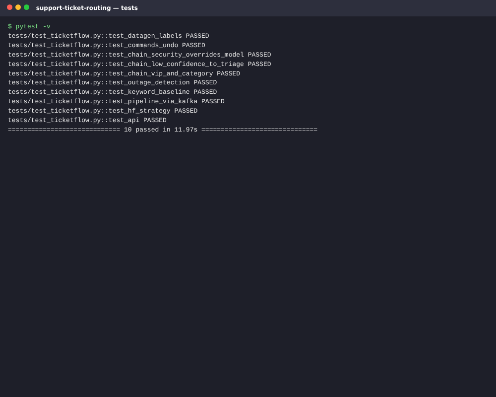

*Рисунок 3 — Результат запуска тестов*

### Мониторинг: Prometheus + Grafana

Каждый сервис отдаёт метрики Prometheus: API — через middleware (счётчик и гистограмма длительности по шаблону пути, `/metrics`; при нескольких процессах uvicorn — multiprocess-режим), Kafka-воркеры — HTTP-сервер метрик на порту 9100 (обработанные сообщения, время обработки, ретраи, DLQ по consumer group). Lag consumer groups и offset'ы топиков снимает kafka-exporter. Prometheus находит все реплики воркеров через DNS service discovery docker-сети. Grafana поднимается с готовым источником данных и дашбордом «overview» (provisioning из `monitoring/`).

*Таблица 9 — Дашборд Grafana «overview»*

| Блок | Панели |
|---|---|
| k6 | RPS, виртуальные пользователи, латентность p50/p95/p99 на стороне клиента, доля ошибок |
| API | RPS по эндпоинтам, латентность p50/p95/p99 (гистограмма на сервере), ошибки 4xx/5xx |
| Kafka | входящий поток по топикам, обработка по consumer group, consumer lag (kafka-exporter), время обработки p95, ретраи и DLQ, число живых реплик воркеров |
| Маршрутизация | тикеты по командам в секунду, сработавшие правила цепочки, распределение по приоритетам |

### E2E-тесты против живого стека

Контейнер `e2e` собирается из того же образа, подключается к той же docker-сети и обращается к сервисам по их именам (`docker compose --profile e2e run --rm e2e`). Тесты проверяют, что топики и consumer groups созданы, и проводят событие через весь асинхронный конвейер: подписываются на выходной топик до отправки, ждут сообщение и проверяют результат в базах данных через API.

*Таблица 10 — E2E-тесты (tests/e2e/test_live.py)*

| Тест | Что проверяет |
|---|---|
| test_api_healthy | API и классификатор |
| test_kafka_topics_and_consumer_groups | группы ticket-classifier, ticket-router |
| test_async_ticket_through_kafka | тикет → классификация → маршрут → tickets.routed, аудит в PostgreSQL |
| test_security_rule_undo_and_search | security-правило, undo, поиск в Elasticsearch, 422 |

### Нагрузочное тестирование (k6)

Скрипт `loadtest/load.js` запускается контейнером grafana/k6 (`docker compose --profile load run --rm k6`). Метрики k6 отправляются в Prometheus через remote write и отображаются на том же дашборде, что и метрики сервисов и Kafka: видно, как рост нагрузки отражается на латентности API, потоке сообщений и lag consumer groups. Пороги k6 (thresholds) задают SLO, итог сохраняется в `evidence/k6_summary.json`.

*Таблица 11 — Сценарии нагрузки*

| Сценарий | Что делает | Профиль |
|---|---|---|
| async | обращение через Kafka: classifier-service ×2 → routing-service ×2 | рост 10 → 80 тикетов/с |
| sync | классификация и маршрутизация внутри API | 5 RPS |
| search | поиск похожих обращений (Elasticsearch) | 3 RPS |

**Контрольный прогон.** До сдачи все сервисы проекта были запущены отдельными процессами с теми же настройками, что в docker-compose (несколько uvicorn-процессов, по 2 реплики воркеров), против брокера с протоколом Kafka (franz-go kfake), PostgreSQL/PostGIS/pgvector и Redis. Сервисы, k6 и Prometheus работали на одной машине с 2 ядрами CPU, поэтому абсолютные значения латентности — оценка снизу. Итоговые графики Grafana и логи `evidence/` фиксируются запуском `scripts/demo.ps1` в Docker.

*Таблица 12 — Результаты контрольного прогона*

| Показатель | Значение |
|---|---|
| Всего запросов / ошибки | 10 288 / 0 % |
| Приём обращения (async) median / p95 | 22 мс / 594 мс (CPU занят классификатором на тех же 2 ядрах) |
| Классификатор, сообщений/с | 20 → 58 после батчевого инференса |
| Тикет через Kafka до tickets.routed (e2e) | 0.3 с |

Что выявила нагрузка и что исправлено:

- Kafka-producer создавался на каждый асинхронный запрос: p95 приёма 8.7 с при 30 RPS. После переиспользования producer'а — p95 0.6 с при 57 RPS.
- Классификатор обрабатывал сообщения по одному. Добавлена батчевая обработка (handle_batch) — модель прогоняется на всей пачке из poll(), пропускная способность выросла почти в 3 раза; при ошибке пачки — откат на поштучную обработку и DLQ.
- Отмена маршрутизации хранила историю команд в памяти одного процесса — с несколькими процессами API отмена теряется. Снимок «до маршрутизации» теперь пишется в журнал (ticket_audit), отмена работает в любом экземпляре.
- Локальный поиск (замена Elasticsearch для тестов) не был потокобезопасен — добавлены блокировка и инкрементальная векторизация.
- routing-service масштабирован до 2 реплик: счётчики инцидентов в Redis, снимки в PostgreSQL.

## 12. Демонстрация работы

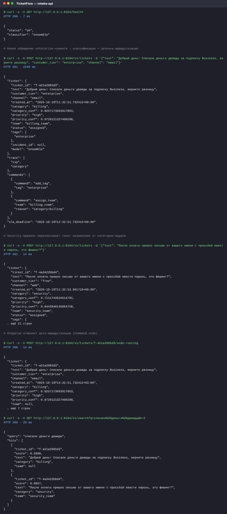

*Рисунок 4 — Работа API: классификация + цепочка правил, security-перехват, undo, поиск*

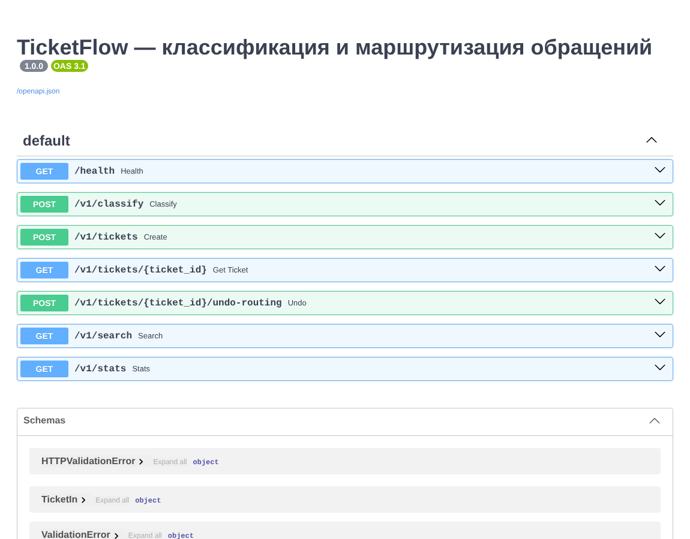

*Рисунок 5 — Swagger UI TicketFlow*

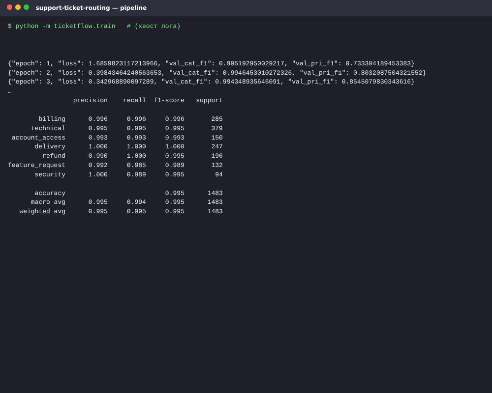

*Рисунок 6 — Лог обучения и classification report*

## 13. ML/NLP-часть

### Датасет

Генератор ticketflow/datagen.py: 12 000 обращений на русском по 7 категориям (6–8 шаблонов формулировок на категорию с подстановками)  разговорный стиль  опечатки (перестановки  пропуски и удвоения букв)  нижний регистр  смешанные темы («И ещё: …»)  маркеры срочности  хвосты-«шум» («вся команда не может работать») независимо от метки. Приоритет зависит от категории  срочности  тарифа клиента  признаков массового сбоя и содержит 8% шума разметки операторов.

Разбиение: train 7170, val 1024, test 1483 (точные дубликаты текста с train удалены) и отдельный срез **test_unseen** (1757) — обращения по шаблонам формулировок, которых вообще не было в обучении (последний шаблон каждой категории). Это проверка устойчивости к новым формулировкам.

*Таблица 13 — Распределение классов*

| Категория / приоритет | Количество |
|---|---|
| billing | 2416 |
| technical | 2925 |
| account_access | 1590 |
| delivery | 1876 |
| refund | 1528 |
| feature_request | 944 |
| security | 721 |
| priority=low | 881 |
| priority=medium | 6436 |
| priority=high | 3822 |
| priority=critical | 861 |

### Модели

- **Keywords** — словари ключевых слов на категорию, приоритет по маркерам срочности и тарифу.
- **TF-IDF + LogReg** — слова (1–2-граммы) + символьные 3–5-граммы, тариф клиента как токен, две логистические регрессии.
- **HF transformer** — BertModel из transformers: 2 слоя  hidden 128  2 головы внимания  собственный WordPiece-токенизатор (6 000 токенов  библиотека tokenizers)  mean pooling и две головы (категория  приоритет)  суммарная cross-entropy; AdamW + OneCycle  6 эпох  859 403 параметров  обучение 12 мин на CPU.
- **Ensemble** — среднее вероятностей HF и keywords для категории (0.5/0.5), приоритет — только HF.

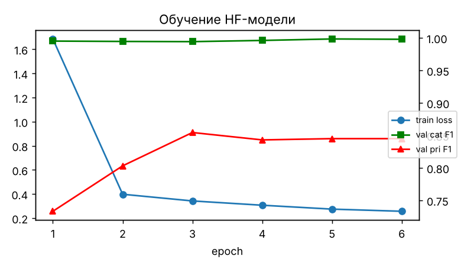

*Рисунок 7 — Обучение HF-модели*

*Таблица 14 — Результаты (macro-F1; recall для high+critical)*

| Модель | Категория test | Приоритет test | Recall high+crit | Категория unseen | мс/тикет |
|---|---|---|---|---|---|
| Ключевые слова (baseline) | 0.759 | 0.612 | 0.933 | 0.897 | 0.024 |
| TF-IDF + LogReg (baseline) | 0.978 | 0.828 | 0.927 | 0.232 | 0.131 |
| HF transformer | 0.995 | 0.860 | 0.956 | 0.255 | 0.848 |
| Ансамбль HF + правила | 0.991 | 0.860 | 0.956 | 0.819 | 0.616 |

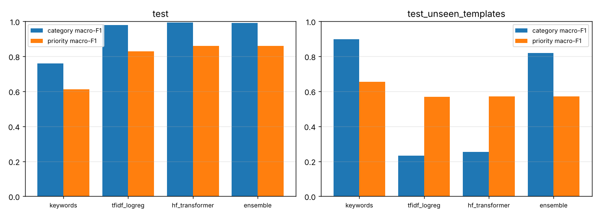

*Рисунок 8 — Сравнение моделей на test и на новых формулировках*

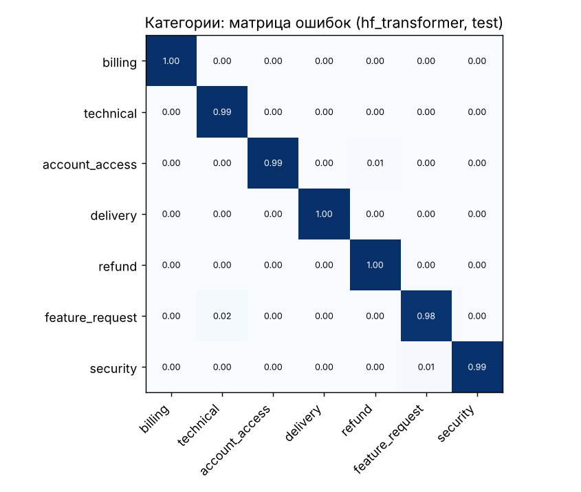

*Рисунок 9 — Матрица ошибок категорий (HF, test)*

**Главный вывод.** На знакомых формулировках HF-модель лучше всех (категория 0.995, приоритет 0.860), но на формулировках, которых не было в обучении, обе ML-модели проваливаются до 0.232–0.255: при 6–8 шаблонах на класс модель запоминает формулировки. Правила устойчивее (0.897), но слабее в целом. Ансамбль сохраняет качество модели на test (0.991) и поднимает категорию на новых формулировках до 0.819 — он выбран для продакшена. Остаточные ошибки дополнительно ловит LowConfidenceHandler (ручной триаж).

### Ограничения

- Синтетический корпус беднее реального; основная мера — дообучение на реальных обращениях и старт с предобученного rubert-tiny2 (init_from).
- Приоритет частично непредсказуем по тексту (шум разметки, внешние факторы) — потолок качества ниже, чем у категории.
- История undo хранится в памяти процесса routing-service; для нескольких экземпляров её нужно восстанавливать из ticket_audit.

## 14. RL-часть

Не применимо.

## 15. Выводы и распределение работы

- Реализован сервис классификации и маршрутизации обращений: Kafka-конвейер created → classified → routed, HF-модель с двумя головами, цепочка бизнес-правил, команды с аудитом и undo, детекция массовых инцидентов в Redis, поиск в Elasticsearch, docker-compose с Kibana.
- Категория определяется с macro-F1 0.991, приоритет — 0.860; полнота для high/critical — 0.956.
- Честная проверка на новых формулировках выявила переобучение на шаблоны; ансамбль с правилами исправляет это без потери качества.
- Паттерны: Strategy, Chain of Responsibility, Command, Observer, Repository.
- Развитие: предобученный энкодер, активное обучение на исправлениях операторов (undo → метка), автоматическое закрытие дубликатов.

*Таблица 15 — Распределение работы (проект выполнен индивидуально)*

| Работа | Исполнитель |
|---|---|
| Постановка задачи, требования, архитектура (C4) | Царьков Артём |
| Реализация микросервисов, Kafka-контракты, хранилища | Царьков Артём |
| Данные, модель, обучение и оценка | Царьков Артём |
| API, Docker/docker-compose, тесты | Царьков Артём |
| Отчёт, README, демонстрация | Царьков Артём |

## Маршрутизация обращений в Grafana

Локальный демонстрационный прогон TicketFlow. Сгенерированные обращения классифицировала KeywordStrategy, затем цепочка правил назначала команду и приоритет. MetricsListener регистрировал исполненные маршруты. Prometheus опрашивал процесс каждые 3 секунды. На снимках показаны панели дашборда overview за последние 5 минут.

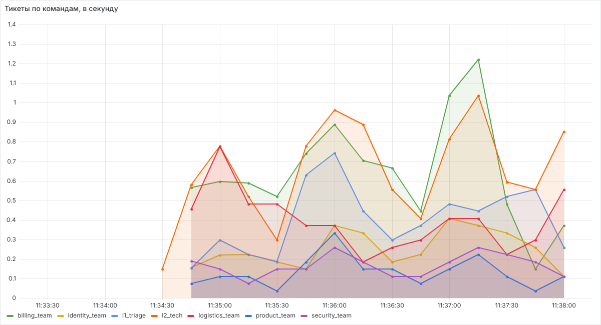

Команды поддержки. Для каждой команды показана скорость изменения ticketflow_routed_total за 30 секунд, в обращениях в секунду. Линии помогают увидеть, куда в этот момент направлялся поток.

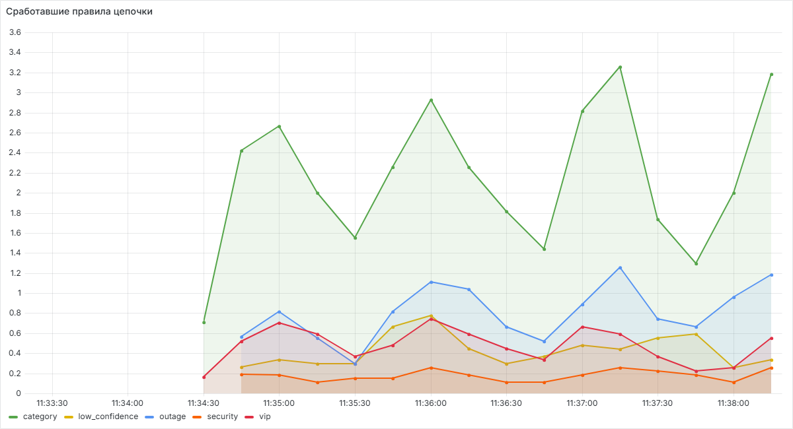

Правила маршрутизации. Скорость изменения ticketflow_rules_fired_total сгруппирована по rule. В показанном окне чаще всего срабатывало правило category.

## Распределение обращений по приоритету

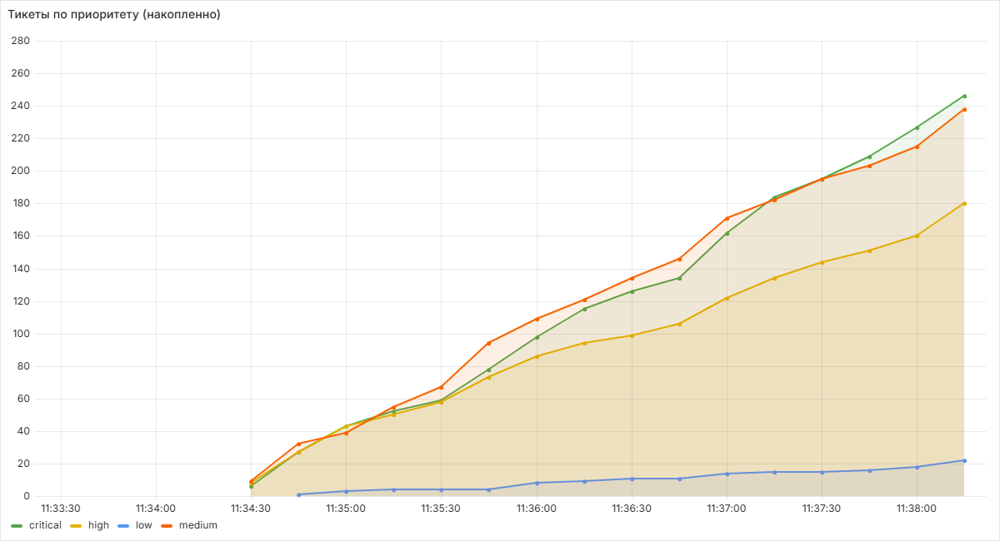

На панели суммируется ticketflow_routed_total по priority с начала работы процесса. Наклон линии показывает, как быстро поступают новые обращения данного приоритета. В показанном интервале критических обращений накопилось меньше всего.

Снимки характеризуют прикладной маршрут локального прогона. Для оценки пропускной способности API, задержки Kafka и качества обученного классификатора нужны отдельные измерения.
