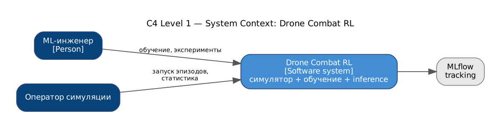
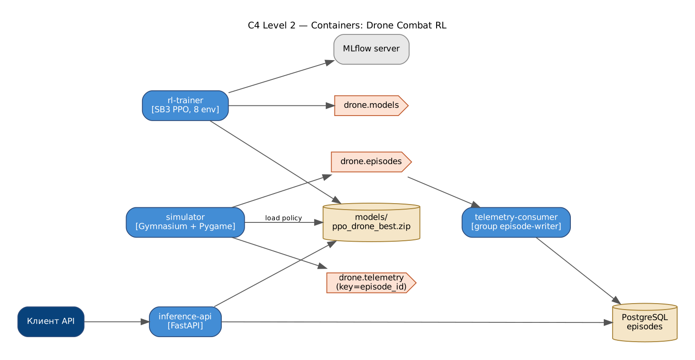
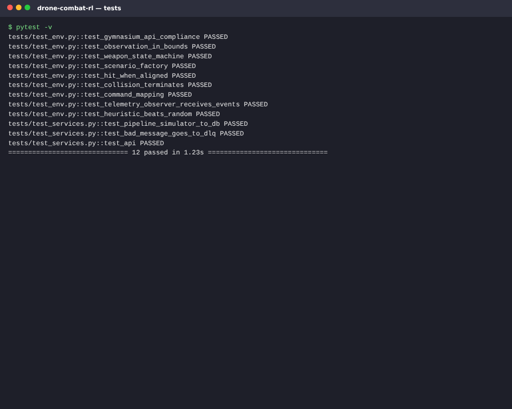
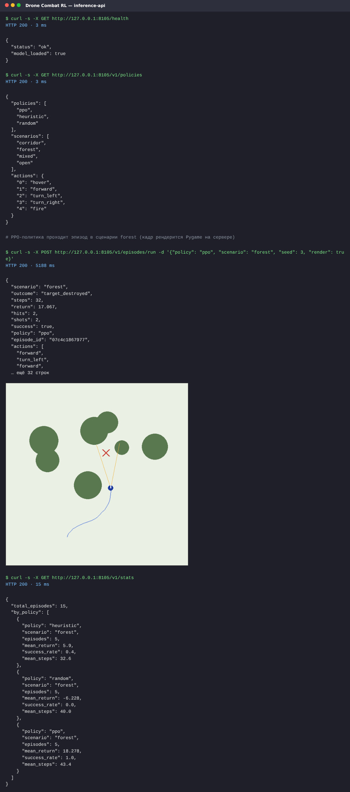
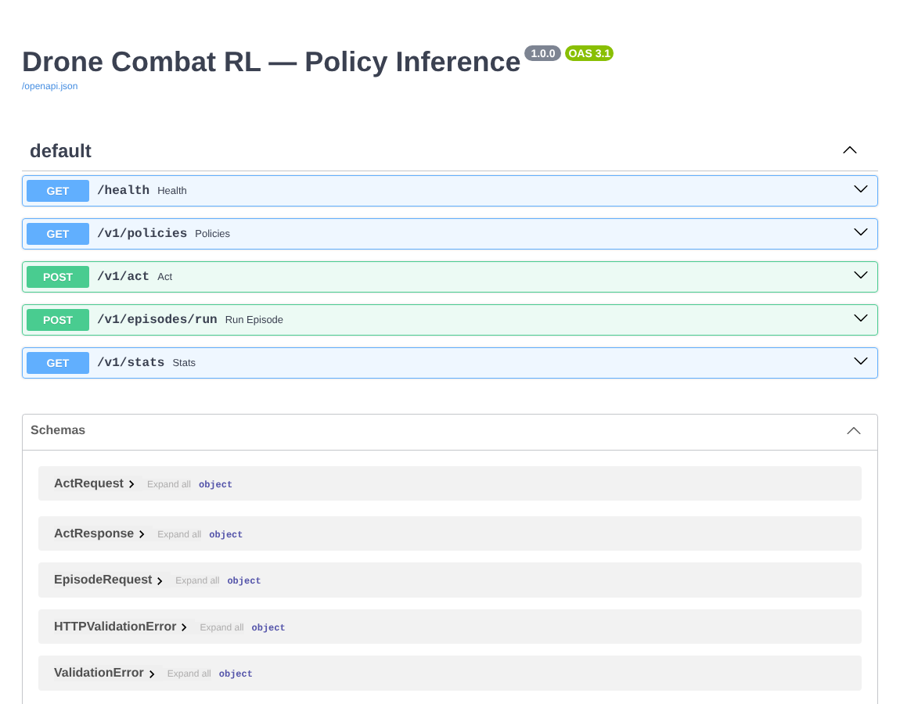
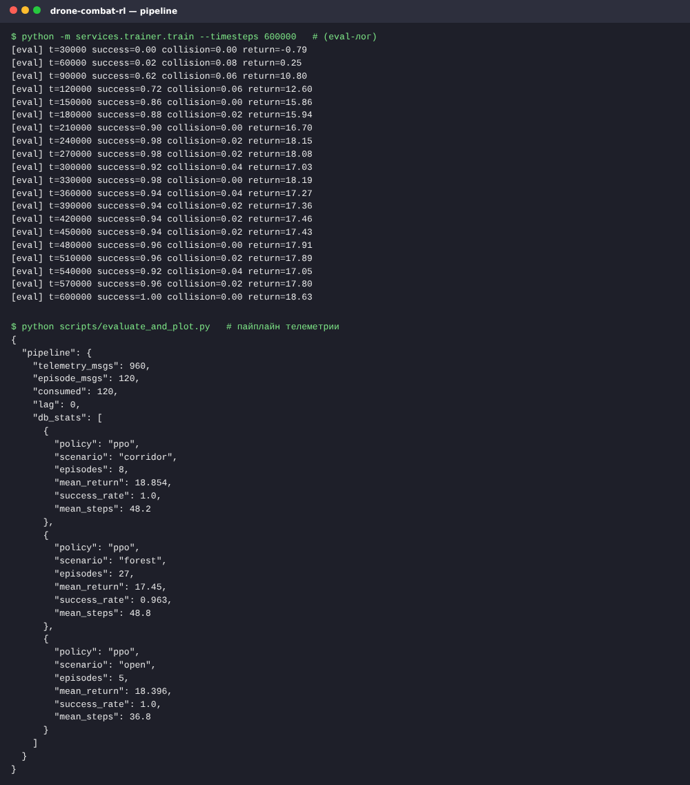
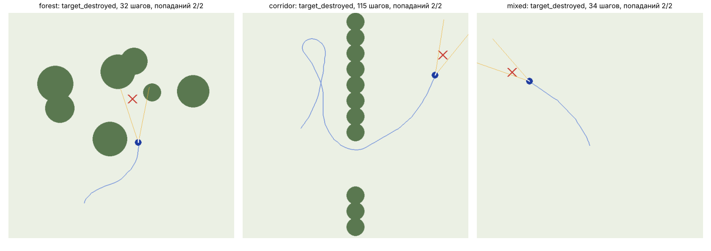
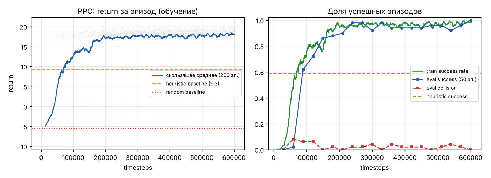
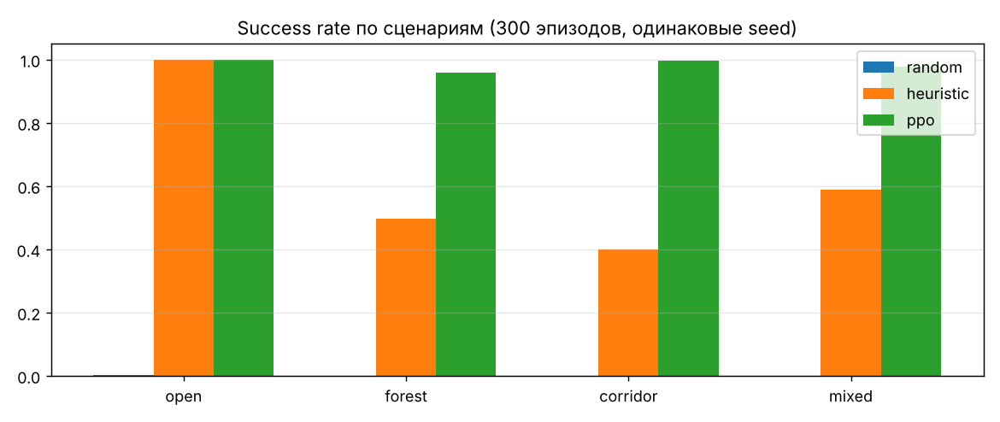

# RL для игры с боевым дроном в 2D

**Отчёт по проекту №5** · Проектный практикум · 2026

- **Выполнил:** Царьков Артём
- **Репозиторий:** github.com/godor1333/Software_architecture_2025_API, projects/Tsarkov_Artem/5_rl-dlya-igry-s-boevym-dronom-v-2d

Также: PDF и Word-версии отчёта в папке [`report/`](report/).

## Содержание

- [1. Цель и проблема проекта](#1-цель-и-проблема-проекта)
- [2. Требования и ограничения](#2-требования-и-ограничения)
- [3. Входные и выходные данные](#3-входные-и-выходные-данные)
- [4. Архитектура](#4-архитектура)
- [5. Микросервисы и границы ответственности](#5-микросервисы-и-границы-ответственности)
- [6. Kafka: топики и сообщения](#6-kafka-топики-и-сообщения)
- [7. Хранилище и индексы](#7-хранилище-и-индексы)
- [8. API](#8-api)
- [9. Применённые паттерны](#9-применённые-паттерны)
- [10. Docker и запуск](#10-docker-и-запуск)
- [11. Тестирование и результаты](#11-тестирование-и-результаты)
- [12. Демонстрация работы](#12-демонстрация-работы)
- [13. ML-часть](#13-ml-часть)
- [14. RL-часть](#14-rl-часть)
- [15. Выводы и распределение работы](#15-выводы-и-распределение-работы)

## 1. Цель и проблема проекта

Ручное программирование поведения боевого дрона (конечные автоматы, «наведись и лети») плохо справляется с препятствиями и с выбором момента атаки при ограниченном боезапасе: простая эвристика либо врезается в препятствия, либо тратит выстрелы впустую. Обучение с подкреплением позволяет получить политику, которая сама находит компромисс между скоростью сближения, облётом препятствий и точностью атаки.

**Цель** — разработать 2D-симулятор боевого дрона (Gymnasium + Pygame), обучить агента (PPO, Stable-Baselines3) **двигаться к цели, избегать препятствий и выбирать момент атаки**, сравнить с baseline'ами и обернуть в систему: тренер с MLflow, сервис инференса политики, симулятор с потоковой телеметрией в Kafka и хранилищем статистики.

Репозиторий: <https://github.com/godor1333/Software_architecture_2025_API/tree/main/projects/Tsarkov_Artem/5_rl-dlya-igry-s-boevym-dronom-v-2d>

## 2. Требования и ограничения

1. Среда с Gymnasium API (проходит gymnasium.utils.env_checker), детерминированная по seed.
2. Несколько сценариев карт (открытая местность, лес, коридор, смешанный) для обучения и оценки обобщения.
3. Обучение PPO с логированием в MLflow и сохранением лучшей модели по валидации.
4. Сравнение с random и эвристическим baseline'ами на одинаковых seed.
5. API инференса: действие по наблюдению, прогон эпизода с кадром, статистика.
6. Телеметрия шагов и итогов эпизодов в Kafka, запись итогов в PostgreSQL.

- Обучение на CPU за минуты (без GPU); инференс < 1 мс на шаг.
- Ограничение: 2D-упрощение — кинематическая модель без аэродинамики, цель — наземный объект с простым движением; задача учебная/исследовательская (симулятор и обучение политики).
- Ограничение среды: демо без Docker-демона — Kafka заменена брокером в памяти с той же семантикой; MLflow — локальный backend SQLite; PostgreSQL реальный.

## 3. Входные и выходные данные

*Таблица 1 — Наблюдение (state), 17 признаков в [-1, 1]*

| Признак | Описание |
|---|---|
| speed | скорость / max |
| dist | расстояние до цели (норм.) |
| sin(angle), cos(angle) | угол на цель относительно курса |
| weapon_ready | оружие готово (State) |
| ammo | остаток боезапаса |
| target_hp | здоровье цели |
| line_of_sight | цель в прямой видимости |
| rays[9] | дальномеры 180° перед дроном, до 30 м (препятствия и границы) |

*Таблица 2 — Действия (Discrete(5)) и выход*

| Действие / выход | Описание |
|---|---|
| 0 hover | торможение |
| 1 forward | ускорение |
| 2/3 turn | поворот на 12° |
| 4 fire | выстрел: попадание, если цель ≤ 25 м, в секторе ±15° и видна |
| Итог эпизода | outcome (target_destroyed / collision / out_of_ammo / timeout), шаги, return, попадания/выстрелы |
| Телеметрия | по шагам: действие, координаты, курс, расстояние, награда, состояние оружия |

## 4. Архитектура



*Рисунок 1 — C4 Level 1 — System Context*

Архитектура «Simulator + RL trainer + policy inference + telemetry/events»: тренер обучает политику и регистрирует модель (MLflow, топик drone.models); симулятор прогоняет эпизоды выбранной политикой и пишет телеметрию в Kafka; consumer сохраняет итоги эпизодов в PostgreSQL; inference-api отдаёт действия и статистику.



*Рисунок 2 — C4 Level 2 — Containers*

### Компоненты среды (C4 Level 3)

- **DroneCombatEnv** (Gymnasium) — физика, награда, лучи, видимость;
- **ScenarioFactory** → OpenScenario / ForestScenario / CorridorScenario / MixedScenario;
- **Weapon** с состояниями ReadyState / ReloadingState / EmptyState;
- **ACTION_TO_COMMAND**: HoverCommand, ForwardCommand, TurnCommand, FireCommand;
- **TelemetrySubject** → KafkaTelemetryObserver, StatsObserver, MemoryObserver;
- **PolicyStrategy** → RandomPolicy, HeuristicPolicy, PPOPolicy.

*Таблица 3 — Точки отказа*

| Отказ | Поведение |
|---|---|
| Ошибка наблюдателя телеметрии | TelemetrySubject ловит исключение подписчика — симуляция не прерывается. |
| Падение telemetry-consumer | Итоги копятся в drone.episodes, дочитываются после рестарта; upsert по episode_id. |
| Нет файла модели | inference-api: /health model_loaded=false, запросы к ppo → 503; heuristic/random доступны. |
| Невалидное наблюдение | 422 (длина ≠ 17). |

## 5. Микросервисы и границы ответственности

*Таблица 4 — Сервисы*

| Сервис | Ответственность | Интерфейсы |
|---|---|---|
| rl-trainer | Обучение PPO в 8 параллельных средах, периодическая оценка, лучшая модель, MLflow | models/, MLflow, drone.models |
| simulator | Прогон эпизодов политикой, публикация телеметрии | drone.telemetry, drone.episodes |
| telemetry-consumer | Запись итогов эпизодов | drone.episodes → PostgreSQL |
| inference-api | Действие политики, прогон эпизода с кадром, статистика | REST; модели, PostgreSQL |
| mlflow | Трекинг экспериментов: параметры, метрики, артефакты | HTTP :5000 |

*Листинг 1 — Структура репозитория*

```
"report/\320\236\321\202\321\207\320\265\321\202_\320\237\321\200\320\276\320\265\320\272\321\2025_RL_\320\261\320\276\320\265\320\262\320\276\320\271_\320\264\321\200\320\276\320\275_\320\246\320\260\321\200\321\214\320\272\320\276\320\262.docx"
"report/\320\236\321\202\321\207\320\265\321\202_\320\237\321\200\320\276\320\265\320\272\321\2025_RL_\320\261\320\276\320\265\320\262\320\276\320\271_\320\264\321\200\320\276\320\275_\320\246\320\260\321\200\321\214\320\272\320\276\320\262.pdf"
.dockerignore
.gitattributes
.gitignore
Dockerfile
README.md
docker-compose.yml
docs/c4_container.dot
docs/c4_context.dot
docs/img/  (9 файлов)
drone_rl/__init__.py
drone_rl/env/  (6 файлов)
drone_rl/evaluate.py
drone_rl/obs.py
drone_rl/policies/  (2 файлов)
drone_rl/storage.py
drone_rl/telemetry/  (3 файлов)
loadtest/load.js
models/eval_history.json
models/final_eval.json
models/ppo_drone_best.zip
models/ppo_drone_last.zip
models/train_episodes.csv
models/train_info.json
monitoring/grafana/  (3 файлов)
monitoring/prometheus.yml
requirements.txt
scripts/demo.ps1
scripts/demo.sh
scripts/evaluate_and_plot.py
services/__init__.py
services/inference/  (2 файлов)
services/simulator/  (2 файлов)
services/telemetry_consumer/  (2 файлов)
services/trainer/  (2 файлов)
sql/schema.sql
tests/e2e/  (3 файлов)
tests/test_env.py
tests/test_services.py
```

## 6. Kafka: топики и сообщения

*Таблица 5 — Топики*

| Топик | Парт. | Ключ | Producer | Consumer group |
|---|---|---|---|---|
| drone.telemetry | 6 | episode_id | simulator | аналитика / replay |
| drone.episodes | 3 | episode_id | simulator | episode-writer |
| drone.models | 1 | ppo | rl-trainer | inference-api (перезагрузка модели) |
| drone.episodes.dlq | 1 | исходный | consumer | ручной разбор |

*Листинг 2 — Сообщения*

```
drone.telemetry:
{
  "type": "step",
  "episode_id": "07c4c1867977",
  "step": 15,
  "payload": {
    "action": "turn_left",
    "x": 41.2,
    "y": 63.9,
    "heading": 4.712,
    "dist": 22.4,
    "reward": 0.0952,
    "weapon": "ready"
  },
  "ts": 1792403417.5
}

drone.episodes:
{
  "type": "episode_end",
  "episode_id": "07c4c1867977",
  "step": 32,
  "payload": {
    "scenario": "forest",
    "outcome": "target_destroyed",
    "steps": 32,
    "return": 17.067,
    "hits": 2,
    "shots": 2,
    "success": true,
    "policy": "ppo"
  }
}
```

Ключ episode_id гарантирует, что все шаги эпизода лежат в одной партиции по порядку (проверяется тестом). Шаги можно прореживать (sample_every=5) — объём телеметрии регулируется без изменения среды. В демо-прогоне 120 эпизодов дали 960 сообщений телеметрии и 120 итогов, lag группы после обработки — 0.

- **Порядок обработки**: ключ сообщения задаёт партицию, поэтому все события одной сущности обрабатываются строго по порядку одним consumer'ом группы; разные сущности обрабатываются параллельно.
- **At-least-once**: offset коммитится только после успешной обработки батча (`enable_auto_commit=False`); при падении consumer'а сообщения будут перечитаны.
- **Идемпотентность**: повторная доставка не создаёт дублей — запись в хранилище выполняется upsert'ом по естественному ключу.
- **Retries и DLQ**: обработчик повторяется до 3 раз; «ядовитое» сообщение после этого отправляется в топик `<topic>.dlq` с текстом ошибки и исходным payload и не блокирует партицию.
- **Producer**: `acks=all`, `retries=5`, `linger_ms=5` — подтверждение записи всеми репликами и небольшая пакетизация.

## 7. Хранилище и индексы

*Листинг 3 — Таблица episodes (SQLAlchemy-модель → PostgreSQL)*

```
class EpisodeRow(Base):
    __tablename__ = "episodes"
    episode_id: Mapped[str] = mapped_column(String(32), primary_key=True)  # идемпотентность по episode_id
    policy: Mapped[str] = mapped_column(String(32), index=True)
    scenario: Mapped[str] = mapped_column(String(32), index=True)
    outcome: Mapped[str] = mapped_column(String(32))
    success: Mapped[bool] = mapped_column(Boolean)
    steps: Mapped[int] = mapped_column(Integer)
    ret: Mapped[float] = mapped_column(Float)
    hits: Mapped[int] = mapped_column(Integer)
    shots: Mapped[int] = mapped_column(Integer)
    created_at: Mapped[datetime] = mapped_column(DateTime(timezone=True), default=lambda: datetime.now(timezone.utc), index=True)
```

Первичный ключ episode_id — идемпотентная запись при повторной доставке; индексы по policy, scenario и created_at обслуживают агрегаты «успешность политики по сценарию» и выборки по времени. Эксперименты обучения хранятся в MLflow (backend SQLite/PostgreSQL, артефакты — zip модели). Retention телеметрии в Kafka — 7 дней (retention.ms), итоги эпизодов — бессрочно.

## 8. API

*Таблица 6 — Эндпоинты inference-api*

| Метод | Путь | Назначение |
|---|---|---|
| POST | /v1/act | действие политики по наблюдению (17 чисел) |
| POST | /v1/episodes/run | эпизод на сервере; render=true → PNG последнего кадра |
| GET | /v1/policies | политики, сценарии, действия |
| GET | /v1/stats | агрегаты эпизодов из PostgreSQL |
| GET | /health | статус, загружена ли модель |

*Листинг 4 — Пример /v1/episodes/run (реальный ответ, сокращено)*

```
POST /v1/episodes/run
{"policy": "ppo", "scenario": "forest", "seed": 3, "render": true}

HTTP 200
{
  "scenario": "forest",
  "outcome": "target_destroyed",
  "steps": 32,
  "return": 17.067,
  "hits": 2,
  "shots": 2,
  "success": true,
  "policy": "ppo",
  "actions": [
    "forward",
    "turn_left",
    "forward",
    "..."
  ],
  "frame_png_base64": "iVBORw0KGgo…"
}
```

## 9. Применённые паттерны

### 9.1 State — оружие дрона

**Где**: drone_rl/env/weapon.py. Состояния Ready / Reloading / Empty сами определяют реакцию на выстрел и такт времени. **Зачем**: логика перезарядки и боезапаса не размазана if'ами по среде; легко добавить состояние (перегрев, заклинивание).

```
class ReadyState(WeaponState):
    name = "ready"

    def fire(self, weapon: "Weapon") -> bool:
        weapon.ammo -= 1
        weapon.cooldown_left = weapon.cooldown_steps
        weapon.state = EmptyState() if weapon.ammo <= 0 else ReloadingState()
        return True


class ReloadingState(WeaponState):
    name = "reloading"

    def fire(self, weapon: "Weapon") -> bool:
        return False

    def tick(self, weapon: "Weapon") -> None:
        weapon.cooldown_left -= 1
        if weapon.cooldown_left <= 0:
            weapon.cooldown_left = 0
            weapon.state = ReadyState()


class EmptyState(WeaponState):
    name = "empty"
```

### 9.2 Command — действия дрона

Дискретное действие политики превращается в объект-команду и применяется к дрону; имена команд пишутся в телеметрию, последовательность команд позволяет воспроизвести эпизод.

```
class TurnCommand(DroneCommand):
    def __init__(self, direction: int) -> None:
        self.direction = direction
        self.name = "turn_left" if direction > 0 else "turn_right"

    def execute(self, drone: "Drone") -> None:
        drone.heading = (drone.heading + self.direction * drone.turn_rate) % (2 * math.pi)
        drone.speed *= 0.95


class FireCommand(DroneCommand):
    name = "fire"

    def execute(self, drone: "Drone") -> None:
        drone.fired_this_step = drone.weapon.fire()


ACTION_TO_COMMAND: dict[int, DroneCommand] = {
    0: HoverCommand(),
    1: ForwardCommand(),
    2: TurnCommand(+1),
    3: TurnCommand(-1),
```

### 9.3 Strategy — политики

```
class PolicyStrategy(ABC):
    name = "abstract"

    @abstractmethod
    def act(self, obs: np.ndarray, env=None) -> int: ...

class PPOPolicy(PolicyStrategy):
    name = "ppo"

    def __init__(self, path: str | Path, deterministic: bool = True) -> None:
        from stable_baselines3 import PPO

        self.model = PPO.load(str(path), device="cpu")
        self.deterministic = deterministic

    def act(self, obs, env=None) -> int:
        a, _ = self.model.predict(obs, deterministic=self.deterministic)
        return int(a)
```

### 9.4 Observer — телеметрия

```
class TelemetrySubject:
    def __init__(self) -> None:
        self._observers: list[TelemetryObserver] = []

    def attach(self, obs: TelemetryObserver) -> None:
        self._observers.append(obs)

    def detach(self, obs: TelemetryObserver) -> None:
        self._observers.remove(obs)

    def emit(self, event: TelemetryEvent) -> None:
        for o in self._observers:
            try:
                o.notify(event)
            except Exception:  # наблюдатель не должен ронять симуляцию
                log.exception("telemetry observer failed")
```

### 9.5 Factory — сценарии

```
class ScenarioFactory:
    _registry: dict[str, type[ScenarioBuilder]] = {
        "open": OpenScenario,
        "forest": ForestScenario,
        "corridor": CorridorScenario,
        "mixed": MixedScenario,
    }

    @classmethod
    def create(cls, name: str, **kwargs) -> ScenarioBuilder:
        try:
            return cls._registry[name](**kwargs)
        except KeyError as e:
            raise ValueError(f"Unknown scenario '{name}'. Available: {sorted(cls._registry)}") from e

    @classmethod
    def register(cls, name: str, builder: type[ScenarioBuilder]) -> None:
        cls._registry[name] = builder

    @classmethod
    def available(cls) -> list[str]:
        return sorted(cls._registry)
```

## 10. Docker и запуск

*Листинг 5 — Dockerfile*

```
FROM python:3.11-slim
ENV PYTHONDONTWRITEBYTECODE=1 PYTHONUNBUFFERED=1 SDL_VIDEODRIVER=dummy
WORKDIR /app
RUN pip install --no-cache-dir torch --index-url https://download.pytorch.org/whl/cpu
COPY requirements.txt .
RUN pip install --no-cache-dir -r requirements.txt
COPY drone_rl ./drone_rl
COPY services ./services
COPY models ./models
COPY tests ./tests
EXPOSE 8000
CMD ["uvicorn", "services.inference.app:app", "--host", "0.0.0.0", "--port", "8000"]
```

*Листинг 6 — Фрагмент docker-compose.yml*

```
  trainer:                       # docker compose --profile train run --rm trainer
    <<: *app
    profiles: ["train"]
    restart: "no"
    command: ["python", "-m", "services.trainer.train", "--timesteps", "600000", "--out", "/app/models"]
    volumes: ["./models:/app/models"]

  simulator:                     # непрерывно гоняет эпизоды трёх политик и пишет телеметрию в Kafka
    <<: *app
    command: ["python", "-m", "services.simulator.run", "--policy", "all", "--episodes", "10", "--loop"]

  telemetry-consumer:
    <<: *app
    command: ["python", "-m", "services.telemetry_consumer.consumer"]

  inference-api:
    <<: *app
    command: ["sh", "-c", "rm -rf /tmp/prom && mkdir -p /tmp/prom && PROMETHEUS_MULTIPROC_DIR=/tmp/prom exec uvicorn services.inference.app:app --host 0.0.0.0 --port 8000 --workers 4"]
    ports: ["8000:8000"]
    healthcheck:
```

*Листинг 7 — Запуск*

```
git clone https://github.com/nesssleh/drone-combat-rl && cd drone-combat-rl
docker compose up -d --build                      # kafka, postgres, mlflow, simulator, consumer, inference-api
docker compose --profile train run --rm trainer   # переобучить PPO
# Swagger: http://localhost:8000/docs ; MLflow: http://localhost:5000

pip install -r requirements.txt
python -m services.trainer.train --timesteps 600000
python scripts/evaluate_and_plot.py
pytest -q
```

Помимо прикладных сервисов docker-compose поднимает **Prometheus** (с приёмом remote write от k6), **Grafana** с готовым дашбордом, **kafka-exporter** (lag consumer groups) и init-контейнер, создающий топики. Профили запускаются отдельно: `--profile e2e` — e2e-тесты внутри docker-сети, `--profile load` — нагрузочный тест k6. API запускается несколькими процессами uvicorn с общими метриками (multiprocess-режим Prometheus). Весь сценарий демонстрации собран в `scripts/demo.ps1` (Windows) и `scripts/demo.sh` (Linux/macOS): запуск, ожидание healthcheck, `docker compose ps`, состав docker-сети, топики Kafka, e2e-тесты, нагрузка, `docker stats`, lag consumer groups, логи. Всё сохраняется в папку `evidence/`.

## 11. Тестирование и результаты

*Таблица 7 — Тестовые сценарии (12 тестов, все проходят)*

| Тест | Что проверяет |
|---|---|
| test_gymnasium_api_compliance | среда проходит env_checker (детерминизм, spaces) |
| test_observation_in_bounds | наблюдения в observation_space |
| test_weapon_state_machine | переходы Ready → Reloading → Ready → Empty |
| test_scenario_factory | фабрика сценариев, ошибка на неизвестном |
| test_hit_when_aligned | попадание при наведении |
| test_collision_terminates | столкновение завершает эпизод со штрафом |
| test_command_mapping | соответствие действий командам |
| test_telemetry_observer_receives_events | события шагов и итога эпизода |
| test_heuristic_beats_random | sanity-check baseline'ов |
| test_pipeline_simulator_to_db | simulator → Kafka → consumer → БД, партиции, идемпотентность, lag=0 |
| test_bad_message_goes_to_dlq | DLQ |
| test_api | все эндпоинты, 422/400 |



*Рисунок 3 — Результат запуска тестов*

### Мониторинг: Prometheus + Grafana

Каждый сервис отдаёт метрики Prometheus: API — через middleware (счётчик и гистограмма длительности по шаблону пути, `/metrics`; при нескольких процессах uvicorn — multiprocess-режим), Kafka-воркеры — HTTP-сервер метрик на порту 9100 (обработанные сообщения, время обработки, ретраи, DLQ по consumer group). Lag consumer groups и offset'ы топиков снимает kafka-exporter. Prometheus находит все реплики воркеров через DNS service discovery docker-сети. Grafana поднимается с готовым источником данных и дашбордом «overview» (provisioning из `monitoring/`).

*Таблица 8 — Дашборд Grafana «overview»*

| Блок | Панели |
|---|---|
| k6 | RPS, виртуальные пользователи, латентность p50/p95/p99 на стороне клиента, доля ошибок |
| API | RPS по эндпоинтам, латентность p50/p95/p99 (гистограмма на сервере), ошибки 4xx/5xx |
| Kafka | входящий поток по топикам, обработка по consumer group, consumer lag (kafka-exporter), время обработки p95, ретраи и DLQ, число живых реплик воркеров |
| Симуляция | эпизоды в минуту по политикам, доля успешных эпизодов, действия агента в секунду |

### E2E-тесты против живого стека

Контейнер `e2e` собирается из того же образа, подключается к той же docker-сети и обращается к сервисам по их именам (`docker compose --profile e2e run --rm e2e`). Тесты проверяют, что топики и consumer groups созданы, и проводят событие через весь асинхронный конвейер: подписываются на выходной топик до отправки, ждут сообщение и проверяют результат в базах данных через API.

*Таблица 9 — E2E-тесты (tests/e2e/test_live.py)*

| Тест | Что проверяет |
|---|---|
| test_api_healthy | API и модель PPO |
| test_kafka_topics_and_consumer_groups | группа episode-writer |
| test_simulator_streams_telemetry_ordered_by_episode | поток телеметрии из Kafka |
| test_episode_results_reach_postgres | итоги эпизодов симулятора в PostgreSQL по политикам |
| test_policy_inference | действие PPO, эпизод forest → target_destroyed, 422 |

### Нагрузочное тестирование (k6)

Скрипт `loadtest/load.js` запускается контейнером grafana/k6 (`docker compose --profile load run --rm k6`). Метрики k6 отправляются в Prometheus через remote write и отображаются на том же дашборде, что и метрики сервисов и Kafka: видно, как рост нагрузки отражается на латентности API, потоке сообщений и lag consumer groups. Пороги k6 (thresholds) задают SLO, итог сохраняется в `evidence/k6_summary.json`.

*Таблица 10 — Сценарии нагрузки*

| Сценарий | Что делает | Профиль |
|---|---|---|
| act | инференс PPO по наблюдению (онлайн-управление) | рост 50 → 400 RPS |
| episodes | полный эпизод на сервере с записью итога | 3 RPS |
| (фон) | simulator непрерывно гоняет 3 политики и пишет телеметрию в Kafka | постоянно |

**Контрольный прогон.** До сдачи все сервисы проекта были запущены отдельными процессами с теми же настройками, что в docker-compose (несколько uvicorn-процессов, по 2 реплики воркеров), против брокера с протоколом Kafka (franz-go kfake), PostgreSQL/PostGIS/pgvector и Redis. Сервисы, k6 и Prometheus работали на одной машине с 2 ядрами CPU, поэтому абсолютные значения латентности — оценка снизу. Итоговые графики Grafana и логи `evidence/` фиксируются запуском `scripts/demo.ps1` в Docker.

*Таблица 11 — Результаты контрольного прогона*

| Показатель | Значение |
|---|---|
| Всего запросов / ошибки | 37 189 / 0 % |
| /v1/act median | 7 мс |
| /v1/act p95 на пике (1 → 2 процесса uvicorn) | 1.38 с → 0.48 с (2 ядра; в Docker — 4 процесса) |
| Телеметрия (e2e) | 220 сообщений по 10 эпизодам, итоги в PostgreSQL |

Что выявила нагрузка и что исправлено:

- Один процесс uvicorn упирался в GIL при 160 RPS (p95 1.4 с) — API запускается несколькими процессами, метрики собираются в multiprocess-режиме, PyTorch ограничен одним потоком на процесс.
- Симулятор гоняет все политики на одинаковых seed (честное сравнение), поэтому id эпизодов совпадали и итоги перезаписывали друг друга. Ключ записи теперь включает политику.
- Добавлен непрерывный режим симулятора (--loop) с метриками — дашборд показывает поток эпизодов в реальном времени.

## 12. Демонстрация работы



*Рисунок 4 — Работа inference-api: политики, эпизод PPO с кадром симулятора, статистика*



*Рисунок 5 — Swagger UI inference-api*



*Рисунок 6 — Лог оценки во время обучения и прогон пайплайна телеметрии*



*Рисунок 7 — Траектории обученного агента: forest, corridor, mixed (крест — уничтоженная цель)*

## 13. ML-часть

Задача решается обучением с подкреплением — см. раздел 14 (датасет не используется: данные порождает среда).

## 14. RL-часть

### Environment

Арена 100×100 м. Дрон: кинематика с ускорением 0.4, максимальной скоростью 2 м/шаг, поворотом 12°/шаг, радиусом 1.5 м. Цель — наземный объект с 2 единицами здоровья, медленно меняющий направление движения. Сценарии: open (без препятствий), forest (7 круглых препятствий радиусом 4–9 м), corridor (стена с одним проходом), mixed (20/50/30%). Эпизод — до 400 шагов. Оружие: 6 выстрелов, перезарядка 8 шагов.

### State / Action / Reward

State и действия — раздел 3. Награда формирует нужное поведение:

*Таблица 12 — Функция награды*

| Событие | Награда |
|---|---|
| приближение к цели (shaping) | +0.05 × уменьшение расстояния |
| каждый шаг | −0.005 (стимул действовать быстро) |
| попадание | +3 |
| уничтожение цели (конец эпизода) | +10 |
| промах | −0.3 |
| попытка огня во время перезарядки | −0.02 |
| столкновение (конец эпизода) | −5 |
| закончились патроны, цель жива (конец) | −2 |

### Алгоритм

PPO (Stable-Baselines3)  MLP-политика 128×128  8 параллельных сред (DummyVecEnv)  n_steps 512  batch 256  10 эпох на обновление  γ = 0.99  GAE λ = 0.95  clip 0.2  коэффициент энтропии 0.01  lr 3·10⁻⁴. Всего 600 000 шагов  обучение 4.0 мин на CPU. Каждые 30 000 шагов — оценка на 50 фиксированных эпизодах  лучшая модель сохраняется; метрики — в MLflow.



*Рисунок 8 — Кривые обучения: return и доля успешных эпизодов против baseline'ов*

### Baseline'ы

- **Random** — случайные действия.
- **Heuristic** — «наведись и лети» по тому же наблюдению: поворот на цель, полёт вперёд, выстрел в секторе; простое уклонение по центральным лучам без планирования пути.

### Итоговая оценка

300 эпизодов на каждую ячейку, одинаковые seed для всех политик (одни и те же карты), seed не пересекаются с обучением и валидацией.

*Таблица 13 — Success rate / столкновения / средний return*

| Сценарий | Random | Heuristic | PPO |
|---|---|---|---|
| open | 0.3% / 47.3% / -5.1 | 100.0% / 0.0% / 18.4 | 100.0% / 0.0% / 18.2 |
| forest | 0.0% / 70.0% / -5.7 | 49.7% / 49.7% / 7.3 | 96.0% / 3.0% / 17.4 |
| corridor | 0.0% / 68.0% / -5.6 | 40.0% / 59.0% / 5.4 | 99.7% / 0.3% / 18.6 |
| mixed | 0.0% / 65.7% / -5.5 | 59.0% / 40.7% / 9.3 | 97.7% / 1.3% / 17.8 |



*Рисунок 9 — Success rate по сценариям*

На открытой местности эвристика уже оптимальна (100%), и PPO с ней совпадает. Различие проявляется с препятствиями: эвристика врезается в 49.7% эпизодов «леса» и 59.0% «коридора», а PPO научился облетать препятствия (столкновения 3.0% и 0.3%) и находить проход в стене, ценой более длинных эпизодов (56 против 36 шагов). Точность попаданий PPO — 99.0%: агент стреляет только при цели в секторе и в прямой видимости, не тратит боезапас. На смешанном сценарии PPO: 97.7% успеха против 59.0% у эвристики.

### Ограничения

- 2D-кинематика без инерции по курсу, ветра и шума сенсоров; цель не уклоняется.
- Наблюдение полностью известно (нет частичной наблюдаемости), противодействия нет.
- Развитие: domain randomization, рекуррентная политика (частичная наблюдаемость), несколько дронов (multi-agent), манёвренная цель.

## 15. Выводы и распределение работы

- Разработан Gymnasium-симулятор боевого дрона с Pygame-визуализацией, сценариями, лучевыми сенсорами и моделью оружия; обучен агент PPO (Stable-Baselines3) за ~4 минуты на CPU.
- PPO достигает 97.7% успешных эпизодов на смешанных картах против 59.0% у эвристики и 0.0% у случайной политики; столкновения снижены с 40.7% до 1.3%.
- Построена система вокруг агента: тренер с MLflow, inference-api, симулятор с телеметрией в Kafka, consumer с идемпотентной записью в PostgreSQL, docker-compose.
- Паттерны: State, Command, Strategy, Observer, Factory.

*Таблица 14 — Распределение работы (проект выполнен индивидуально)*

| Работа | Исполнитель |
|---|---|
| Постановка задачи, требования, архитектура (C4) | Царьков Артём |
| Реализация микросервисов, Kafka-контракты, хранилища | Царьков Артём |
| Данные, модель, обучение и оценка | Царьков Артём |
| API, Docker/docker-compose, тесты | Царьков Артём |
| Отчёт, README, демонстрация | Царьков Артём |
